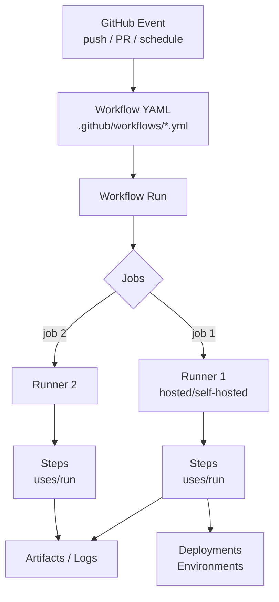

# GitHub Actions

## 1. TL;DR
GitHub Actions is GitHub’s built-in CI/CD and automation platform that lets you run workflows in response to events (push, pull request, schedule, manual dispatch, etc.). Workflows are defined as YAML files in your repository and run on hosted or self-hosted runners. Use it to automatically build, test, lint, package, deploy, and manage operational automations close to your code.

## 2. Background & Motivation
Before GitHub Actions, teams typically relied on external CI/CD systems (Jenkins, Travis CI, CircleCI, GitLab CI) that required separate configuration, credentials, and integration work. GitHub Actions brought automation directly into the GitHub platform:

- **Fewer moving parts**: source code, PRs, reviews, and pipelines live together.
- **Event-driven automation**: any GitHub event can trigger workflows.
- **Reusable building blocks**: “actions” encapsulate common tasks (checkout code, setup language runtimes, upload artifacts).
- **Security and governance**: fine-grained tokens, environments, approvals, secrets, and audit logs.

It matters because most engineering workflows (testing, packaging, deployments, notifications, dependency updates) benefit from being automated, consistent, and traceable.

## 3. Core Concepts

| Term | Meaning |
|---|---|
| Workflow | A YAML-defined automation pipeline stored in `.github/workflows/*.yml`. |
| Event | Something that triggers a workflow (e.g., `push`, `pull_request`, `schedule`, `workflow_dispatch`). |
| Job | A set of steps that run on the same runner. Jobs can run in parallel or depend on each other. |
| Step | A single task in a job. Can be `run` (shell command) or `uses` (an action). |
| Action | Reusable unit of automation (JavaScript action, Docker action, or composite action). |
| Runner | The machine that executes jobs (`ubuntu-latest`, `windows-latest`, `macos-latest`, or self-hosted). |
| Artifact | Files produced by a workflow that can be uploaded/downloaded between jobs or kept for later (logs, build outputs). |
| Cache | Stored dependency/build cache to speed up workflows (e.g., `~/.m2`, `node_modules`). |
| Secrets | Encrypted values provided to workflows (tokens, passwords). |
| Environment | Named target (e.g., `staging`, `prod`) with protection rules (approvals), secrets, and variables. |
| Matrix | Strategy to run a job across multiple versions/OSes in parallel. |

From first principles: a workflow is an event-triggered program. It starts when GitHub emits an event, schedules one or more jobs, each job runs on a runner, and each step executes commands or calls actions.

**Analogy (hardest idea: jobs vs steps vs runners)**: Think of a **job** as a “kitchen station” that has one cook (runner) and a recipe (steps). All steps in the job happen in that station, sharing the same workspace. If you need another station (e.g., run tests on Windows), that’s another job, potentially in parallel.

## 4. Theory (Deep Dive)

### 4.1 Architecture / Data Flow


### 4.2 Events and Triggers
Common triggers:

- `push`: run on commits to branches/tags.
- `pull_request`: run for PR activity (opened, synchronize, etc.).
- `workflow_dispatch`: manual run with inputs.
- `schedule`: cron-based.
- `release`: on GitHub Releases.

Important nuance: `pull_request` workflows (from forks) run with restricted permissions by default; secrets are not exposed to untrusted code.

### 4.3 Execution Model, Isolation, and Dependencies
- **Within a job**: steps run sequentially on the same runner; later steps can use files created by earlier steps.
- **Across jobs**: jobs are isolated; share data via **artifacts** or outputs, and coordinate via `needs`.
- **Failure behavior**: a step failure fails the job by default; can override with `continue-on-error: true`.

### 4.4 Permissions and Token Model
Each workflow run gets a `GITHUB_TOKEN` scoped to the repository. You can reduce permissions via:

```yaml
permissions:
  contents: read
  pull-requests: write
```

Security principles:
- Prefer least privilege.
- Prefer OIDC-based cloud auth (where supported) instead of long-lived cloud keys.
- Pin third-party actions to a commit SHA for supply-chain safety.

### 4.5 Matrix Builds (Performance/Parallelism)
Matrix lets you test multiple environments:

```yaml
strategy:
  matrix:
    os: [ubuntu-latest, windows-latest]
    node: [18, 20]
```

This expands into $|os| \times |node|$ parallel job runs.

### 4.6 Caching vs Artifacts
- **Cache**: speeds up future runs by reusing dependencies/build intermediates keyed by hash (e.g., lockfiles). Not guaranteed to be present.
- **Artifacts**: outputs from *this* run that you want to download later or pass to another job.

### 4.7 Performance Characteristics / Trade-offs
- Hosted runners are easy but ephemeral and have concurrency/minute limits depending on plan.
- Self-hosted runners offer custom hardware and network access but require patching, scaling, and hardening.
- More jobs/matrix = faster feedback but higher compute usage and cost.

## 5. Practical Usage

### 5.1 Minimal “Hello World” Workflow
Create `.github/workflows/hello.yml`:

```yaml
name: hello

on:
  push:
    branches: [main]

jobs:
  hello:
    runs-on: ubuntu-latest
    steps:
      - name: Say hello
        run: echo "Hello from GitHub Actions"
```

### 5.2 Realistic Example: CI for Node.js (lint + test + build)

```yaml
name: ci

on:
  pull_request:
  push:
    branches: [main]

permissions:
  contents: read

jobs:
  test:
    runs-on: ubuntu-latest
    strategy:
      matrix:
        node: [18, 20]

    steps:
      - uses: actions/checkout@v4

      - name: Setup Node
        uses: actions/setup-node@v4
        with:
          node-version: ${{ matrix.node }}
          cache: npm

      - name: Install
        run: npm ci

      - name: Lint
        run: npm run lint

      - name: Test
        run: npm test

      - name: Build
        run: npm run build

      - name: Upload build artifact
        uses: actions/upload-artifact@v4
        with:
          name: dist-node-${{ matrix.node }}
          path: dist/
```

What this demonstrates:
- Triggers on PRs and pushes to `main`.
- Runs tests for Node 18 and 20 in parallel.
- Uses built-in npm caching.
- Uploads build output as an artifact.

### 5.3 Typical Deployment Pattern (Environments + Approvals)
High level:
- `build` job produces an artifact.
- `deploy` job downloads it and deploys to `staging`.
- Production deploy uses an `environment: production` that requires approval.

Key YAML primitives:
- `needs: build`
- `environment: production`
- `secrets` scoped to that environment

## 6. Common Pitfalls & Best Practices

| Mistake | Why it happens | Fix |
|---|---|---|
| Not pinning third-party actions | Tags can move; supply-chain risk | Pin to a commit SHA (or trusted release) and review updates. |
| Leaking secrets in logs | Echoing env vars, verbose tools | Mask secrets, avoid printing env, use `::add-mask::` when needed. |
| Using cache as if it’s guaranteed | Cache can miss/evict | Make builds correct without cache; treat cache as optimization only. |
| Confusing job isolation | Files don’t exist across jobs | Use artifacts or `actions/cache`; declare dependencies with `needs`. |
| Workflows too slow | Unoptimized installs and serial jobs | Use caching, split jobs, matrix wisely, avoid redundant work. |
| PRs from forks failing due to permissions | Security restrictions | Use `pull_request_target` carefully (with strict checkout) or alternative validation strategy. |
| Over-broad `GITHUB_TOKEN` permissions | Defaults may allow more than needed | Set `permissions:` at workflow/job level to least privilege. |

## 7. Comparison with Alternatives

| Option | Use when | Pros | Cons |
|---|---|---|---|
| GitHub Actions | You host code on GitHub and want tight integration | Native events/PR checks, marketplace actions, easy setup | Hosted runner limits, YAML complexity at scale |
| Jenkins | Need deep customization or legacy pipelines | Highly flexible, self-hosted control | Maintenance burden, plugin sprawl, infra overhead |
| GitLab CI | You’re on GitLab or want GitLab-native | Strong monorepo support, integrated DevOps | Not GitHub-native |
| CircleCI | Need strong CI features and caching | Fast builds, mature ecosystem | External system, integration management |
| Azure DevOps Pipelines | Heavy Microsoft ecosystem | Enterprise governance, integrations | Separate platform; more setup if GitHub-first |

## 8. Real-World Applications
- **CI checks on PRs**: unit/integration tests, linting, formatting, static analysis.
- **Release automation**: build binaries, create GitHub Releases, generate changelogs, publish packages (npm, Maven, PyPI).
- **Deployments**: deploy to Kubernetes/VMs/serverless using environment protections and approvals.
- **Security automation**: code scanning workflows, dependency review gates.
- **Ops automation**: scheduled cleanups, syncing docs, rotating tokens, notifying Slack.

Concrete examples:
- A backend service runs tests on every PR and deploys to staging on merge.
- A library publishes to npm when a version tag is pushed.
- A mobile app builds artifacts nightly via `schedule` and uploads them for QA.

## 9. Practice Questions

### 9.1 Conceptual (5 questions)
1. 🟢 Easy: What are the differences between a workflow, job, and step?
2. 🟡 Medium: Why are jobs isolated from each other, and how do you pass data between them?
3. 🟡 Medium: What is `GITHUB_TOKEN`, and what are best practices for configuring its permissions?
4. 🟡 Medium: When would you choose a self-hosted runner over a GitHub-hosted runner?
5. 🔴 Hard: Explain the security risks of `pull_request_target` and how to use it safely.

### 9.2 Applied / Scenario-Based (4 questions)
1. 🟡 Medium: Your workflow is slow because dependency installation runs every time. What would you change?
2. 🟡 Medium: A `deploy` job cannot find the build output created in the `build` job. Why, and how do you fix it?
3. 🔴 Hard: A PR from a fork needs to run tests but must not access secrets. How would you design the workflows?
4. 🔴 Hard: You want to run integration tests only when files under `api/` change. How can you implement this?

### 9.3 Coding / Hands-On (3 tasks)
1. 🟢 Easy: Write a workflow that runs on `workflow_dispatch` and prints the branch name and commit SHA.
2. 🟡 Medium: Create a matrix workflow that tests a Python project on Python 3.10–3.12 and uploads coverage artifacts.
3. 🔴 Hard: Build a two-job workflow where job A produces an artifact and job B downloads it and runs a deployment script, gated by an environment approval.

### 9.4 Interview-Style (3 questions)
1. 🟡 Medium: How do you keep GitHub Actions workflows reproducible over time?
2. 🔴 Hard: Describe how you would secure a CI/CD pipeline that deploys to production using GitHub Actions.
3. 🟡 Medium: How would you design pipelines for a monorepo with multiple services to avoid redundant builds?

## 10. Answers & Explanations

<details>
<summary>Answer to 9.1 Q1</summary>

A **workflow** is the whole automation defined by a YAML file. A **job** is a group of steps that runs on a single runner and shares a filesystem/workspace. A **step** is an individual action invocation (`uses`) or shell command (`run`) executed sequentially within a job.

</details>

<details>
<summary>Answer to 9.1 Q2</summary>

Jobs are isolated to enable parallelism, reproducibility, and security (each job can run on a fresh VM/container). To pass data between jobs, you typically upload artifacts in one job and download them in another, or use job outputs for small values. For dependencies, use caching to speed up re-installation.

</details>

<details>
<summary>Answer to 9.1 Q3</summary>

`GITHUB_TOKEN` is an auto-generated token provided to a workflow run for authenticating to GitHub APIs (e.g., commenting on PRs, creating releases). Best practice is **least privilege**: set `permissions:` at workflow/job level to only what’s needed (e.g., `contents: read`). Avoid using a personal access token unless necessary, and prefer short-lived tokens/OIDC where possible.

</details>

<details>
<summary>Answer to 9.1 Q4</summary>

Choose self-hosted runners when you need custom hardware (GPUs), special network access (private VPC resources), preinstalled tooling, or to reduce hosted minutes. Trade-offs: you must manage patching, scaling, queueing, and hardening, and you must protect runners from untrusted code execution.

</details>

<details>
<summary>Answer to 9.1 Q5</summary>

`pull_request_target` runs in the context of the base repository (not the fork), which can expose secrets and write permissions. If you check out and execute code from the PR head, a malicious contributor could exfiltrate secrets. Safe usage includes: avoid running untrusted code; only run trusted scripts from the base branch; validate inputs; use read-only permissions; and if you must fetch PR code, treat it as data (e.g., run static checks without executing arbitrary scripts) or use separate workflows.

</details>

<details>
<summary>Answer to 9.2 Q1</summary>

Use `actions/cache` (or built-in caching features like `actions/setup-node` with `cache: npm`) keyed by lockfiles (`package-lock.json`, `poetry.lock`, etc.). Also reduce redundant installs by splitting jobs (lint/test/build) only when necessary, and avoid reinstalling in each job if you can reuse artifacts (though reusing artifacts for dependency directories can be tricky across platforms).

</details>

<details>
<summary>Answer to 9.2 Q2</summary>

Because each job runs on a separate runner with its own filesystem, the build output isn’t automatically available to other jobs. Fix by uploading the build output as an artifact in `build` and downloading it in `deploy`, and declare `deploy` depends on `build` using `needs: build`.

</details>

<details>
<summary>Answer to 9.2 Q3</summary>

Run tests on `pull_request` with minimal permissions and without secrets. For workflows that need secrets (like deployment), trigger only on trusted events such as `push` to protected branches or after a maintainer approval, and use environments with required reviewers. Avoid running secret-bearing workflows on untrusted fork code.

</details>

<details>
<summary>Answer to 9.2 Q4</summary>

Use path filters such as:

```yaml
on:
  pull_request:
    paths:
      - 'api/**'
```

For more complex conditions (e.g., multiple services), you can add a “changed files” detection step and use `if:` conditions to skip jobs based on outputs.

</details>

<details>
<summary>Answer to 9.3 Q1</summary>

Example:

```yaml
name: manual-info
on:
  workflow_dispatch:

jobs:
  info:
    runs-on: ubuntu-latest
    steps:
      - run: |
          echo "ref=${GITHUB_REF}"
          echo "sha=${GITHUB_SHA}"
```

This prints the branch/tag ref and commit SHA for the run.

</details>

<details>
<summary>Answer to 9.3 Q2</summary>

Use `actions/setup-python` with a matrix, then run tests and upload coverage:

```yaml
name: python-ci
on: [push, pull_request]

jobs:
  test:
    runs-on: ubuntu-latest
    strategy:
      matrix:
        python: ['3.10', '3.11', '3.12']
    steps:
      - uses: actions/checkout@v4
      - uses: actions/setup-python@v5
        with:
          python-version: ${{ matrix.python }}
      - run: pip install -r requirements.txt
      - run: pytest --cov --cov-report=xml
      - uses: actions/upload-artifact@v4
        with:
          name: coverage-${{ matrix.python }}
          path: coverage.xml
```

Matrix makes it run for each Python version.

</details>

<details>
<summary>Answer to 9.3 Q3</summary>

Use two jobs with artifacts and an environment gate:

- Job A: build and upload artifact.
- Job B: `needs: build`, `environment: production`, download artifact, run deploy script.

The environment gate forces an approval (if configured in repo settings) before job B runs.

</details>

<details>
<summary>Answer to 9.4 Q1</summary>

Pin versions: use fixed action versions (ideally commit SHAs), lock dependency versions, and build in consistent environments (containers or known runner images). Avoid “latest” tags for critical tools unless you accept drift.

</details>

<details>
<summary>Answer to 9.4 Q2</summary>

Use protected branches, least-privilege `GITHUB_TOKEN` permissions, environment approvals for production, secret scoping per environment, and OIDC for cloud auth. Ensure untrusted PR code can’t access secrets; separate CI from CD triggers; audit third-party actions and pin them.

</details>

<details>
<summary>Answer to 9.4 Q3</summary>

Use path-based triggers and job-level conditionals to run only the pipelines affected by a change. Consider a “detect changes” job that outputs which services changed and use `if:`/matrix generation to run only required builds/tests.

</details>

## 11. Summary / Cheat Sheet
- Workflows are YAML files under `.github/workflows/` triggered by events.
- A workflow run executes **jobs**; each job runs on a **runner**; jobs contain sequential **steps**.
- Jobs are isolated; share data via artifacts/outputs/caches.
- Use matrix for multi-version/OS testing.
- Use least privilege for `GITHUB_TOKEN`; protect production with environments/approvals.
- Cache speeds up runs; artifacts move build outputs.

## 12. Further Reading
- GitHub Docs: GitHub Actions (concepts, workflows, contexts, expressions)
- GitHub Docs: Security hardening for GitHub Actions
- GitHub Docs: Using environments for deployment
- GitHub Docs: Caching dependencies to speed up workflows
- OpenID Connect in GitHub Actions (for cloud provider authentication)
