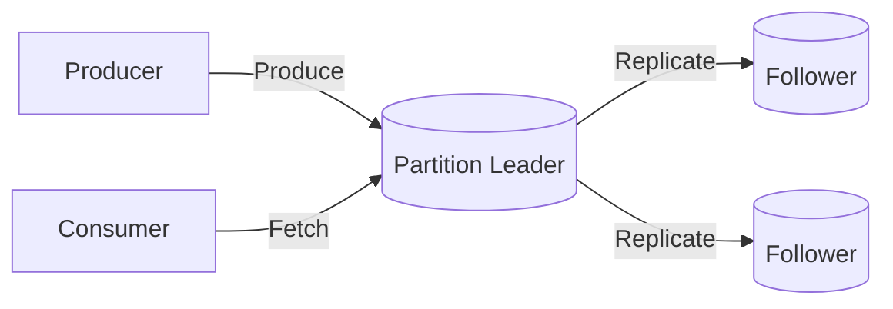

# Kafka Overview & Core Terminology

## 1. TL;DR
Apache Kafka is a distributed event streaming platform built around a durable, partitioned, append-only log. It exists to move data reliably between systems and to store and replay event streams at scale. Use it when you need high-throughput ingestion, fan-out to multiple consumers, and replayable event history (e.g., pipelines, microservices integration, streaming analytics).

## 2. Background & Motivation
Traditional message queues are great for work distribution but often optimize for deleting messages after consumption and for point-to-point delivery. Many modern systems need a shared, durable history of events that multiple systems can read independently, the ability to replay from any point, and horizontal scalability via partitioning.

Kafka’s core idea is to treat a stream of events as an append-only log, replicated across brokers, where consumers track their own position (offset) rather than messages being removed.

## 3. Core Concepts

| Term | Meaning |
|---|---|
| Event / Record / Message | A key-value payload with metadata (timestamp, headers) appended to a topic partition. |
| Topic | Named stream/category of events (e.g., `orders`). |
| Partition | An ordered, append-only log for a topic; unit of parallelism and ordering. |
| Offset | Monotonic position of a record within a partition. |
| Broker | Kafka server process storing partitions and serving reads/writes. |
| Cluster | A group of brokers operating together. |
| Leader (partition leader) | Broker replica that handles all reads/writes for a partition. |
| Follower | Replica that copies data from leader. |
| ISR (In-Sync Replicas) | Replicas that are sufficiently caught up to be eligible for leader election. |
| Producer | Client that writes records to Kafka. |
| Consumer | Client that reads records from Kafka. |
| Consumer Group | Set of consumers cooperating to read partitions in parallel (each partition assigned to at most one consumer in a group). |
| Commit (offset commit) | Persisting the consumer’s progress so it can resume after restart. |
| Retention | Policy controlling how long Kafka keeps records (time/size). |
| Compaction | Keeping at least the latest record per key (useful for changelog streams). |

### Building from first principles
Kafka is essentially a distributed log: data is appended, read sequentially, partitioned to scale throughput, replicated for fault tolerance, and consumed via offsets tracked by consumers.

### Analogy (offsets + replay)
A topic partition is a book: producers only add new pages at the end. Consumers place a bookmark (offset). Multiple readers can have different bookmarks, and any reader can go back to re-read.

## 4. Theory (Deep Dive)

### Architecture / data flow


### Key internal model
- Writes go to the partition leader.
- Records are appended to the leader’s log and replicated to followers.
- Acknowledgment behavior depends on producer `acks` and replication state.
- Reads are typically served from the leader.

### Guarantees and trade-offs
- Ordering is guaranteed within a partition, not across partitions.
- Durability depends on replication factor and `acks`.
- Partition count sets parallelism and impacts operational overhead.

## 5. Practical Usage

### Minimal “hello world” (CLI)
```bash
kafka-topics.sh --bootstrap-server localhost:9092 --create --topic demo --partitions 3 --replication-factor 1
kafka-console-producer.sh --bootstrap-server localhost:9092 --topic demo
kafka-console-consumer.sh --bootstrap-server localhost:9092 --topic demo --from-beginning
```

### Realistic usage pattern
- Use a topic per event type/domain boundary (e.g., `orders.created`).
- Choose partitions based on expected throughput and consumer parallelism.
- Use message keys to preserve per-entity ordering (e.g., key by `orderId`).

## 6. Common Pitfalls & Best Practices

| Mistake | Why it happens | Fix |
|---|---|---|
| Expecting global ordering | Partitions are independent logs | Use keys to route related events to the same partition; tolerate cross-partition reordering. |
| Too few partitions | Underestimates future scale | Plan partitions for peak throughput and consumer parallelism. |
| `acks=1` for critical data | Optimizes latency but risks data loss | Use `acks=all` with appropriate replication and min ISR. |
| Treating Kafka as a deleting queue | Kafka retains data independent of consumption | Model consumers as offset-tracking readers; manage retention/compaction. |

## 7. Comparison with Alternatives

| Approach | When it’s better | When Kafka is better |
|---|---|---|
| RabbitMQ / traditional MQ | Complex routing, per-message ack semantics | High throughput streaming, replay, multi-subscriber consumption. |
| Cloud streams (e.g., Kinesis) | Fully managed, cloud-native integration | Kafka ecosystem/portability and deep configurability. |
| Redis Streams | Simple deployments, moderate scale | Large-scale retention, replication, mature ecosystem. |

## 8. Real-World Applications
- Event-driven microservices integration.
- Data pipelines into stream processors and data lakes.
- CDC (Change Data Capture) fan-out.
- Observability pipelines (logs/events).

## 9. Practice Questions

### 9.1 Conceptual (5 questions)
1. 🟢 Why does Kafka use consumer-tracked offsets instead of deleting messages after consumption?
2. 🟡 What ordering guarantee does Kafka provide, and what does it not provide?
3. 🟡 How do partitions enable scalability?
4. 🟡 What is ISR and why does it matter?
5. 🔴 When would you choose log compaction over time-based retention?

### 9.2 Applied / Scenario-Based (3–5 questions)
1. 🟡 You need per-customer ordering. How would you design keys/partitions?
2. 🔴 A consumer reprocesses old data after restarts. What offset-related issues could cause this?
3. 🟡 Your topic has 3 partitions but you run 10 consumers in the same group. What happens and why?

### 9.3 Coding / Hands-On (2–3 tasks)
1. 🟢 Produce keyed records and observe partition assignment.
2. 🟡 Run two consumers in one group; stop one and observe rebalance.

### 9.4 Interview-Style (3 questions)
1. 🟡 Explain Kafka’s log model and how it differs from a queue.
2. 🔴 Discuss throughput vs latency trade-offs in Kafka.
3. 🔴 How do retention and replay change system design?

## 10. Answers & Explanations

<details>
<summary>Answer to 9.1 Q1</summary>

Offsets enable independent consumption by multiple groups and replay/backfills. Retention is decoupled from consumption, so Kafka can act as a durable event store.

</details>

<details>
<summary>Answer to 9.1 Q2</summary>

Kafka guarantees ordering within a single partition because records are appended sequentially there. Across partitions there is no global ordering guarantee.

</details>

<details>
<summary>Answer to 9.1 Q3</summary>

Partitions are independent logs that can be distributed across brokers. Producers/consumers can operate in parallel across partitions, increasing throughput.

</details>

<details>
<summary>Answer to 9.1 Q4</summary>

ISR is the set of replicas that are sufficiently caught up with the leader. Restricting leader election to ISR reduces the chance of data loss.

</details>

<details>
<summary>Answer to 9.1 Q5</summary>

Compaction is for “latest value per key” streams (state/changelog). Time retention is for immutable history. Compaction trades full history for bounded storage while preserving newest state.

</details>

<details>
<summary>Answer to 9.2 Q1</summary>

Key by `customerId` so all events for a customer map to the same partition, preserving order. Ensure partition count supports throughput; handle hot keys if needed.

</details>

<details>
<summary>Answer to 9.2 Q2</summary>

Likely causes include missing commits, wrong group id, committing before processing, or `auto.offset.reset=earliest` when no committed offset exists. Fix by verifying group id and commit-after-processing strategy.

</details>

<details>
<summary>Answer to 9.2 Q3</summary>

Only 3 consumers can be assigned partitions; the remaining 7 will be idle because a partition is assigned to at most one consumer per group.

</details>

<details>
<summary>Answer to 9.3 Q1</summary>

Kafka’s partitioner hashes the key (by default) to pick a partition, so identical keys consistently go to the same partition unless partition count changes.

</details>

<details>
<summary>Answer to 9.3 Q2</summary>

When a consumer stops, the group rebalances and remaining consumers take over partitions. This illustrates why slow poll loops can trigger rebalances.

</details>

<details>
<summary>Answer to 9.4 Q1</summary>

Kafka retains an append-only log and consumers track offsets, enabling replay and multiple subscribers. A queue typically deletes/acks messages on consumption.

</details>

<details>
<summary>Answer to 9.4 Q2</summary>

Batching, compression, and larger requests increase throughput but can add latency. Smaller batches reduce latency but increase per-message overhead.

</details>

<details>
<summary>Answer to 9.4 Q3</summary>

Replay enables backfills and new consumers, but requires careful retention policies and idempotent downstream processing to handle duplicates.

</details>

## 11. Summary / Cheat Sheet
- Kafka is a distributed, partitioned, replicated append-only log.
- Ordering is per partition; scale via partitions.
- Consumers track offsets; retention is independent of consumption.
- Replication and ISR provide fault tolerance.

## 12. Further Reading
- Apache Kafka Documentation (Concepts, Design)
- Kafka: The Definitive Guide (O’Reilly)
