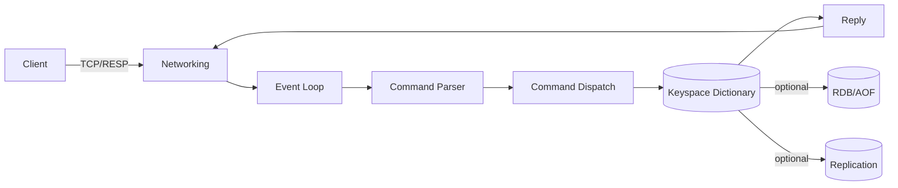

# Redis Overview & Terminology

## 1. TL;DR
Redis is an in-memory data structure server used as a cache, key-value store, message broker, and more. Internally, Redis is a single primary process that multiplexes many client connections via an event loop, executes commands (mostly) single-threaded, and stores data in memory using specialized encodings for performance and memory efficiency. Use Redis when you need low-latency reads/writes, flexible data structures, and optional persistence and replication.

## 2. Background & Motivation
Traditional relational databases optimize for durability and complex queries, but they incur higher latency due to disk I/O, locking, and query planning. Many applications need a fast, simple data store for caching, counters, leaderboards, rate limiting, sessions, queues, and pub/sub.

Redis emerged to solve:
- Low-latency access: keep the working set in memory.
- Simple programming model: operate on data structures directly (strings, lists, sets, hashes, sorted sets).
- Operational flexibility: persistence (RDB/AOF), replication, HA (Sentinel), clustering.

## 3. Core Concepts

| Term | Meaning |
|---|---|
| Keyspace | All keys stored in a Redis database (db0..dbN). |
| Value | One of Redis data types (string, list, set, hash, zset, stream, etc.). |
| Command | An operation like `GET`, `SET`, `HSET`, `ZADD`. |
| Encoding | Internal representation chosen for a value (e.g., hashtable vs listpack). |
| TTL | Time-to-live; expiration time associated with a key. |
| RDB | Snapshot-based persistence format. |
| AOF | Append-only log of write commands for durability. |
| Replication | Copying state from primary to replicas. |
| Sentinel | Monitoring + failover orchestration for Redis (non-cluster). |
| Redis Cluster | Sharded, multi-node Redis with hash slots. |

From first principles:
- Redis stores a mapping: `key -> object`.
- A Redis object has: a type (string/hash/...) + an encoding (how it’s stored) + metadata (refcount, LRU/LFU).
- Requests come in over TCP, parsed via RESP, executed, and responses written back.

Hardest idea analogy (encodings):
Think of Redis values like a “container” (type) that can be packed in different ways (encoding) depending on what you put inside. A small suitcase (compact encoding) is great for a weekend trip, but a bigger suitcase (hashtable/skiplist) is better when you carry lots of items.

## 4. Theory (Deep Dive)
### 4.1 High-level architecture


### 4.2 Object model (simplified)
Redis internally uses a small object header (often referred to as `robj` in Redis source) that points to the actual data structure.

Key points:
- Types: string, list, set, hash, zset, stream, etc.
- Encodings: chosen dynamically (e.g., small hash may be listpack; larger becomes hashtable).
- Metadata: eviction info (LRU/LFU), refcounts.

### 4.3 Performance characteristics
- Most commands are $O(1)$ or $O(\log n)$.
- Latency is minimized by:
  - In-memory storage.
  - Single-threaded execution (no locking on the main data structures).
  - Efficient encodings for small collections.

Trade-offs:
- Single-threaded command execution means one slow command can block others.
- Memory is the primary scaling constraint unless using Redis Cluster.

## 5. Practical Usage
### 5.1 Minimal hello world
```bash
redis-server
redis-cli SET hello world
redis-cli GET hello
```

### 5.2 Realistic example: session store with TTL
```bash
redis-cli SETEX session:123 3600 '{"userId":42,"roles":["admin"]}'
redis-cli GET session:123
redis-cli TTL session:123
```
Explanation:
- `SETEX` stores a value and sets expiration in one atomic command.
- Redis tracks TTL metadata and deletes the key when it expires.

## 6. Common Pitfalls & Best Practices
| Mistake | Why it happens | Fix |
|---|---|---|
| Using Redis as a durable primary DB without AOF/fsync tuning | Default settings may lose recent writes on crash | Configure AOF + appropriate `appendfsync` policy; test crash recovery |
| Running blocking commands on large keys | Single-threaded command execution blocks other clients | Avoid huge values; use SCAN; redesign data model |
| Unbounded memory growth | No TTLs/eviction strategy | Set TTLs; configure `maxmemory` + eviction policy |

## 7. Comparison with Alternatives
| Option | Use when | Notes |
|---|---|---|
| Redis | Low-latency data structures, caching, queues | Rich commands, persistence optional |
| Memcached | Simple caching only | No persistence, fewer data types |
| Kafka | Durable event streaming | Higher latency, different use case |

## 8. Real-World Applications
- Caching database query results (read-heavy services).
- Rate limiting (API gateways) using counters with TTL.
- Leaderboards using sorted sets.
- Pub/Sub for notifications and real-time updates.

## 9. Practice Questions
### 9.1 Conceptual (5 questions)
1. 🟢 What is the difference between a Redis data type and an encoding?
2. 🟡 Why does Redis prefer single-threaded command execution?
3. 🟡 What does “in-memory” imply for durability and cost?
4. 🟡 How do TTLs change operational behavior and memory usage?
5. 🔴 Why can one slow command impact many clients in Redis?

### 9.2 Applied / Scenario-Based (3–5 questions)
1. 🟡 You notice periodic latency spikes. What Redis behaviors could cause them?
2. 🔴 Your cache is evicting hot keys unexpectedly. What would you check?
3. 🟡 You store large JSON blobs per user. What issues might arise?

### 9.3 Coding / Hands-On (2–3 tasks)
1. 🟢 Implement a rate limiter using `INCR` + `EXPIRE`.
2. 🟡 Model a leaderboard using sorted sets and fetch top N.

### 9.4 Interview-Style (3 questions)
1. 🟡 Explain how Redis can be both a cache and a datastore.
2. 🔴 Describe trade-offs between Redis persistence modes.
3. 🔴 How would you design keys to avoid hot spotting in a sharded setup?

## 10. Answers & Explanations
<details>
<summary>Answer to Q1</summary>

A data type is the logical abstraction (string, hash, set, etc.). An encoding is the internal representation chosen for efficiency (e.g., a small hash might be stored in a compact listpack; a larger hash in a hashtable). The same type can use different encodings depending on size and content.

</details>

<details>
<summary>Answer to Q2</summary>

Single-threaded execution avoids locks around shared data structures, making most operations fast and predictable. Redis instead relies on an event loop to handle many clients concurrently, while executing commands one at a time.

</details>

<details>
<summary>Answer to Q3</summary>

In-memory implies very low latency but also that data is lost on process crash unless persistence is enabled. It also means capacity is bounded by RAM, which is more expensive than disk.

</details>

<details>
<summary>Answer to Q4</summary>

TTLs allow automatic removal of stale keys, helping bound memory usage and reducing manual cleanup. However, expiration work (tracking and deleting keys) adds background overhead and can cause bursts of activity.

</details>

<details>
<summary>Answer to Q5</summary>

Because the main thread executes commands sequentially, a slow operation (e.g., operating on a huge value or blocking disk fsync) can delay the processing of subsequent commands from other clients, increasing latency across the system.

</details>

<details>
<summary>Answer to Scenario 9.2 Q1</summary>

Latency spikes can come from: background AOF rewrite or RDB snapshot CPU/disk usage, fork-related copy-on-write memory pressure, expired key cleanup bursts, big-key operations, or slow clients causing output buffer pressure.

</details>

<details>
<summary>Answer to Scenario 9.2 Q2</summary>

Check `maxmemory` and eviction policy (LRU/LFU/random/ttl), memory fragmentation, whether keys have TTLs and are expiring, and whether your access pattern makes some keys appear cold to the chosen policy. Also verify if replicas/clients are causing memory pressure via buffers.

</details>

<details>
<summary>Answer to Scenario 9.2 Q3</summary>

Large blobs increase memory usage, fragmentation, network bandwidth, and persistence/replication cost. They can also increase latency for reads/writes and amplify copy-on-write overhead during fork (RDB/AOF rewrite). Consider splitting fields into hashes, compressing, or storing blobs elsewhere.

</details>

<details>
<summary>Answer to Hands-On 9.3 Q1</summary>

Use a key like `rl:{userId}:{window}`. On request: `INCR` the key and if result is 1 then `EXPIRE` to window seconds. Allow if count <= limit. This is a fixed-window limiter.

</details>

<details>
<summary>Answer to Hands-On 9.3 Q2</summary>

Use `ZADD leaderboard {score} {userId}` to update. Fetch top N with `ZREVRANGE leaderboard 0 N-1 WITHSCORES`.

</details>

<details>
<summary>Answer to Interview 9.4 Q1</summary>

As a cache, Redis holds derived/temporary data with TTLs and eviction. As a datastore, it can persist to disk (RDB/AOF) and replicate. The same data structures can support both patterns depending on durability and operational requirements.

</details>

<details>
<summary>Answer to Interview 9.4 Q2</summary>

RDB provides periodic point-in-time snapshots (faster restart, smaller files) but can lose recent writes between snapshots. AOF logs every write (better durability) but can be larger and requires rewrite; fsync policy trades off latency vs durability.

</details>

<details>
<summary>Answer to Interview 9.4 Q3</summary>

In Redis Cluster, keys map to hash slots. Use hash tags like `{user:42}:profile` and `{user:42}:sessions` to co-locate related keys when needed, but avoid making one slot too hot. Distribute traffic by designing keys so heavy users don’t concentrate on one slot.

</details>

## 11. Summary / Cheat Sheet
- Redis is an in-memory server that executes commands mostly single-threaded via an event loop.
- Values have types (logical) and encodings (physical), optimized for size/performance.
- Optional persistence (RDB/AOF) and replication add durability/availability.
- Watch out for big keys, blocking commands, and unbounded memory.

## 12. Further Reading
- Redis official documentation (redis.io docs)
- Book: *Redis in Action* (Josiah L. Carlson)
- Redis source code (especially networking, object, and db internals)
