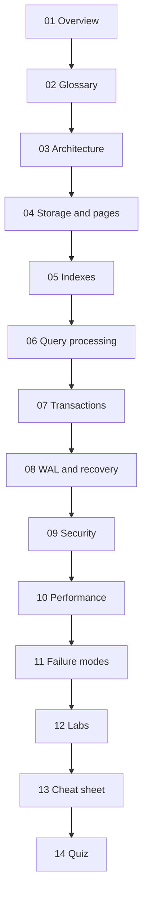

# How Databases Work Internally: Study Guide Index

> A beginner-friendly, modular guide to what happens inside a relational database, from a SQL string to bytes on disk and back after a crash.

## Learning objectives

- Understand how a database turns a query into a plan, executes it, and returns rows.
- Understand how data is laid out on disk in pages and found quickly with indexes.
- Understand how transactions, MVCC, and the write-ahead log provide ACID guarantees.
- Be able to diagnose slow queries, blocked sessions, and common failures.
- Be able to secure and tune a database with reasoned, measured changes.

## Prerequisites

- Basic comfort with a command line and the idea of a file.
- Optional: elementary SQL (`SELECT`, `INSERT`, `UPDATE`). The guide explains the rest.
- Tools for the labs: the `sqlite3` shell and Docker for PostgreSQL. See [Hands-on Labs](./12-hands-on-labs.md).

## 1. Intuition

Think of this guide as a tour of a large library. You first see the building from outside (the overview), then learn the vocabulary (glossary), then walk the floor plan (architecture). After that you visit each room in turn: the stacks (storage pages), the card catalog (indexes), the reference desk (query optimizer), the reservation desk (transactions), and the logbook that survives a power cut (write-ahead log). Finally you learn how to secure the building, speed it up, and handle emergencies.

## 2. How it works

How to use the guide:

1. Read files **in numbered order** the first time. Each builds on earlier ones, and each ends with a link to the next.
2. In every file, read the **Intuition** first, then **How it works**. Skim the diagram, and return to the deep dive when you want the details.
3. Run the **Worked example** or the matching lab to see the mechanism for yourself.
4. Answer the **Self-check questions** before moving on.
5. Use the [Cheat Sheet](./13-cheat-sheet.md) as a quick reference and the [Exercises and Quiz](./14-exercises-and-quiz.md) to test yourself.

### Assumptions made for this guide

- The request "explain how a database works internally" is interpreted as **relational, row-oriented, single-node transactional databases**.
- **PostgreSQL** is the primary reference implementation, because its internals are well documented. **SQLite** is used for simple, zero-setup demonstrations. **InnoDB** and LSM-based stores are mentioned where they differ.
- Numbers such as default settings are taken from PostgreSQL and described as defaults that **vary by version**. Always verify on your own server with `SHOW`.
- Distributed databases (sharding, consensus, distributed transactions) are out of scope, except where replication is mentioned briefly.
- Example outputs are illustrative. They show the expected pattern, not exact numbers from a specific machine.

## 3. Architecture / data flow

The recommended learning path:

Each box is one file, and each arrow means "read this next". The first three files give you the big picture and vocabulary, files 04 to 08 are the core mechanisms in the order a request meets them (disk, index, plan, concurrency, durability), and files 09 to 14 are the practical skills.

## 4. Internals deep dive

### File list

| File | Topic | What you will learn |
| --- | --- | --- |
| [01-overview.md](./01-overview.md) | Overview | What a database is, history, families, life of a query |
| [02-glossary.md](./02-glossary.md) | Glossary | Every term used in the guide, grouped by layer |
| [03-architecture.md](./03-architecture.md) | Architecture | Components, process models, background workers, catalog |
| [04-storage-engine-and-pages.md](./04-storage-engine-and-pages.md) | Storage | Pages, slotted layout, buffer pool, row versus column |
| [05-indexes-btree-and-lsm.md](./05-indexes-btree-and-lsm.md) | Indexes | B+tree search and splits, LSM trees, bloom filters |
| [06-query-processing-and-optimizer.md](./06-query-processing-and-optimizer.md) | Query processing | Parsing, statistics, cost model, join algorithms |
| [07-transactions-and-concurrency.md](./07-transactions-and-concurrency.md) | Transactions | ACID, MVCC, isolation levels, locks, deadlocks |
| [08-wal-and-crash-recovery.md](./08-wal-and-crash-recovery.md) | WAL and recovery | Write-ahead rule, LSN, checkpoints, torn pages |
| [09-security.md](./09-security.md) | Security | Threats, authentication, roles, injection, encryption |
| [10-performance-and-tuning.md](./10-performance-and-tuning.md) | Performance | Bottlenecks, settings, indexing, query fixes |
| [11-failure-modes-and-troubleshooting.md](./11-failure-modes-and-troubleshooting.md) | Troubleshooting | Failure catalog, diagnostic queries, incident process |
| [12-hands-on-labs.md](./12-hands-on-labs.md) | Labs | Six experiments with expected output |
| [13-cheat-sheet.md](./13-cheat-sheet.md) | Cheat sheet | Commands, defaults, symptom to action table |
| [14-exercises-and-quiz.md](./14-exercises-and-quiz.md) | Quiz | 28 questions with hidden answers |

### Suggested study plans

| Goal | Files to read, in order |
| --- | --- |
| Quick conceptual understanding | 01, 03, 04, 05, 07, 08 |
| Application developer | 01, 05, 06, 07, 09, 10 |
| Operator or SRE | 03, 08, 10, 11, 12, 13 |
| Interview preparation | 01 to 08, then 14 |
| Hands-on learner | 01, 03, then 12 alongside 04 to 08 |

### Key ideas that connect the files

| Idea | Where it appears |
| --- | --- |
| Disk is slow and block-based, so do I/O in pages | 01, 04, 05 |
| Keep hot pages in memory | 04, 10 |
| Sorted wide trees find rows in few reads | 05, 06 |
| Estimates drive plan choice | 06, 10, 11 |
| Keep several row versions so readers do not block | 07, 10, 11 |
| Log first, write data later | 04, 07, 08, 11 |
| Least privilege and parameterized queries | 09 |

## 5. Worked example

A five-minute path through the guide, using only SQLite:

1. Read [Overview](./01-overview.md), section 5, and run the three-row table example.
2. Run `EXPLAIN QUERY PLAN` and note that you did not tell the database how to find the row.
3. Open [Indexes](./05-indexes-btree-and-lsm.md), section 5, and watch `SCAN` change to `SEARCH` after `CREATE INDEX`.
4. Open [WAL and Recovery](./08-wal-and-crash-recovery.md), section 5, and switch SQLite to WAL mode.

Expected result: after these steps you have personally seen the optimizer, an index, and a write-ahead log, which are three of the pillars of the whole guide.

## 6. Tradeoffs and limitations

- The guide favors **understanding mechanisms** over exhaustive product documentation. Consult official documentation for exact syntax and version-specific behavior.
- PostgreSQL-specific details (TOAST, vacuum, `ctid`) are not universal. Other engines solve the same problems differently, and the guide notes this where relevant.
- No benchmarks are claimed. Performance statements are qualitative or illustrative.
- Distributed systems topics need their own guide.

## 7. Common misconceptions and pitfalls

- Skipping the glossary and then getting lost in later files. Keep it open in a tab.
- Treating illustrative output as exact. Your numbers will differ.
- Reading only the cheat sheet. It lacks the reasoning that makes the commands safe to use.
- Running labs against a production server. Use throwaway containers or in-memory databases.
- Assuming every database behaves like PostgreSQL.

## 8. Recap

- The guide has 15 files: this index, 14 numbered concept files in beginner-to-advanced order.
- Files 01 to 03 give context, 04 to 08 explain the core mechanisms, 09 to 14 cover practice.
- PostgreSQL is the main reference and SQLite the demo tool.
- Every file follows the same nine-section structure so you always know where to look.
- Test yourself with labs and the quiz after reading.

## 9. Self-check questions

1. In what order does a SQL query pass through the major database components?
2. Which two files explain why commit is fast but still durable?
3. Which file would you open first if a query is stuck?
4. What assumptions does this guide make about the type of database?
5. Which study plan fits your goal best?

## Next

Start with the [Overview](./01-overview.md).
