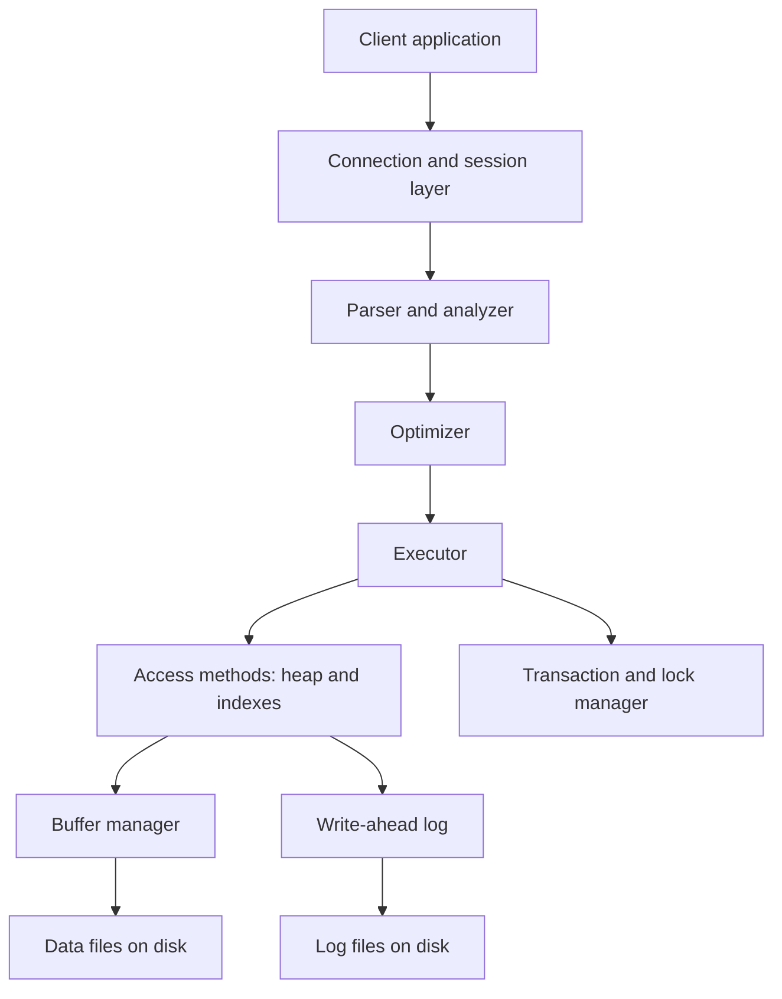

# Database Overview: What a Database Is and Why It Exists

> A database is a program that stores data durably on disk and lets many users read and change it safely and quickly, using a query language instead of hand-written file code.

## Learning objectives

- Explain in your own words what problem a database solves that plain files do not.
- Name the major layers inside a typical relational database and what each one does.
- Describe, at a high level, what happens between typing `SELECT` and seeing rows.
- Compare relational, key-value, document, column, and graph databases.
- Place important milestones in database history (relational model, SQL, ARIES, LSM trees).

## Prerequisites

- None. You only need to know what a file and a program are.
- Unknown words are defined in the [Glossary](./02-glossary.md).
- After this file, continue to the [Architecture](./03-architecture.md).

## 1. Intuition

Imagine a huge library with thousands of visitors every day.

- **Plain files** are like a pile of loose papers on a table. Anyone can read them, but finding one page means scanning everything. If two people write on the same paper at once, the result is a mess. If the lights go out in the middle of a rewrite, the paper may be half old and half new.
- **A database** is like the same library with a professional staff. There is a **card catalog** (indexes) so that finding a book is fast. There is a **front desk** (the query processor) that takes your request in a standard language and works out the best way to fetch it. There is a **rule that nobody edits a book without first writing the planned change in a logbook** (the write-ahead log), so after a power cut the staff can finish or undo the work. There is a **reservation system** (concurrency control) so two people never overwrite each other.

Everything a database does internally exists to give you four promises: your data **survives** crashes, your changes are **all-or-nothing**, concurrent users do **not corrupt** each other, and answers come **fast** even when data is much larger than memory.

## 2. How it works

Here is the life of one query, in order. Each step is expanded in a later file.

1. **A client connects.** It opens a network socket (or calls an in-process library) and authenticates. The database creates a session. This is why connections cost memory and why pooling matters (see [Performance](./10-performance-and-tuning.md)).
2. **The client sends SQL text.** SQL is *declarative*: it says what you want, not how to get it. This is deliberate. Because you do not say how, the database is free to choose a better method as data grows.
3. **The parser** checks grammar and turns the text into a tree. If you wrote `SELEC`, it fails here, before touching any data.
4. **The analyzer** resolves names against the catalog: does table `users` exist, does column `email` exist, what is its type?
5. **The optimizer** enumerates ways to run the query (use an index, scan the whole table, which join order) and estimates the cost of each from statistics. It picks the cheapest. See [Query Processing](./06-query-processing-and-optimizer.md).
6. **The executor** runs the chosen plan. It asks the storage layer for pages of data.
7. **The buffer manager** checks whether a page is already in memory. If yes, it is a cheap hit. If no, it reads the page from disk, which is roughly thousands of times slower than memory. See [Storage](./04-storage-engine-and-pages.md).
8. **Concurrency control** decides which row versions this query may see, so that it gets a consistent view even while others write. See [Transactions](./07-transactions-and-concurrency.md).
9. **For writes**, the database first appends a description of the change to the **write-ahead log** and forces it to disk, and only then reports success. Modified data pages are flushed later. See [WAL and Recovery](./08-wal-and-crash-recovery.md).
10. **Results stream back** to the client row by row.

Why this order? Each step narrows work for the next: validation is cheap and prevents wasted effort; optimization is worth its cost because a bad plan can be a million times slower than a good one; logging first makes durability cheap, because appending to a log is a fast sequential write while updating scattered pages is slow random I/O.

## 3. Architecture / data flow



Box by box:

- **Client application**: your code or a tool like `psql`. It only speaks SQL and a wire protocol.
- **Connection and session layer**: authenticates, holds per-session settings, and tracks the current transaction.
- **Parser and analyzer**: converts text to a validated tree.
- **Optimizer**: chooses the plan. It reads statistics from the catalog.
- **Executor**: runs plan nodes, pulling rows through them.
- **Access methods**: the code that knows how to read a table (heap) or an index (B-tree and others).
- **Buffer manager**: a cache of disk pages in RAM; every page access goes through it.
- **Data files on disk**: the durable home of tables and indexes.
- **Transaction and lock manager**: enforces isolation and detects deadlocks.
- **Write-ahead log**: an append-only record of changes used for crash recovery.

Arrows show who calls whom. Notice the log sits beside the data path: writes touch both.

## 4. Internals deep dive

### The one fact that shapes everything

A disk (even an SSD) is far slower than RAM, and it is read in blocks, not bytes. So nearly every database design decision tries to **minimize the number of block reads and writes** and to **turn random I/O into sequential I/O**. Pages, B-trees, buffer pools, and write-ahead logs are all consequences of this one fact.

### Brief history

| Year | Milestone | Why it matters |
| --- | --- | --- |
| 1970 | Codd publishes the relational model paper | Data as tables with a mathematical foundation, independent of physical storage |
| mid 1970s | IBM System R and Berkeley Ingres | First working relational systems; System R pioneered the cost-based optimizer and SQL |
| 1980s | SQL becomes standardized and commercial | A common language across vendors |
| 1992 | ARIES recovery paper (Mohan et al.) | The write-ahead logging design that most recovery systems still follow |
| 1996 | LSM-tree paper (O'Neil et al.) | Write-optimized storage later used in many key-value stores |
| 2000s | NoSQL wave, Bigtable paper in 2006 | Scale-out systems trading features for scale |
| 2000s-2010s | Column stores and in-memory engines grow | Analytics and speed-focused designs |

### Families of databases

| Family | Data shape | Storage idea | Good for | Weak at |
| --- | --- | --- | --- | --- |
| Relational row store | Tables of rows | Heap pages plus B-tree indexes | General transactional apps | Very wide analytics scans |
| Column store | Tables stored by column | Compressed column chunks | Analytics and aggregation | Single-row updates |
| Key-value (LSM) | Key to bytes | Memtable plus sorted files | Heavy write ingestion | Complex queries |
| Document | JSON-like documents | Often B-tree or LSM | Flexible schemas | Multi-document joins |
| Graph | Nodes and edges | Adjacency structures | Relationship traversal | Bulk tabular analysis |
| In-memory | Any | Data lives in RAM, log on disk | Very low latency | Cost per GB |

This guide focuses on the relational row-store design, using PostgreSQL and SQLite as concrete references, because its ideas are the foundation the others vary.

## 5. Worked example

SQLite is a database that runs as a library, so you can try this with only the `sqlite3` command.

```bash
sqlite3 :memory:
```

```sql
CREATE TABLE t(id INTEGER PRIMARY KEY, name TEXT);
INSERT INTO t(name) VALUES ('ada'), ('grace'), ('linus');
SELECT * FROM t WHERE id = 2;
EXPLAIN QUERY PLAN SELECT * FROM t WHERE id = 2;
```

Expected output (format can vary slightly by version):

```text
2|grace
QUERY PLAN
`--SEARCH t USING INTEGER PRIMARY KEY (rowid=?)
```

What happened: you never said how to find id 2. The optimizer noticed that `id` is the primary key, which SQLite stores as the B-tree key, and chose a direct search instead of scanning all rows. That one line of plan is the optimizer and the index layer working together.

## 6. Tradeoffs and limitations

- **Generality costs speed.** A hand-built structure for one exact access pattern can beat a general database, at the cost of weeks of work and no safety net.
- **Durability costs latency.** Waiting for the log to reach disk on every commit is slower than not waiting. Settings exist to relax this, but relaxing it risks losing recent commits.
- **Isolation costs concurrency.** Stronger isolation levels can cause more waiting or more retried transactions.
- **One machine has limits.** A single-node database is bounded by one machine's disk, RAM, and CPU. Scaling out brings new problems such as replication and consistency.

## 7. Common misconceptions and pitfalls

- "A database is just a big file." The file layout is only one layer; the logging, caching, and concurrency layers do most of the work.
- "Indexes always make queries faster." They speed reads but slow writes and use space; the optimizer may also rightly ignore them for tiny tables.
- "NoSQL means no schema or no transactions." It varies by product; many offer transactions, and many SQL databases store JSON.
- "Commit means the data is in the data file." Commit means the log record is durable. Data pages may be written later.
- "Memory caches make durability irrelevant." Caches are lost on crash; the log is what saves you.

## 8. Recap

- A database gives durability, atomicity, isolation, and speed on top of slow disks.
- A query flows through parser, optimizer, executor, access methods, buffer manager, and disk.
- Declarative SQL lets the optimizer pick the method.
- Write-ahead logging turns slow random writes into fast sequential ones for commit.
- Different database families make different storage and consistency tradeoffs.

## 9. Self-check questions

1. Why is SQL declarative, and how does that help the optimizer?
2. What is the main cost that database internals try to minimize?
3. Why does the log get written before data pages?
4. Name two differences between a row store and a column store.
5. What does `EXPLAIN QUERY PLAN` show you?

## Next

Continue to the [Glossary](./02-glossary.md).
