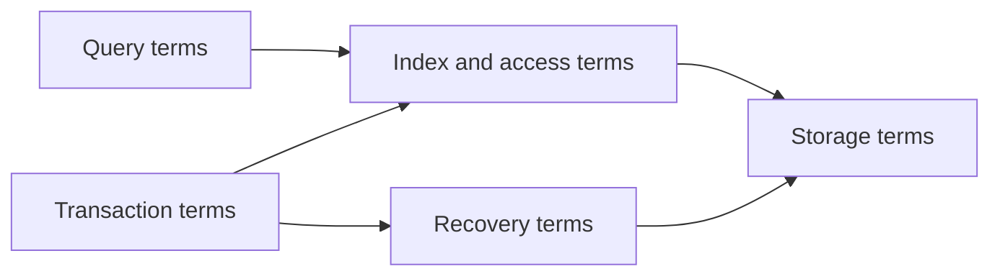

# Glossary of Database Internals Terms

> A reference of every technical term used in this guide, grouped by topic, with a pointer to the file that explains it in depth.

## Learning objectives

- Look up any unfamiliar term quickly and find where it is explained.
- Group terms into the layers they belong to (storage, indexing, query, transaction, recovery).
- Distinguish look-alike terms such as latch versus lock, and rollback versus recovery.
- Read a sentence about database internals and decode each term.

## Prerequisites

- [Overview](./01-overview.md) for the big picture.
- No other files are required, since this file is a lookup table.

## 1. Intuition

A glossary is like the legend on a map. You do not read it front to back; you glance at it when a symbol is unclear. The database field is full of words that sound similar but mean different things (a *lock* and a *latch*, a *log* and a *journal*). Learning the vocabulary early makes everything else easier, because the concepts are layered: storage terms support index terms, which support query terms, which support transaction terms.

## 2. How it works

How to use this glossary effectively:

1. Read the topic group that matches the file you are studying.
2. When you meet an unknown word in another file, search here by name.
3. Follow the "Where" link for the full mechanism.
4. Try to restate the definition in your own words, because restating exposes gaps.
5. Pay attention to the "Pairs that are often confused" table. Most beginner mistakes come from mixing near-synonyms.

The terms are grouped by layer because the layers mirror how a request travels: from the client, to the query layer, to the access layer, to storage, with transactions and recovery wrapped around them.

## 3. Architecture / data flow

- **Query terms** describe how SQL becomes a plan.
- **Index and access terms** describe how the plan finds rows.
- **Storage terms** describe pages and files.
- **Transaction terms** describe correctness under concurrency; they influence which rows access methods may return.
- **Recovery terms** describe how storage is rebuilt after a crash; transactions feed it through the log.

## 4. Internals deep dive

### Storage terms

| Term | Definition | Where |
| --- | --- | --- |
| Page (block) | Fixed-size unit of disk and cache I/O, commonly 4 KB to 16 KB | [Storage](./04-storage-engine-and-pages.md) |
| Heap | Unordered collection of pages holding a table's rows | [Storage](./04-storage-engine-and-pages.md) |
| Tuple | One row version as stored | [Storage](./04-storage-engine-and-pages.md) |
| Slotted page | Page layout with a slot directory pointing to variable-length rows | [Storage](./04-storage-engine-and-pages.md) |
| TID or ctid | Physical row address: page number plus slot number | [Storage](./04-storage-engine-and-pages.md) |
| Buffer pool | In-memory cache of pages | [Storage](./04-storage-engine-and-pages.md) |
| Dirty page | Cached page changed in memory but not yet written to disk | [Storage](./04-storage-engine-and-pages.md) |
| TOAST | PostgreSQL mechanism for storing oversized values out of line | [Storage](./04-storage-engine-and-pages.md) |
| Row store | Stores all columns of a row together | [Storage](./04-storage-engine-and-pages.md) |
| Column store | Stores each column's values together | [Storage](./04-storage-engine-and-pages.md) |
| Catalog | Internal tables describing tables, columns, indexes, and statistics | [Architecture](./03-architecture.md) |

### Index terms

| Term | Definition | Where |
| --- | --- | --- |
| Index | Auxiliary structure mapping key values to row locations | [Indexes](./05-indexes-btree-and-lsm.md) |
| B-tree (B+tree) | Balanced, wide, shallow tree of pages; the default index | [Indexes](./05-indexes-btree-and-lsm.md) |
| Fanout | Number of children per tree node | [Indexes](./05-indexes-btree-and-lsm.md) |
| Page split | Dividing a full index page into two when inserting | [Indexes](./05-indexes-btree-and-lsm.md) |
| Composite index | Index on several columns, ordered by the first, then second | [Indexes](./05-indexes-btree-and-lsm.md) |
| Covering index | Index containing all columns a query needs, avoiding table access | [Indexes](./05-indexes-btree-and-lsm.md) |
| LSM tree | Write-optimized structure of in-memory table plus sorted immutable files | [Indexes](./05-indexes-btree-and-lsm.md) |
| Memtable | In-memory sorted buffer of recent writes in an LSM tree | [Indexes](./05-indexes-btree-and-lsm.md) |
| SSTable | Sorted, immutable file in an LSM tree | [Indexes](./05-indexes-btree-and-lsm.md) |
| Compaction | Merging sorted files to remove old data and reduce read cost | [Indexes](./05-indexes-btree-and-lsm.md) |
| Bloom filter | Compact structure that says a key is definitely absent or possibly present | [Indexes](./05-indexes-btree-and-lsm.md) |
| Tombstone | Marker written by an LSM delete | [Indexes](./05-indexes-btree-and-lsm.md) |

### Query terms

| Term | Definition | Where |
| --- | --- | --- |
| Parser | Turns SQL text into a syntax tree | [Query Processing](./06-query-processing-and-optimizer.md) |
| Optimizer (planner) | Chooses the cheapest execution plan | [Query Processing](./06-query-processing-and-optimizer.md) |
| Cost model | Formulas estimating I/O and CPU for each plan | [Query Processing](./06-query-processing-and-optimizer.md) |
| Statistics | Summaries of data distribution used for estimates | [Query Processing](./06-query-processing-and-optimizer.md) |
| Selectivity | Fraction of rows a condition keeps | [Query Processing](./06-query-processing-and-optimizer.md) |
| Cardinality | Number of rows an operator produces | [Query Processing](./06-query-processing-and-optimizer.md) |
| Sequential scan | Reading every page of a table | [Query Processing](./06-query-processing-and-optimizer.md) |
| Nested loop, hash join, merge join | Three core join algorithms | [Query Processing](./06-query-processing-and-optimizer.md) |
| Volcano model | Executor design where each operator returns one row per call | [Query Processing](./06-query-processing-and-optimizer.md) |

### Transaction terms

| Term | Definition | Where |
| --- | --- | --- |
| Transaction | A group of operations that succeed or fail together | [Transactions](./07-transactions-and-concurrency.md) |
| ACID | Atomicity, Consistency, Isolation, Durability | [Transactions](./07-transactions-and-concurrency.md) |
| Isolation level | How much concurrent transactions may see of each other | [Transactions](./07-transactions-and-concurrency.md) |
| MVCC | Multi-version concurrency control: keep several row versions so readers do not block writers | [Transactions](./07-transactions-and-concurrency.md) |
| Snapshot | The set of row versions visible to a transaction | [Transactions](./07-transactions-and-concurrency.md) |
| Lock | Logical guard held for a transaction's duration | [Transactions](./07-transactions-and-concurrency.md) |
| Latch | Short physical guard protecting an in-memory structure | [Transactions](./07-transactions-and-concurrency.md) |
| Deadlock | Cycle of transactions each waiting on another | [Transactions](./07-transactions-and-concurrency.md) |
| Vacuum | Cleanup of dead row versions in PostgreSQL | [Transactions](./07-transactions-and-concurrency.md) |
| Write skew | Anomaly where two transactions each read overlapping data and write disjoint data, breaking a rule | [Transactions](./07-transactions-and-concurrency.md) |

### Recovery terms

| Term | Definition | Where |
| --- | --- | --- |
| WAL | Write-ahead log: append-only record of changes written before data pages | [WAL and Recovery](./08-wal-and-crash-recovery.md) |
| LSN | Log sequence number: position in the log | [WAL and Recovery](./08-wal-and-crash-recovery.md) |
| Checkpoint | Point where dirty pages are flushed so recovery can start later in the log | [WAL and Recovery](./08-wal-and-crash-recovery.md) |
| Redo and undo | Reapply committed changes, or reverse uncommitted ones | [WAL and Recovery](./08-wal-and-crash-recovery.md) |
| fsync | System call forcing buffered file data to stable storage | [WAL and Recovery](./08-wal-and-crash-recovery.md) |
| Torn page | A page partly written when a crash occurs | [WAL and Recovery](./08-wal-and-crash-recovery.md) |
| Replication | Copying changes to another server, often by shipping the log | [Failure Modes](./11-failure-modes-and-troubleshooting.md) |

### Pairs that are often confused

| Pair | Difference |
| --- | --- |
| Lock vs latch | Locks protect logical data for a whole transaction; latches protect memory structures for microseconds |
| Rollback vs recovery | Rollback cancels one live transaction; recovery repairs the whole database after a crash |
| Index scan vs sequential scan | One follows a tree to matching rows; the other reads everything |
| Cardinality vs selectivity | Cardinality is a row count; selectivity is a fraction |
| Log vs journal | Both record changes; "journal" is SQLite's older rollback-style term, "WAL" is the log-forward style |

## 5. Worked example

Decode this sentence: "The checkpointer flushed dirty pages after the WAL reached LSN 0/3000060, so redo on restart starts later."

1. *Checkpointer*: background process performing a checkpoint.
2. *Dirty pages*: changed pages in the buffer pool not yet on disk.
3. *WAL reached LSN 0/3000060*: the log has been written up to that position (the PostgreSQL LSN format is two hexadecimal numbers separated by a slash).
4. *Redo starts later*: because everything before the checkpoint is already in data files, the replay after a crash can skip it, which shortens recovery.

Expected result of the exercise: you can state in plain words that checkpoints trade extra writing now for faster restart later.

## 6. Tradeoffs and limitations

- Vendors use different names for similar ideas (for example, "block" versus "page", "heap" versus "table file"). This guide picks one and notes aliases.
- Some terms here are PostgreSQL-specific (TOAST, vacuum, ctid). Other engines have equivalents under other names.
- Definitions are intentionally short; the linked files carry the nuance.

## 7. Common misconceptions and pitfalls

- Treating "transaction" as meaning only multi-statement blocks. A single statement is also a transaction.
- Thinking "lock" always means exclusive. Many lock modes exist and many are shared.
- Confusing "consistency" in ACID (rules such as constraints hold) with "consistency" in distributed systems (all replicas agree).
- Thinking "cache" is one thing. The buffer pool, the operating system page cache, and CPU caches are all separate.
- Assuming a term means the same in every product.

## 8. Recap

- Terms cluster into storage, index, query, transaction, and recovery layers.
- Page, tuple, and buffer pool are the core storage words.
- Cardinality and selectivity feed the optimizer's cost model.
- Locks protect logic; latches protect memory.
- WAL, LSN, and checkpoint are the vocabulary of recovery.

## 9. Self-check questions

1. What is the difference between a lock and a latch?
2. What does a TID identify?
3. How do selectivity and cardinality relate to each other?
4. Why is the word "consistency" ambiguous?
5. What does a checkpoint change about recovery time?

## Next

Continue to [Architecture](./03-architecture.md).
