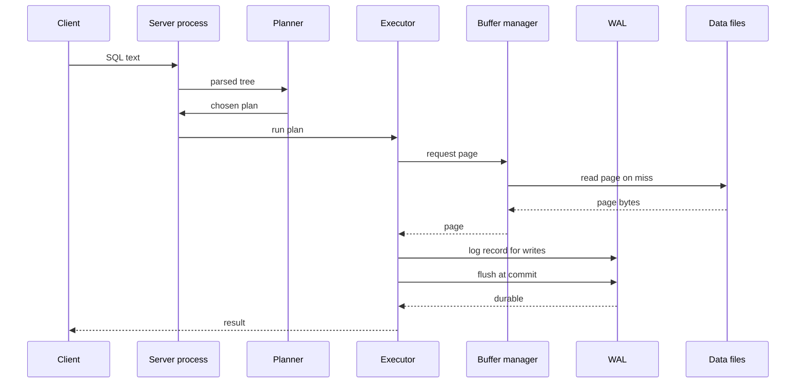

# Database Architecture: Components and How They Interact

> A relational database is a stack of cooperating components: connections, a query pipeline, access methods, a buffer cache, a transaction manager, a log, and background workers.

## Learning objectives

- List the major components of a database server and each one's responsibility.
- Contrast the process-per-connection model with the in-process library model.
- Trace a read and a write through the components in order.
- Explain what background processes do and why they exist.
- Identify the catalog and its role.

## Prerequisites

- [Overview](./01-overview.md)
- [Glossary](./02-glossary.md)

## 1. Intuition

Think of a restaurant. Customers (clients) talk to a waiter (the connection layer). The waiter hands the order to a head chef (the optimizer) who decides the recipe steps. Line cooks (the executor) do the steps. The pantry (the buffer pool) holds ingredients close at hand, while the warehouse (disk) holds the rest. A manager (the lock and transaction manager) makes sure two cooks do not use the same pan at once. A notebook (the log) records every dish started. After closing time, cleaners (background workers) tidy up, restock the pantry, and archive the notebook.

No single person does everything. The same is true inside a database: separate components, each with one job, communicate through narrow interfaces.

## 2. How it works

A **read** such as `SELECT name FROM users WHERE id = 7`:

1. The client sends the text over a socket. The server process for this connection receives it.
2. The parser builds a tree; the analyzer checks names against the **catalog** (the database's own tables describing schema).
3. The optimizer reads statistics from the catalog and chooses a plan, say an index lookup on `id`.
4. The executor starts the plan. The index access method asks the buffer manager for the root page of the index.
5. The buffer manager looks in a hash table of cached pages. On a miss, it picks a victim page to evict, reads the needed page from the data file, and returns it.
6. The access method walks down the tree to a leaf, gets the row's physical address, then requests the table page.
7. A **visibility check** decides whether this row version is visible to the current snapshot.
8. The row goes back up through the executor and over the socket.

A **write** such as `UPDATE users SET name = 'x' WHERE id = 7`:

1. Steps 1 to 6 find the row, because an update must first find it.
2. The transaction manager takes a lock on the row, or notes a conflict and waits.
3. The access method changes the page in the buffer pool, marking it dirty. Before that, it creates a log record describing the change.
4. At commit, the log is flushed up to the commit record. Only then does the client get "COMMIT".
5. The dirty page stays in memory. A background process writes it to disk later.

Why separate commit durability from page writing? Because forcing a log flush is a single sequential append, while forcing every changed page means many random writes. Splitting these gives both safety and throughput.

## 3. Architecture / data flow



Reading the diagram:

- **Client to Server process**: the only network hop. All later arrows are inside one server.
- **Planner reply**: the planner returns a plan, not data.
- **Executor to Buffer manager**: every page access goes through the cache.
- **Buffer manager to Data files**: only on a cache miss, which is the expensive path.
- **Executor to WAL**: only for writes; the flush at commit is the durability point.
- **Dashed arrows** are return values.

### Component responsibilities

| Component | Responsibility | Key state |
| --- | --- | --- |
| Connection manager | Accept, authenticate, and track sessions | Session table |
| Parser and analyzer | Syntax and name checking | Catalog cache |
| Planner and optimizer | Pick the plan | Statistics |
| Executor | Run plan operators | Operator state, working memory |
| Access methods | Read and write tables and indexes | Page layouts |
| Buffer manager | Cache pages, choose eviction victims | Buffer table, dirty flags |
| Transaction manager | Assign transaction IDs, snapshots, commit status | Transaction status data |
| Lock manager | Grant and queue locks; detect deadlocks | Lock table in shared memory |
| WAL manager | Append and flush log records | Log buffer, current LSN |
| Background workers | Checkpoint, flush, clean up, gather stats | Schedules |

## 4. Internals deep dive

### Process models

| Model | Example | How it works | Pro | Con |
| --- | --- | --- | --- | --- |
| Process per connection | PostgreSQL | A parent process forks a child per client; children share memory areas | Isolation; a crash in one backend is contained, though shared memory is reset on certain crashes | Each connection uses memory; thousands are costly |
| Thread per connection | MySQL | One thread per client in one process | Lighter than processes | A bug can affect the whole process |
| In-process library | SQLite | The database engine is linked into your program; no server | Zero setup; very fast calls | Limited concurrent writers; no network access |

PostgreSQL's default `max_connections` is 100, which is a hint that connections are meant to be few and pooled.

### Shared memory

Server processes that share state use shared memory. Major regions in PostgreSQL include the buffer pool (`shared_buffers`, default 128 MB), the lock table, and the WAL buffers. Private memory per backend holds operator working space such as sort buffers (`work_mem`, default 4 MB per operation).

### Latches

Because many processes touch shared structures, short-lived **latches** protect them. Latches are held for microseconds and never across disk waits if avoidable. This is different from transaction **locks**, which may be held for seconds or minutes.

### Background workers

| Worker | Job | Why needed |
| --- | --- | --- |
| Checkpointer | Periodically flush all dirty pages and mark a recovery start point | Bounds crash recovery time |
| Background writer | Trickle-flush dirty pages | Keeps clean buffers available for foreground queries |
| WAL writer | Flush the log buffer periodically | Reduces commit waiting |
| Autovacuum | Remove dead row versions and refresh statistics | Prevents bloat, keeps plans good |
| Replication senders | Stream the log to standbys | High availability and read scaling |

### The catalog

The catalog is a set of ordinary tables that describe the database itself: tables, columns, types, indexes, constraints, and statistics. The database uses its own storage engine to store its catalog. In PostgreSQL you can query `pg_class` and `pg_attribute`; in SQLite, `sqlite_schema`.

```sql
SELECT relname, relkind, relpages FROM pg_class WHERE relname = 'users';
```

### Data files and layout

PostgreSQL stores each table or index in its own file (split into 1 GB segments by default). The file is an array of fixed-size pages, so page number N lives at byte offset N times page size. That arithmetic is why locating a page is O(1) once its number is known.

## 5. Worked example

Inspect a live PostgreSQL server to see components as processes. Start one with Docker if needed:

```bash
docker run --name pg -e POSTGRES_PASSWORD=secret -d postgres:16
docker exec -it pg ps -eo pid,args
```

Expected output (PIDs vary; exact titles vary by version):

```text
  PID COMMAND
    1 postgres
   28 postgres: checkpointer
   29 postgres: background writer
   31 postgres: walwriter
   32 postgres: autovacuum launcher
   33 postgres: logical replication launcher
```

Now connect and observe your own backend appear:

```bash
docker exec -it pg psql -U postgres -c "SELECT pid, backend_type, state FROM pg_stat_activity;"
```

```text
 pid |         backend_type         | state
-----+------------------------------+--------
  28 | checkpointer                 |
  29 | background writer            |
  31 | walwriter                    |
  45 | client backend               | active
```

Each row is a component from the table above, running as its own process.

## 6. Tradeoffs and limitations

- **Process per connection** is robust but heavy; use a pooler when many clients exist.
- **Shared buffer pool plus OS cache** can store a page twice (double buffering), using more memory.
- **Background workers** compete with queries for I/O. Aggressive cleanup can slow foreground work; lazy cleanup causes bloat.
- **Embedded engines** give simplicity but not multi-machine access.

## 7. Common misconceptions and pitfalls

- "The database is one program doing one thing." It is a team of processes or threads.
- "More connections means more throughput." Beyond the CPU and I/O capacity, extra connections only add contention.
- "The buffer pool is the same as the OS cache." They are separate layers.
- "The catalog is special magic." It is regular tables, which explains why `ALTER TABLE` is a transaction-aware operation in some systems.

## 8. Recap

- Components: connection layer, parser, optimizer, executor, access methods, buffer manager, transaction and lock managers, WAL, background workers.
- All page access goes through the buffer manager.
- Writes log first and flush the log at commit; data pages flush later.
- Background workers keep the system healthy: checkpoint, write, vacuum.
- The catalog is the database describing itself in tables.

## 9. Self-check questions

1. Why does the buffer manager sit between the executor and the data files?
2. What is the difference between `shared_buffers` and `work_mem` in role?
3. Why is commit durability tied to the log rather than the data file?
4. What problem does the background writer solve?
5. Give one advantage and one disadvantage of process-per-connection.

## Next

Continue to [Storage Engine and Pages](./04-storage-engine-and-pages.md).
