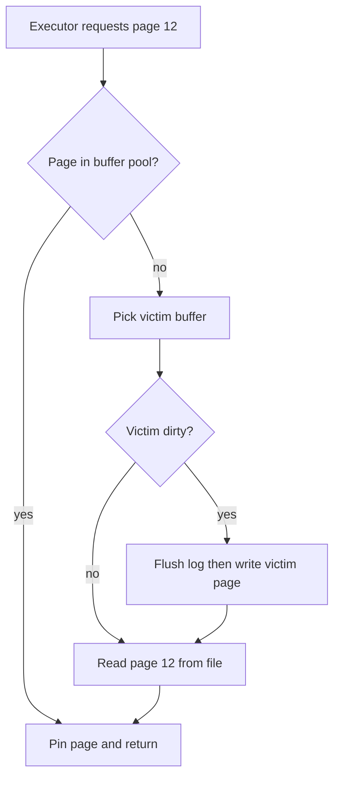

# Storage Engine and Pages

> A database stores tables as arrays of fixed-size pages, each page holding many rows, and reads them through an in-memory buffer pool.

## Learning objectives

- Explain why databases use fixed-size pages instead of reading individual rows.
- Describe the slotted page layout and how rows are addressed.
- Explain how the buffer pool decides what to keep and evict.
- Contrast row storage with column storage.
- Understand how large values and updates affect storage.

## Prerequisites

- [Overview](./01-overview.md)
- [Architecture](./03-architecture.md)
- Terms in the [Glossary](./02-glossary.md)

## 1. Intuition

Picture a filing cabinet whose drawers each hold exactly one folder size. You never fetch a single sheet from the warehouse; you fetch a whole folder because the trip is the expensive part. Once the folder is on your desk, flipping through its sheets is nearly free.

A **page** is that folder. Disks are read in blocks, so reading 100 bytes costs about the same as reading 8,000. The database therefore groups many rows into one page, and always moves whole pages between disk and memory. Your desk is the **buffer pool**: it fits only some folders, so when it is full you must send one back.

## 2. How it works

How a row gets stored and found:

1. **A table is a file of pages.** The file is split into equal blocks. PostgreSQL uses 8 KB pages by default, InnoDB (MySQL) uses 16 KB, and SQLite uses 4096 bytes by default in modern versions (configurable). Equal size means page N starts at byte N times page size, a direct calculation with no search.
2. **Inserting a row** requires finding a page with enough free space. The database keeps a free-space map so it need not scan pages.
3. **Within the page**, the row is placed in free space, and a small entry in a **slot directory** records where it sits. Other structures refer to the row by page number plus slot number, not by byte offset. This is the **tuple identifier** (TID).
4. **Why a slot indirection?** Rows have variable length, and pages are occasionally compacted to remove gaps. If other structures stored raw byte offsets, compaction would break them. With a slot, the row can move inside the page while its address stays stable.
5. **Reading** requires asking the buffer manager for the page. If it is cached, no disk access occurs. If not, the page is read and a cached page may be evicted.
6. **Updating** in PostgreSQL does not overwrite in place. It writes a new row version and marks the old one as ended, which supports concurrent readers (see [Transactions](./07-transactions-and-concurrency.md)).
7. **Flushing** happens later: modified (dirty) pages are written by the background writer or checkpointer, after their log records are safely on disk (see [WAL](./08-wal-and-crash-recovery.md)).

## 3. Architecture / data flow



Explanation of each node:

- **Executor requests page 12**: the access method names a file and page number.
- **Page in buffer pool?**: a hash table keyed by file and page number answers in O(1) average time.
- **Pin page and return**: a pin count prevents the page from being evicted while in use.
- **Pick victim buffer**: a replacement policy chooses an unpinned page to discard. PostgreSQL uses a clock-sweep approximation of LRU.
- **Victim dirty?**: a dirty victim must be written first, or its changes would be lost.
- **Flush log then write**: the log must reach disk before the page, the write-ahead rule.
- **Read page 12**: one block read from the file.

## 4. Internals deep dive

### Slotted page layout

```text
+-----------------------------------------------------+
| Page header (LSN, free space pointers, flags)       |
+-----------------------------------------------------+
| Slot 1 | Slot 2 | Slot 3 | ...  (grow downward)     |
+-----------------------------------------------------+
|                 free space                          |
+-----------------------------------------------------+
|        ... Row 3 | Row 2 | Row 1  (grow upward)     |
+-----------------------------------------------------+
| Optional special area (used by index pages)         |
+-----------------------------------------------------+
```

The slot directory grows from the start and row data grows from the end toward the middle. When they meet, the page is full. In PostgreSQL, the page header is 24 bytes, each slot (line pointer) is 4 bytes, and each row has a header of about 23 bytes before its data, aligned to 8 bytes. Those header bytes include transaction IDs used for visibility.

The page header stores the **LSN** of the last log record that changed the page. The buffer manager uses it to enforce that the log is flushed at least that far before writing the page.

### Page types

| Type | Contents | Used by |
| --- | --- | --- |
| Heap page | Table rows | Table scans, index lookups |
| Index page | Keys and pointers | B-tree lookups |
| Free space map page | Free bytes per heap page | Insert placement |
| Visibility map page | Bits marking pages with all-visible rows | Skipping work in vacuum and index-only scans |
| Overflow page | Oversized values | Large text or binary |

### Large values

A row must fit within a page. PostgreSQL uses **TOAST**: values over about 2 KB are compressed and, if still large, moved into a side table in chunks, leaving a small pointer in the row. This keeps the main heap dense, so scans that do not need the big column avoid reading it.

### Buffer pool replacement

| Policy | Idea | Weakness |
| --- | --- | --- |
| LRU | Evict least recently used | One large scan flushes the whole useful cache |
| Clock sweep | Cheaper LRU approximation with usage counters | Approximate |
| Ring buffer for scans | Large sequential scans reuse a small ring of buffers | Scan data is not cached for others |

PostgreSQL uses a small ring buffer for big sequential scans specifically so one report query does not wash out the hot working set.

### Row store versus column store

| Aspect | Row store | Column store |
| --- | --- | --- |
| Layout | All fields of a row adjacent | All values of one column adjacent |
| Read one whole row | One page | Many places |
| Aggregate one column over many rows | Reads unneeded columns | Reads only that column |
| Compression | Moderate | High, since same-type values are similar |
| Updates | Cheap | Costlier |
| Typical use | Transactions | Analytics |

### Complexity

- Locate page N in a file: O(1).
- Check buffer pool: O(1) average with a hash table.
- Full table scan: O(number of pages).
- Insert: O(1) typical with the free-space map.

## 5. Worked example

Using PostgreSQL:

```sql
CREATE TABLE users(id int, name text);
INSERT INTO users SELECT g, 'user' || g FROM generate_series(1, 3) AS g;
SELECT ctid, * FROM users;
```

```text
 ctid  | id | name
-------+----+-------
 (0,1) |  1 | user1
 (0,2) |  2 | user2
 (0,3) |  3 | user3
```

The `ctid` is page 0, slots 1 to 3. Now update a row:

```sql
UPDATE users SET name = 'ada' WHERE id = 2;
SELECT ctid, * FROM users;
```

```text
 ctid  | id | name
-------+----+-------
 (0,1) |  1 | user1
 (0,3) |  3 | user3
 (0,4) |  2 | ada
```

The updated row moved to slot 4, because PostgreSQL wrote a new row version instead of overwriting. The old version at slot 2 is still physically present until vacuum removes it. Check the file size:

```sql
SELECT pg_relation_size('users');
```

```text
 pg_relation_size
------------------
             8192
```

One 8 KB page holds all four row versions.

## 6. Tradeoffs and limitations

- **Page size**: larger pages make sequential reads efficient but waste memory when only one row is needed and increase write cost per change. Smaller pages do the opposite.
- **Write-new-version updates** support concurrency but create dead rows that need cleanup and make tables grow (bloat).
- **Slotted pages** have internal fragmentation; free space may be unusable until compaction.
- **Column stores** are poor for point updates and for fetching full rows.

## 7. Common misconceptions and pitfalls

- "A table is stored sorted." A heap is unordered; only an index provides order.
- "`ctid` is a stable key." It changes on update and after some maintenance; never store it.
- "Deleting rows shrinks the file." Space is generally reused inside the file, but returned to the operating system only by specific operations.
- "`SELECT *` is harmless." It reads wide rows and large values, wasting I/O.
- "More memory for the buffer pool is always better." The OS cache also helps; settings must leave room for it and for per-query memory.

## 8. Recap

- Databases do I/O in fixed-size pages because disk access cost is per block, not per byte.
- Slotted pages let variable-length rows move without breaking their addresses.
- The buffer pool caches pages; dirty pages are written back later, after their log records.
- PostgreSQL updates create new row versions, so dead versions must be cleaned.
- Row stores favor transactions; column stores favor analytics.

## 9. Self-check questions

1. Why does the database read a whole page to get one row?
2. What problem does the slot directory solve?
3. Why must the log be flushed before a dirty page is written?
4. What happens to the old row version after an update in PostgreSQL?
5. Why does PostgreSQL use a ring buffer for large sequential scans?

## Next

Continue to [Indexes: B-tree and LSM](./05-indexes-btree-and-lsm.md).
