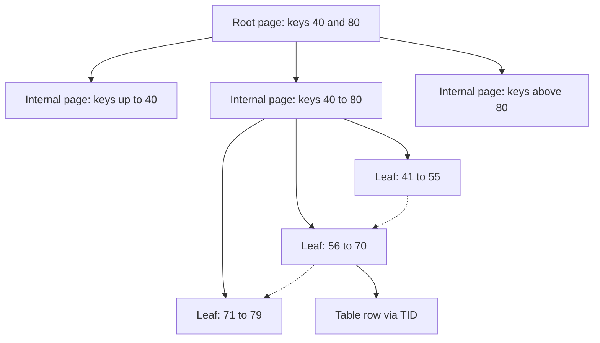
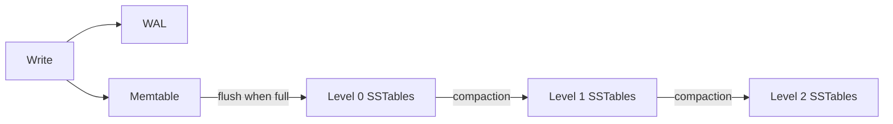

# Indexes: B-tree and LSM Tree

> An index is a separate, sorted structure that lets the database find rows by key in a handful of page reads instead of scanning the whole table.

## Learning objectives

- Explain how a B+tree is searched, grown, and kept balanced.
- Calculate roughly why a B+tree stays only a few levels deep.
- Describe composite and covering indexes and the leftmost-prefix rule.
- Explain how an LSM tree trades read cost for write speed.
- Decide between B-tree and LSM designs for a workload.

## Prerequisites

- [Storage Engine and Pages](./04-storage-engine-and-pages.md)
- [Glossary](./02-glossary.md) for fanout, page split, and compaction

## 1. Intuition

A phone book is sorted by last name. To find "Okafor" you do not read from page one; you open the middle, see you are at "M", jump forward, and in a few flips you land on the right page. That is binary-style search over sorted data.

A B-tree is the same idea, but each "flip" opens a page with hundreds of names, so the number of flips is tiny. An **LSM tree** is different: it is like a clerk who writes new entries on a small notepad (fast), and every so often merges the notepad into a bigger sorted book. Writing is easy; reading may require checking the notepad and several books.

## 2. How it works

### B+tree lookup

1. Start at the **root page**, always kept hot in cache.
2. The page holds sorted separator keys and child pointers. Binary-search within the page to choose the child whose range contains the target key.
3. Move to that child page. Repeat until you reach a **leaf page**.
4. The leaf holds the key and a pointer to the table row (a TID), or the row itself in clustered designs like InnoDB.
5. Use the pointer to fetch the table page.

Leaves are linked left to right, so a range query (`BETWEEN`) finds the start leaf once and then follows links, reading sequentially.

### B+tree insert

1. Search to the correct leaf, as above.
2. If the leaf has room, insert the key in sorted position. Done.
3. If the leaf is full, **split** it: allocate a new page, move about half of the keys to it, and insert a separator key into the parent.
4. If the parent is full, split it too, and so on upward. If the root splits, a new root is created and the tree grows one level taller.

Why does this keep the tree balanced? Because the tree only becomes taller by splitting the root, all leaves are always at the same depth. No path is ever longer than another.

### LSM write and read

1. A write goes first to the **write-ahead log** (for durability) and then to the **memtable**, a sorted in-memory structure.
2. When the memtable fills, it is written as a new immutable sorted file (an **SSTable**) in one sequential pass.
3. A read checks the memtable, then SSTables from newest to oldest, until it finds the key. A **bloom filter** per file lets it skip files that definitely lack the key.
4. In the background, **compaction** merges files, dropping overwritten and deleted entries, so the number of files to check stays bounded.

## 3. Architecture / data flow



- **Root page**: single entry point. Its separator keys split the key space into ranges.
- **Internal pages**: only route; they hold keys and child pointers, not row data.
- **Leaf pages**: hold the actual index entries, in sorted order.
- **Dotted arrows between leaves**: sibling links used for range scans.
- **Row via TID**: the final hop to the heap page where the full row lives.

LSM write path:



## 4. Internals deep dive

### Why B-trees are shallow

The key quantity is **fanout**, the number of children per page. Suppose a page is 8 KB and each entry (key plus pointer) takes about 16 to 20 bytes. Then a page holds roughly 400 entries, so fanout is a few hundred. The number of levels is about log base fanout of N. As an illustration (actual numbers vary by key size and fill factor):

| Fanout | Levels for 1 million keys | Levels for 1 billion keys |
| --- | --- | --- |
| 100 | 3 | 5 |
| 300 | 3 | 4 |
| 500 | 3 | 4 |

So even a billion keys needs only about 4 page reads, and the top levels are almost always cached, so real disk reads per lookup are often 1 or 2.

Complexity: search, insert, and delete are O(log N) page accesses. Range scan is O(log N + K / entries per page) for K results.

### Page splits and fill factor

Random inserts cause splits, which leave pages roughly half to two-thirds full on average, so indexes are larger than the minimum possible. Sequential keys (auto-increment) fill the right edge efficiently but make that edge a contention point. Many engines expose a **fill factor** setting (PostgreSQL's default for B-tree is 90 percent) to leave room for future inserts.

### Composite index and leftmost prefix

An index on `(country, city)` is sorted by country, then by city within a country. It helps queries that constrain `country`, or `country` and `city`. It does not efficiently help a query on `city` alone, because cities are scattered across all countries.

```sql
CREATE INDEX idx_geo ON places(country, city);
-- Uses the index:     WHERE country = 'IN'
-- Uses the index:     WHERE country = 'IN' AND city = 'Pune'
-- Poor use of it:     WHERE city = 'Pune'
```

### Covering index

If the index contains every column a query needs, the database can answer from the index alone, skipping the table fetch. PostgreSQL calls this an index-only scan, which also depends on the visibility map to confirm rows are visible without visiting the heap.

### Other index types

| Type | Best for | Note |
| --- | --- | --- |
| B-tree | Equality, ranges, ordering | Default in most systems |
| Hash | Equality only | No range support |
| GIN (PostgreSQL) | Many keys per row, such as arrays or full text | Slower to update |
| GiST and others | Spatial, nearest-neighbor | Specialized |
| Bitmap | Low-cardinality columns in analytics | Common in some warehouse engines |

### LSM details and amplification

| Measure | B-tree | LSM tree |
| --- | --- | --- |
| Write cost | Random page writes, possible splits | Sequential appends plus later compaction |
| Read cost | Few page reads | May check several files, mitigated by bloom filters |
| Space | Fragmentation from splits | Duplicate versions until compaction |
| Write amplification | Moderate | Can be high because data is rewritten at each compaction level |
| Predictable latency | Good | Compaction can cause spikes |

**Write amplification** means physical bytes written per logical byte; **read amplification** means files or pages consulted per lookup. Compaction strategy (leveled versus size-tiered) shifts the balance between them; details vary by product.

A **bloom filter** is a bit array set by several hash functions. For a lookup, if any bit is zero the key is definitely absent; if all are one the key is possibly present. It has false positives but no false negatives.

### Deletes in LSM

A delete cannot remove data from an immutable file, so it writes a **tombstone** marker. Compaction later drops both the tombstone and the older values once they cannot be needed.

## 5. Worked example

Use SQLite to see the index take effect.

```sql
CREATE TABLE users(id INTEGER PRIMARY KEY, email TEXT, country TEXT);
WITH RECURSIVE n(i) AS (SELECT 1 UNION ALL SELECT i + 1 FROM n WHERE i < 10000)
INSERT INTO users(email, country)
SELECT 'user' || i || '@x.com', CASE WHEN i % 2 = 0 THEN 'IN' ELSE 'US' END FROM n;

EXPLAIN QUERY PLAN SELECT * FROM users WHERE email = 'user77@x.com';
```

```text
QUERY PLAN
`--SCAN users
```

Without an index, all 10,000 rows are examined. Now add one:

```sql
CREATE INDEX idx_users_email ON users(email);
EXPLAIN QUERY PLAN SELECT * FROM users WHERE email = 'user77@x.com';
```

```text
QUERY PLAN
`--SEARCH users USING INDEX idx_users_email (email=?)
```

Test the leftmost rule:

```sql
CREATE INDEX idx_geo ON users(country, email);
EXPLAIN QUERY PLAN SELECT * FROM users WHERE country = 'IN' AND email = 'user78@x.com';
```

```text
QUERY PLAN
`--SEARCH users USING INDEX idx_geo (country=? AND email=?)
```

The exact wording and the choice among available indexes can vary by SQLite version.

## 6. Tradeoffs and limitations

- **Every index slows writes**: each insert, update of an indexed column, or delete must also modify each index, and each may split pages.
- **Indexes consume space** and cache, competing with table data.
- **Low-selectivity columns** (for example a boolean) gain little, because the index returns a large share of the table and random fetches cost more than a scan.
- **Functions on columns** such as `WHERE lower(email) = 'x'` bypass a plain index on `email` unless you create an expression index.
- **LSM** gives high write rates but unpredictable compaction work and more complex reads.

## 7. Common misconceptions and pitfalls

- "Index everything." Over-indexing raises write cost and memory use.
- "A B-tree is a binary tree." It has hundreds of children per node.
- "Column order in a composite index does not matter." It determines which queries it can serve.
- "LSM is always faster." It favors writes; point reads and scans can be slower.
- "`LIKE '%abc'` can use a B-tree." A leading wildcard destroys sorted-prefix searching.

## 8. Recap

- A B+tree finds a key in O(log N) page reads, with very high fanout giving 3 to 4 levels for huge tables.
- Splits propagate upward, keeping all leaves at equal depth.
- Composite indexes follow the leftmost-prefix rule.
- LSM trees buffer writes in memory and merge sorted files in the background, trading read and space cost for write speed.
- Every index is a read-versus-write tradeoff.

## 9. Self-check questions

1. Why are B-tree internal pages kept free of row data?
2. What triggers a page split and what happens to the parent?
3. Why can an index on `(a, b)` not efficiently serve a query only on `b`?
4. What is a tombstone and why does LSM need it?
5. What can a bloom filter tell you, and what can it not?

## Next

Continue to [Query Processing and the Optimizer](./06-query-processing-and-optimizer.md).
