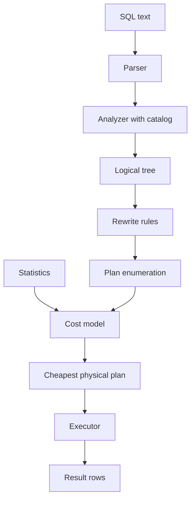

# Query Processing and the Optimizer

> SQL text is parsed into a tree, turned into many candidate plans, scored by a cost model using statistics, and the cheapest plan is executed one row at a time.

## Learning objectives

- Follow SQL through parsing, analysis, optimization, and execution.
- Explain how statistics, selectivity, and cost lead to a plan choice.
- Compare nested loop, hash, and merge joins.
- Read a basic `EXPLAIN` output.
- Understand why optimizers sometimes choose badly.

## Prerequisites

- [Storage Engine and Pages](./04-storage-engine-and-pages.md)
- [Indexes](./05-indexes-btree-and-lsm.md)
- [Glossary](./02-glossary.md)

## 1. Intuition

You want to drive across a city. You describe the destination, not the turns. A navigation app considers several routes, estimates each one's time using traffic data, and picks the fastest. If its traffic data is stale, it may pick a slow route.

SQL is the destination; the optimizer is the navigation app; **statistics** are the traffic data. Stale or missing statistics are the number one reason a database picks a bad plan.

## 2. How it works

1. **Parsing.** A grammar turns the text into a parse tree. Errors such as a missing keyword stop here.
2. **Analysis.** Names resolve against the catalog; types are checked; views are expanded. The result is a **logical query tree** made of relational operators such as scan, filter, join, aggregate, sort.
3. **Rewriting and simplification.** Constant expressions are folded, subqueries may be flattened into joins, and filters are pushed down toward the scans so fewer rows flow upward. Why push filters down? Because discarding rows early reduces work in every later operator.
4. **Plan enumeration.** For each table, the optimizer considers access paths: sequential scan or each usable index. For joins, it considers join orders and algorithms.
5. **Costing.** Each candidate gets a numeric cost from a **cost model**, estimated from statistics: row counts, distinct values, value histograms, and most-common-values lists. The cost combines estimated page reads and CPU work.
6. **Plan selection.** The lowest-cost plan wins. Join ordering is combinatorial: n tables have up to n factorial orders. The classic System R approach uses dynamic programming to avoid repeated work; PostgreSQL uses it up to a threshold and then a genetic algorithm (`geqo_threshold` defaults to 12 tables).
7. **Execution.** The executor runs the plan tree. Parent operators repeatedly ask children for the next row (the **Volcano** or iterator model), so rows flow upward without materializing intermediate results unless needed.

## 3. Architecture / data flow



- **Parser**: syntax only.
- **Analyzer with catalog**: meaning and types.
- **Logical tree**: what to compute, with no algorithms chosen.
- **Rewrite rules**: semantics-preserving simplifications.
- **Plan enumeration**: generates physical alternatives (which index, which join algorithm).
- **Statistics** feed the **cost model**, which scores each alternative.
- **Cheapest physical plan**: the chosen algorithm tree, handed to the executor.

## 4. Internals deep dive

### Statistics

PostgreSQL's `ANALYZE` samples table rows and stores per column: fraction of nulls, number of distinct values, a most-common-values list with frequencies, and a histogram of the remaining values. These live in `pg_statistic` and are viewable through `pg_stats`.

**Selectivity** estimation example: if `country = 'IN'` appears in 50 percent of sampled rows, estimated selectivity is 0.5. With 1,000,000 rows, estimated **cardinality** is 500,000. For multiple conditions, a simple model multiplies selectivities, assuming the columns are independent. When columns are correlated (city and country), this assumption underestimates and plans go wrong. PostgreSQL offers extended statistics (`CREATE STATISTICS`) for such cases.

### Cost model

PostgreSQL costs are in arbitrary units anchored to one sequential page fetch costing 1.0 (`seq_page_cost`). Random page fetch is `random_page_cost`, default 4.0 (a figure reflecting spinning disks; many SSD deployments lower it). CPU costs per tuple are small fractions like `cpu_tuple_cost` 0.01. Plans display as `cost=startup..total`.

### Access paths

| Path | Reads | Best when |
| --- | --- | --- |
| Sequential scan | Every page in order | Many rows match, or table is small |
| Index scan | Index then table pages at random | Few rows match |
| Index-only scan | Index only | Covering index and visible pages |
| Bitmap scan | Index builds a page bitmap, then reads pages in order | Medium selectivity |

The crossover is why an index is sometimes ignored: if a query returns, say, a third of the table, thousands of random fetches cost more than one sequential pass.

### Join algorithms

| Algorithm | How it works | Cost shape | Good when |
| --- | --- | --- | --- |
| Nested loop | For each outer row, look up matches in inner, ideally via index | Outer rows times inner lookup cost | Outer is small and inner is indexed |
| Hash join | Build a hash table on the smaller input, probe with the larger | Roughly linear in both inputs | Large unsorted inputs, equality joins |
| Merge join | Sort both inputs on the key and merge | Sort cost plus linear merge | Inputs already sorted or ranges needed |

If the hash table exceeds working memory (`work_mem`, default 4 MB in PostgreSQL), it spills to disk in batches, which is far slower.

### Pseudocode of the iterator model

```text
operator.open()
while (row = operator.next()) != END:
    emit(row)
operator.close()

HashJoin.next():
    if not built: build hash table from left child
    loop:
        r = right.next()
        if r is END: return END
        if hash table has match for r: return joined row
```

Why iterators? They use constant memory per operator for streaming operators like filter and scan. Only blocking operators such as sort and hash build need to hold data.

### Prepared statements and plan caching

A parameterized statement can be parsed once and executed many times, saving parse effort. The planner may use a generic plan or a custom plan per parameter set; behavior varies by version and settings.

## 5. Worked example

PostgreSQL:

```sql
CREATE TABLE orders(id serial PRIMARY KEY, customer_id int, amount numeric);
INSERT INTO orders(customer_id, amount)
SELECT (random() * 1000)::int, (random() * 100)::numeric FROM generate_series(1, 100000);
ANALYZE orders;
EXPLAIN SELECT * FROM orders WHERE customer_id = 42;
```

Illustrative output (costs and row counts will differ):

```text
 Seq Scan on orders  (cost=0.00..1887.00 rows=100 width=15)
   Filter: (customer_id = 42)
```

Add an index and re-check:

```sql
CREATE INDEX idx_orders_cust ON orders(customer_id);
ANALYZE orders;
EXPLAIN ANALYZE SELECT * FROM orders WHERE customer_id = 42;
```

```text
 Bitmap Heap Scan on orders  (cost=5.04..300.10 rows=100 width=15) (actual time=0.05..0.20 rows=98 loops=1)
   Recheck Cond: (customer_id = 42)
   ->  Bitmap Index Scan on idx_orders_cust  (cost=0.00..5.01 rows=100 width=0)
         Index Cond: (customer_id = 42)
 Planning Time: 0.1 ms
 Execution Time: 0.3 ms
```

How to read it: indentation shows the tree; the child (`Bitmap Index Scan`) feeds the parent. Compare `rows=` (estimate) with `actual ... rows=` (reality). A large mismatch signals bad statistics. `EXPLAIN ANALYZE` actually runs the statement, so wrap data-changing statements in a transaction you roll back.

## 6. Tradeoffs and limitations

- **Estimates are guesses.** Errors compound through joins; a 10x error on one input can change the best algorithm.
- **Independence assumption** fails for correlated columns.
- **Planning takes time**, so very short queries may spend more time planning than running.
- **Plan instability**: a small data change can flip the plan, sometimes causing sudden slowdowns.
- **Hints** are not standard SQL; PostgreSQL deliberately offers none in core, while other products do.

## 7. Common misconceptions and pitfalls

- "The optimizer always finds the best plan." It finds the best plan according to its estimates.
- "Rewriting the SQL order of joins changes the plan." Usually the optimizer reorders joins itself, up to limits.
- "`EXPLAIN` runs the query." Only `EXPLAIN ANALYZE` does.
- "A seq scan is bad." It is optimal for small tables or large result fractions.
- "Run ANALYZE only when slow." Stale statistics silently degrade plans; autovacuum normally refreshes them, but bulk loads may outrun it.

## 8. Recap

- Query flow: parse, analyze, rewrite, enumerate, cost, execute.
- The cost model depends on statistics; bad statistics mean bad plans.
- Three join algorithms suit three situations.
- Execution is typically pull-based, one row at a time through operators.
- Compare estimated and actual rows to diagnose planner problems.

## 9. Self-check questions

1. Why are filters pushed toward scans?
2. What does the independence assumption do to estimates for correlated columns?
3. When is a hash join better than a nested loop?
4. Why might the planner pick a sequential scan though an index exists?
5. What is the difference between `EXPLAIN` and `EXPLAIN ANALYZE`?

## Next

Continue to [Transactions and Concurrency](./07-transactions-and-concurrency.md).
