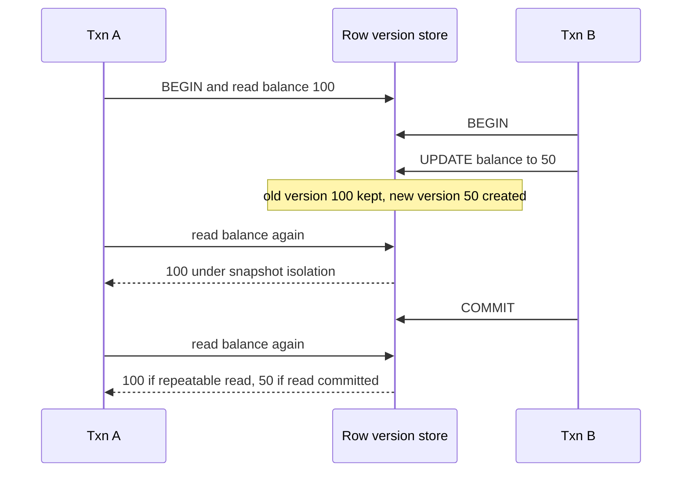
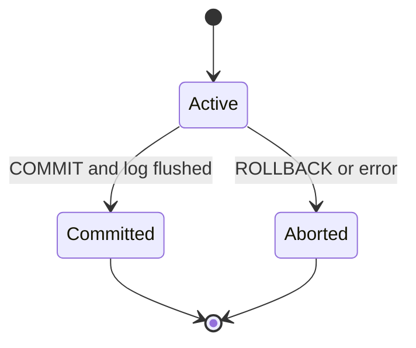

# Transactions and Concurrency Control

> Transactions group operations into all-or-nothing units, and concurrency control, mainly locking and multi-version snapshots, keeps simultaneous users from corrupting or confusing each other.

## Learning objectives

- State the four ACID properties and which mechanism provides each.
- Describe the classic anomalies: dirty read, non-repeatable read, phantom, write skew.
- Explain how MVCC works using row version headers and snapshots.
- Compare two-phase locking with MVCC.
- Explain deadlocks and how they are detected.

## Prerequisites

- [Storage Engine and Pages](./04-storage-engine-and-pages.md)
- [Architecture](./03-architecture.md)
- [Glossary](./02-glossary.md)

## 1. Intuition

Two people share a bank account. One transfers money out while the other checks the balance. If the checker sees the money gone from one account but not yet in the other, the totals look wrong. A transaction is a promise: the transfer appears as a single instant, or not at all.

Now think of a shared ledger. One approach is to lock the whole page while someone edits, so everyone else waits. Another is to give each reader a **photograph of the ledger at the moment they started**, while writers write a new version. Readers never wait. The first approach is **locking**; the second is **MVCC**.

## 2. How it works

### ACID

| Property | Meaning | Main mechanism |
| --- | --- | --- |
| Atomicity | All changes happen or none | Log and abort handling |
| Consistency | Rules such as constraints always hold after commit | Constraint checks plus correct application logic |
| Isolation | Concurrent transactions do not interfere beyond the allowed level | Locks and MVCC |
| Durability | Committed data survives crashes | Write-ahead log flush |

### MVCC step by step (PostgreSQL style)

1. **Each transaction gets an ID** (xid) when it first writes.
2. **Each row version carries two hidden fields**: `xmin`, the transaction that created it, and `xmax`, the transaction that deleted or replaced it (zero if none).
3. **An UPDATE** creates a new version with `xmin` equal to the updater, and sets `xmax` on the old version to the updater. It does not overwrite.
4. **A snapshot** records which transactions were in progress and the next unassigned ID when the statement (or transaction) began.
5. **Visibility rule**: a version is visible if its creator `xmin` committed before the snapshot and its `xmax` is either unset, aborted, or not yet committed relative to the snapshot.
6. **Readers therefore never block writers and vice versa**, because they look at different versions.
7. **Write-write conflicts** still need locks: two transactions updating the same row cannot both succeed, so the second waits for the first to commit or abort.
8. **Cleanup**: versions no snapshot can see are dead and are reclaimed by vacuum.

Why create a new version instead of overwriting? Because overwriting would destroy the old value that an older snapshot still needs.

## 3. Architecture / data flow



- **Txn A and Txn B**: two concurrent sessions.
- **Row version store**: the heap with multiple versions of the row.
- **Note**: both versions coexist physically.
- **Final read**: the answer depends on isolation level. Under read committed, each statement takes a fresh snapshot, so A sees 50 after B commits. Under repeatable read, A keeps its original snapshot.

### Transaction states



## 4. Internals deep dive

### Anomalies

| Anomaly | What happens | Example |
| --- | --- | --- |
| Dirty read | Read data from an uncommitted transaction | See a balance that later rolls back |
| Non-repeatable read | Same row read twice gives different values | Another transaction commits between reads |
| Phantom read | Same query returns a different set of rows | Another transaction inserts a matching row |
| Write skew | Two transactions read overlapping data, write different rows, and together break a rule | Two doctors both go off call because each saw the other still on call |
| Lost update | One update overwrites another | Two read-modify-write cycles interleave |

### Isolation levels (SQL standard and PostgreSQL behavior)

| Level | Dirty read | Non-repeatable read | Phantom | PostgreSQL implementation |
| --- | --- | --- | --- | --- |
| Read uncommitted | Allowed by standard | Possible | Possible | Behaves as read committed; dirty reads never occur |
| Read committed | No | Possible | Possible | Default; new snapshot per statement |
| Repeatable read | No | No | Not in PostgreSQL | One snapshot per transaction (snapshot isolation) |
| Serializable | No | No | No | Snapshot plus detection of dangerous dependency patterns (SSI); may abort with a serialization failure |

Note that snapshot isolation still permits write skew; only serializable prevents it. Other databases implement levels differently (MySQL InnoDB defaults to repeatable read with its own gap-locking behavior), so behavior varies by product.

### Locks

| Lock mode (row level) | Taken by | Conflicts with |
| --- | --- | --- |
| Shared (FOR SHARE) | Readers who must block deletes or updates | Exclusive modes |
| Exclusive (FOR UPDATE, UPDATE, DELETE) | Writers | All other row locks |
| Table-level modes | DDL and bulk operations | Vary by mode |

**Two-phase locking (2PL)**: a transaction acquires locks in a growing phase and releases them only after commit or abort (strict 2PL). This guarantees serializability but makes readers wait for writers. Pure-locking databases pay this concurrency cost; MVCC reduces it for reads.

### Deadlocks

A **deadlock** occurs when A waits for a lock B holds and B waits for one A holds. The lock manager builds a **wait-for graph**; a cycle means deadlock. PostgreSQL checks only after a lock wait lasts longer than `deadlock_timeout` (default 1 second), because most waits are not deadlocks and checking is expensive. One victim transaction is aborted with an error; the application should retry it.

```text
A holds row 1, wants row 2
B holds row 2, wants row 1
Wait-for graph: A -> B -> A  (cycle)
```

Avoid deadlocks by locking rows in a consistent order.

### Vacuum and the cost of MVCC

Dead versions occupy space. Vacuum scans for versions invisible to every snapshot and marks that space reusable. A **long-running transaction** holds an old snapshot, which stops vacuum from removing anything newer, so tables bloat. Transaction IDs are 32-bit in PostgreSQL, so vacuum also **freezes** old rows to avoid ID wraparound; ignoring this can force the database into protective shutdown (see [Failure Modes](./11-failure-modes-and-troubleshooting.md)).

### Latches versus locks

Latches guard in-memory structures (a buffer page during modification) for microseconds; locks guard logical data across the transaction. Both are required.

## 5. Worked example

Two `psql` sessions in PostgreSQL.

```sql
-- Setup (either session)
CREATE TABLE acct(id int PRIMARY KEY, bal int);
INSERT INTO acct VALUES (1, 100);
```

Session A:

```sql
BEGIN ISOLATION LEVEL REPEATABLE READ;
SELECT bal FROM acct WHERE id = 1;
```

```text
 bal
-----
 100
```

Session B:

```sql
UPDATE acct SET bal = 50 WHERE id = 1;
```

```text
UPDATE 1
```

(autocommit makes this commit immediately). Session A again:

```sql
SELECT bal FROM acct WHERE id = 1;
```

```text
 bal
-----
 100
```

A still sees 100 because of its snapshot. Now A tries to write the same row:

```sql
UPDATE acct SET bal = bal + 1 WHERE id = 1;
```

```text
ERROR:  could not serialize access due to concurrent update
```

This is the repeatable read rule: A cannot update a row that changed after its snapshot, so it must roll back and retry.

```sql
ROLLBACK;
SELECT bal FROM acct WHERE id = 1;
```

```text
 bal
-----
  50
```

## 6. Tradeoffs and limitations

- **MVCC** gives non-blocking reads but needs vacuum, extra space, and can still cause write conflicts.
- **Stronger isolation** increases aborts (serialization failures) or waiting; applications must retry.
- **Locking** is simple to reason about but reduces concurrency and risks deadlock.
- **Long transactions** are costly: they hold locks, snapshots, and block cleanup.

## 7. Common misconceptions and pitfalls

- "Transactions make everything serial." Only serializable guarantees that outcome, and implementation details vary.
- "Read committed means no surprises." Two reads in a row can differ.
- "Retries are optional." At higher isolation levels and after deadlocks, retries are part of correct application design.
- "`BEGIN` then idle is harmless." An idle-in-transaction session can block vacuum and hold locks.
- "Consistency is guaranteed by the database alone." The database enforces declared constraints; your business rules need constraints or logic.

## 8. Recap

- ACID is delivered by logging (A, D) and locks plus MVCC (I), with constraints for C.
- MVCC keeps multiple row versions tagged with creator and deleter transaction IDs; snapshots decide visibility.
- Isolation levels trade anomalies for concurrency; PostgreSQL defaults to read committed.
- Deadlocks are cycles in the wait-for graph; the database aborts one victim.
- Long transactions harm everyone by pinning old snapshots.

## 9. Self-check questions

1. What do `xmin` and `xmax` record?
2. Why does an UPDATE create a new row version rather than overwrite?
3. Which anomaly can snapshot isolation still allow?
4. How does PostgreSQL decide when to run deadlock detection?
5. Why do long-running transactions cause table bloat?

## Next

Continue to [WAL and Crash Recovery](./08-wal-and-crash-recovery.md).
