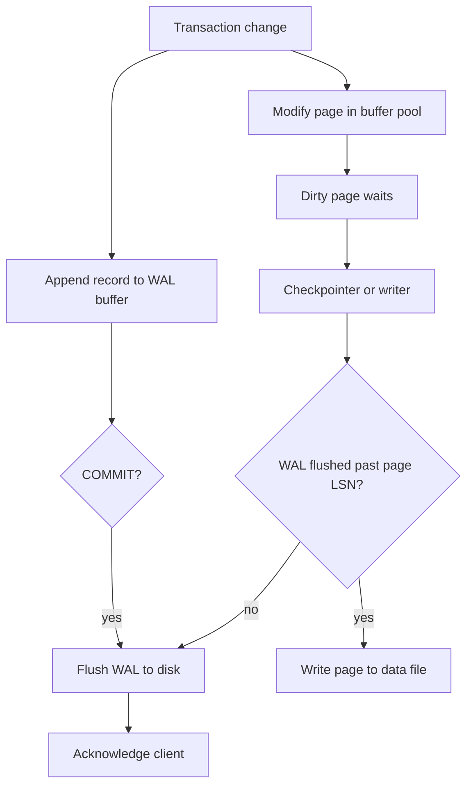
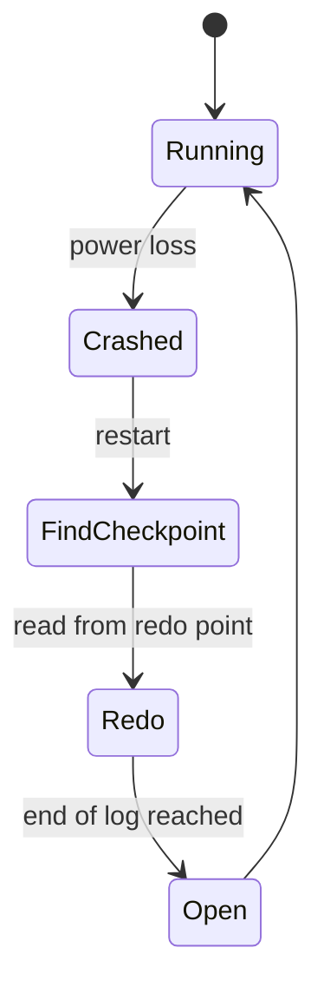

# Write-Ahead Logging and Crash Recovery

> The database records every change in an append-only log before changing data files, so after a crash it can replay the log to restore exactly the committed state.

## Learning objectives

- State the write-ahead rule and why it makes commits fast and safe.
- Explain log sequence numbers, checkpoints, and redo.
- Contrast steal and no-steal, force and no-force buffer policies.
- Describe what happens during crash recovery step by step.
- Explain torn pages and full-page writes.

## Prerequisites

- [Storage Engine and Pages](./04-storage-engine-and-pages.md)
- [Transactions and Concurrency](./07-transactions-and-concurrency.md)
- [Glossary](./02-glossary.md)

## 1. Intuition

A carpenter rebuilding a staircase keeps a notebook. Before pulling any plank, he writes "removing plank 3, replacing with plank 3b". If he is interrupted at any moment, anyone can read the notebook and finish the job or reverse it. The notebook is small and written in order, so adding a line is quick. The staircase itself is slow to change.

The **write-ahead log (WAL)** is that notebook. The data files are the staircase. The rule is: the note comes first.

## 2. How it works

### The core problem

Memory is fast but forgets on power loss. Data files are durable but writing the right pages in the right order for every commit is slow random I/O, and a crash in the middle of many page writes leaves a half-updated database. We want fast commits and crash safety together.

### Steps for a write

1. A transaction modifies a page in the buffer pool. The page is now dirty.
2. Before or while modifying it, the system appends a **log record** describing the change to the log buffer in memory. Each record gets a **log sequence number (LSN)**, increasing with log position.
3. The modified page stores the LSN of the last record that changed it (`pageLSN`).
4. On **COMMIT**, a commit record is appended and the log is flushed to disk (using `fsync` or an equivalent) up to that LSN. Only after the flush returns does the database tell the client the commit succeeded. This provides durability.
5. The dirty data page is **not** forced to disk at commit (a **no-force** policy). It will be written later by the background writer or checkpointer.
6. Before any dirty page is written, the log must be flushed at least up to that page's `pageLSN`. This is the **write-ahead rule**. Without it, a page could reach disk with changes whose log records were lost, and recovery could not explain or undo them.

### Why this is fast

The log is written sequentially. Sequential appends are much faster than scattered page writes, particularly on spinning disks. Also, many concurrent commits can share a single flush, called **group commit**, so throughput rises as concurrency rises.

### Steps for crash recovery

1. On startup, the server finds the **last checkpoint record** in the log. That record names the **redo point**, the LSN from which replay must begin, because all earlier changes are known to be on disk.
2. It reads log records forward from the redo point.
3. For each record, it checks the target page. If the page's `pageLSN` is lower than the record's LSN, the change is missing, so it is reapplied (**redo**). If the page is already at or beyond that LSN, the record is skipped. This makes replay **idempotent**: running it twice gives the same result.
4. At the end of the log, the database is in the same physical state as at the crash moment.
5. Transactions with no commit record are treated as aborted. In PostgreSQL, no physical undo is needed, because their row versions are simply invisible under MVCC. In ARIES-style designs that update in place (like InnoDB's approach with undo logs), an **undo** phase rolls them back.
6. The database opens for connections.

## 3. Architecture / data flow



- **Modify page** and **Append record** happen together for every change.
- **COMMIT? decision**: only commits force a flush; ordinary changes just fill the WAL buffer.
- **Acknowledge client**: durability point.
- **Dirty page waits**: the page stays in memory.
- **WAL flushed past page LSN?**: the write-ahead rule check before any page is written.

Recovery states:



## 4. Internals deep dive

### Buffer policies

| Policy | Meaning | Consequence |
| --- | --- | --- |
| Steal | Uncommitted dirty pages may be written to disk | Needs undo ability after a crash |
| No-steal | Uncommitted pages stay in memory | Memory limits transaction size |
| Force | All changed pages written at commit | Slow commits |
| No-force | Pages may be written after commit | Needs redo from the log |

Most production engines use **steal and no-force**, the combination that requires both redo and undo (or MVCC to make undo unnecessary), because it gives the best performance.

### Log record contents

A typical record includes: LSN, transaction ID, record type, target file and page, and the change data (or a physical diff). PostgreSQL's WAL is mainly physical-to-a-page, logical within a page. Log files are divided into segments, 16 MB by default in PostgreSQL, and old segments are recycled or archived after checkpoints.

### Checkpoints

A **checkpoint** forces all dirty pages that existed at that moment to disk and records a redo point. After it, earlier log is no longer needed for crash recovery. In PostgreSQL, `checkpoint_timeout` defaults to 5 minutes, and `max_wal_size` (default 1 GB) can also trigger one. The checkpointer spreads its writes across the interval (`checkpoint_completion_target`) to avoid I/O spikes.

| Setting | Effect of larger value |
| --- | --- |
| `checkpoint_timeout` | Fewer checkpoints, less write overhead, longer crash recovery |
| `max_wal_size` | Allows more log between checkpoints |
| `wal_buffers` | Bigger in-memory log staging area |

### Torn pages and full-page writes

Operating systems and disks may write pages in smaller units (for example, 4 KB sectors for an 8 KB page). A crash can leave a **torn page**: half old, half new, which cannot be repaired by replaying a small delta. PostgreSQL defends with **full-page writes**: the first time a page changes after a checkpoint, the entire page image goes into the log. This increases log volume right after each checkpoint. Other engines use a doublewrite buffer (InnoDB) for the same problem.

### fsync and durability knobs

`fsync` asks the operating system to push buffered data to stable storage. If disabled, a crash can corrupt the database. PostgreSQL's `synchronous_commit` (default `on`) controls whether commit waits for the flush; setting `off` can lose the last few transactions on a crash but does not corrupt the database. Hardware matters: disks with volatile write caches that lie about flushing break the guarantee.

### SQLite journaling

SQLite offers two models. In rollback-journal mode it copies original pages into a journal before changing the database, so a crash can be undone. In WAL mode, changes are appended to a `-wal` file and readers see a consistent view while a writer appends. Periodic checkpoints copy the WAL contents back into the main database file.

### Replication from the log

Because the log describes every change in order, a standby server can replay it continuously, giving physical replication. This reuses the recovery code path, which is why a replica is effectively a database in permanent recovery.

### Complexity

Log append: O(1). Recovery time is proportional to the amount of log since the last checkpoint, not to database size.

## 5. Worked example

PostgreSQL: observe the log position advance.

```sql
CREATE TABLE ev(id serial, msg text);
SELECT pg_current_wal_lsn() AS before \gset
INSERT INTO ev(msg) SELECT 'row' || g FROM generate_series(1, 1000) g;
SELECT pg_size_pretty(pg_wal_lsn_diff(pg_current_wal_lsn(), :'before')) AS wal_written;
```

Illustrative output (varies by version and data):

```text
 wal_written
-------------
 98 kB
```

That is the amount of log generated by the insert, before most of the data pages were written to the data file.

Force a checkpoint and watch it:

```sql
CHECKPOINT;
```

```text
CHECKPOINT
```

SQLite WAL mode:

```bash
sqlite3 demo.db "PRAGMA journal_mode=WAL; CREATE TABLE t(x); INSERT INTO t VALUES (1);"
ls demo.db*
```

```text
wal
demo.db
```

Note that the first line of output is the pragma's result. While a connection remains open, `ls` may also list `demo.db-wal` and `demo.db-shm`; they may be removed when the last connection closes cleanly.

## 6. Tradeoffs and limitations

- **Write amplification**: data is written twice, once to the log and once to the data file, plus full-page images.
- **Commit latency** is bounded by the log device's flush time; a slow disk slows every commit.
- **Log volume** can fill a disk if replication slots or archiving fall behind.
- **Recovery time** grows with checkpoint spacing.
- **Relaxed durability** is faster but risks losing acknowledged commits.

## 7. Common misconceptions and pitfalls

- "Commit writes the table to disk." It writes the log; tables are written later.
- "Turning off fsync is a harmless speedup." It can corrupt the entire database after a crash.
- "WAL is a backup." It supports crash recovery and, with base backups, point-in-time recovery, but by itself is not a backup.
- "Recovery takes time proportional to database size." It scales with log since the last checkpoint.
- "Replica lag is a network issue only." Slow replay on the replica is a common cause.

## 8. Recap

- Write-ahead rule: log before data page; flush log at commit.
- Steal and no-force gives speed, and relies on log-based redo and undo or MVCC.
- LSNs make replay idempotent by comparing record LSN to page LSN.
- Checkpoints bound recovery time and allow log recycling.
- Full-page writes or doublewrite protect against torn pages.

## 9. Self-check questions

1. What exactly is flushed to disk at commit?
2. Why must the log be flushed before a dirty page is written?
3. How does the page LSN make redo idempotent?
4. What tradeoff does a longer `checkpoint_timeout` create?
5. Why does PostgreSQL not need a physical undo phase?

## Next

Continue to [Security](./09-security.md).
