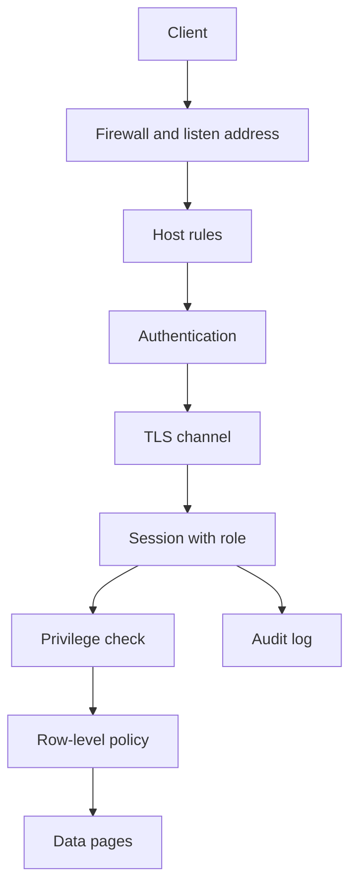

# Database Security: Threats, Defaults, and Hardening

> Securing a database means controlling who can connect, what they can do, how data travels and rests, and how mistakes are detected.

## Learning objectives

- Identify the main threats against a database server.
- Explain authentication versus authorization and how roles and privileges work.
- Show how SQL injection works and how parameterized queries stop it.
- Describe encryption in transit and at rest, and what each protects against.
- Apply a hardening checklist.

## Prerequisites

- [Architecture](./03-architecture.md)
- [Query Processing](./06-query-processing-and-optimizer.md)
- [Glossary](./02-glossary.md)

## 1. Intuition

A database is a vault. Security has several layers: the **walls** (network access), the **front door** (authentication), the **keycards** (authorization for each room), the **armored cases** (encryption), and the **cameras** (auditing). A thief who gets past one layer should face another. A common failure is a vault with a strong door but every employee holding a master key, which in database terms is an application connecting as the superuser.

## 2. How it works

A connection attempt passes through these checks in order:

1. **Network reachability.** The server listens on certain interfaces and ports. PostgreSQL's default `listen_addresses` is `localhost`, so it is not exposed externally until configured. Firewalls add a second barrier.
2. **Host-based rules.** In PostgreSQL, `pg_hba.conf` lists, top to bottom, which user may connect to which database from which address and by which authentication method. The first matching line wins. If none match, access is refused.
3. **Authentication.** The client proves identity: password (stored as a salted hash; the default method since PostgreSQL 14 is `scram-sha-256`), client certificate, or an external system such as LDAP or Kerberos.
4. **Session setup.** Optionally upgrade to TLS so that credentials and data are encrypted on the wire.
5. **Authorization on every statement.** The analyzer checks privileges: does this role have `SELECT` on this table or column? Privileges are checked at analysis time and execution time, not just at login.
6. **Row-level policies.** If enabled, the database adds extra filter conditions so a role sees only certain rows.
7. **Auditing.** Logs record connections, failures, and optionally statements.

Why check each statement and not just login? Because a stolen or over-permissive account would otherwise grant unrestricted access once connected.

## 3. Architecture / data flow



- **Firewall and listen address**: first filter; blocks unwanted networks.
- **Host rules**: per-user and per-address policy.
- **Authentication**: verifies identity.
- **TLS channel**: protects traffic from eavesdropping.
- **Session with role**: the identity used for later checks.
- **Privilege check** and **Row-level policy**: authorization at table, column, and row granularity.
- **Audit log**: records activity for detection and forensics.

## 4. Internals deep dive

### Threat model

| Threat | How it happens | Primary defense |
| --- | --- | --- |
| SQL injection | Untrusted text becomes part of SQL | Parameterized queries, least privilege |
| Credential theft or weak passwords | Guessing, leaks, default accounts | Strong auth, rotate secrets, no defaults |
| Network eavesdropping | Traffic read on the wire | TLS |
| Exposed database port | Server reachable from the internet | Private networks, firewall |
| Privilege escalation | Over-permissive roles, dangerous extensions | Least privilege, restrict superuser |
| Stolen disk or backup | Files copied | Encryption at rest, encrypted backups |
| Insider misuse | Legitimate user over-reads | Roles, RLS, auditing |
| Denial of service | Connection or query floods | Connection limits, timeouts, pooling |

### SQL injection mechanics

If code builds SQL by concatenation:

```python
query = "SELECT * FROM users WHERE name = '" + user_input + "'"
```

and `user_input` is `' OR '1'='1`, the final text becomes `SELECT * FROM users WHERE name = '' OR '1'='1'`, which is true for every row. The fix is to send the SQL structure and the values separately:

```python
cursor.execute("SELECT * FROM users WHERE name = %s", (user_input,))
```

With parameters, the parser builds the tree before the value is substituted, so the value can never change the statement's structure. This works because parsing and data are separate steps (see [Query Processing](./06-query-processing-and-optimizer.md)). Identifiers such as table names cannot be parameters; validate them against an allow-list.

### Roles and privileges

PostgreSQL uses **roles** for both users and groups. Privileges are granted on objects.

```sql
CREATE ROLE app_reader LOGIN PASSWORD 'change-me';
GRANT CONNECT ON DATABASE shop TO app_reader;
GRANT USAGE ON SCHEMA public TO app_reader;
GRANT SELECT ON orders TO app_reader;
REVOKE ALL ON ALL TABLES IN SCHEMA public FROM PUBLIC;
```

The **superuser** bypasses permission checks and can run server-side file and program operations, so applications should never use it.

### Row-level security

```sql
ALTER TABLE orders ENABLE ROW LEVEL SECURITY;
CREATE POLICY own_orders ON orders
  USING (customer_id = current_setting('app.customer_id')::int);
```

The policy's condition is appended to every query on the table for non-owner roles. Table owners and superusers may bypass it unless forced.

### Encryption

| Layer | Protects against | Typical mechanism |
| --- | --- | --- |
| In transit | Network sniffing, tampering | TLS |
| At rest, disk or volume | Stolen disks | Operating system or cloud volume encryption |
| At rest, column or application level | Database admins and leaked dumps | Application encrypts before storing |
| Backups | Stolen backup files | Encrypt backup archives |

PostgreSQL core does not offer built-in transparent data encryption of data files in standard releases (varies by version and distribution), so volume-level encryption is the usual approach.

### Hashing passwords

Never store plain passwords in your own tables. Use a slow salted hash designed for passwords (such as bcrypt, scrypt, or Argon2) in the application. The reason for slowness is to make offline guessing costly.

### Hardening checklist

| Item | Action |
| --- | --- |
| Network | Bind to private interfaces, firewall the port |
| Authentication | Use scram-sha-256 or certificates, avoid `trust` in `pg_hba.conf` |
| Accounts | Remove sample accounts, rotate passwords, separate app and admin roles |
| Privileges | Grant minimum, revoke default public rights |
| Transport | Require TLS (`hostssl` rules) |
| Updates | Apply security patches for the engine and extensions |
| Resources | Set `statement_timeout`, connection limits |
| Auditing | Log connections and failed logins; consider an audit extension |
| Backups | Encrypt, test restores, restrict access |

## 5. Worked example

Demonstrate least privilege in PostgreSQL.

```sql
CREATE DATABASE shop;
\c shop
CREATE TABLE orders(id serial, customer_id int, amount numeric);
INSERT INTO orders(customer_id, amount) VALUES (1, 10), (2, 20);
CREATE ROLE reporter LOGIN PASSWORD 'r3port';
GRANT CONNECT ON DATABASE shop TO reporter;
GRANT USAGE ON SCHEMA public TO reporter;
GRANT SELECT ON orders TO reporter;
```

Connect as `reporter` and try operations:

```sql
SELECT count(*) FROM orders;
DELETE FROM orders;
```

```text
 count
-------
     2

ERROR:  permission denied for table orders
```

The read succeeded, the delete failed. Even if an attacker injects SQL through this application's connection, the damage is limited to what `reporter` may do.

## 6. Tradeoffs and limitations

- **TLS** adds small CPU overhead and certificate management work.
- **Row-level security** can complicate query plans and testing.
- **Encryption at rest** does not protect data from a compromised running database, since the server holds the keys.
- **Fine-grained roles** raise administration effort.
- **Auditing every statement** adds log volume and some overhead.

## 7. Common misconceptions and pitfalls

- "Escaping quotes is enough against injection." Use parameters; manual escaping fails in subtle cases.
- "The database is inside our network, so it is safe." Internal compromises and misconfigured networks happen.
- "`trust` authentication is fine for development." It tends to leak into production.
- "Encryption at rest protects against SQL injection." It does not.
- "Backups are not part of the attack surface." Unencrypted dumps are a common leak source.

## 8. Recap

- Defense in depth: network, host rules, authentication, authorization, encryption, auditing.
- Parameterized queries stop injection by separating structure from values.
- Use least-privilege roles, never the superuser, for applications.
- TLS protects the wire; disk encryption protects stolen media; neither stops a legitimate but over-privileged user.
- Patch, rotate secrets, and test restores of encrypted backups.

## 9. Self-check questions

1. Why does a parameterized query prevent injection?
2. What does the first matching line in `pg_hba.conf` decide?
3. Which threat does TLS address, and which does it not?
4. Why should an application not connect as a superuser?
5. What does row-level security add to each query?

## Next

Continue to [Performance and Tuning](./10-performance-and-tuning.md).
