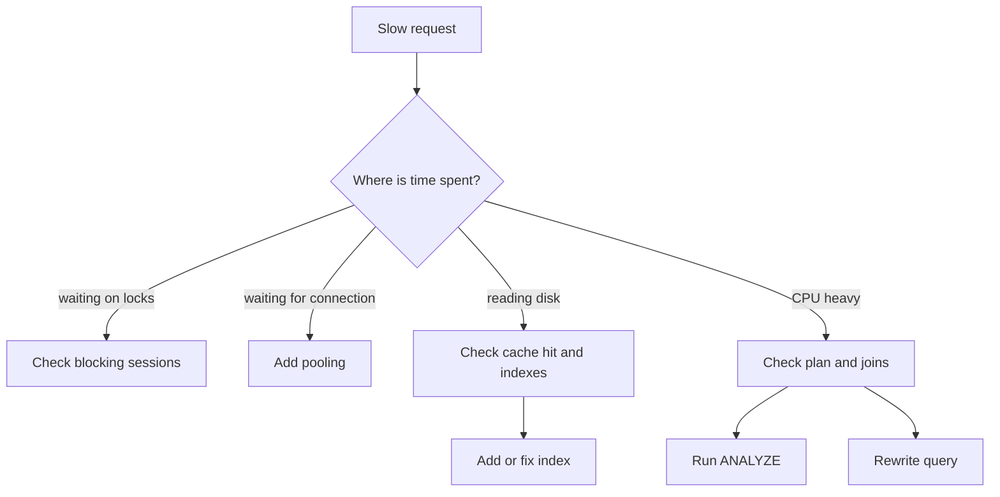

# Performance and Tuning

> Database performance work is a loop of measuring, finding the bottleneck (usually I/O, locks, or bad plans), changing one thing, and measuring again.

## Learning objectives

- Identify whether a workload is bound by CPU, memory, I/O, locks, or connections.
- Read key metrics such as cache hit ratio and slow query statistics.
- Tune the main memory and planner settings and explain their effect.
- Apply schema, index, and query changes in the right order.
- Understand the cost of maintenance such as vacuum and bloat.

## Prerequisites

- [Storage Engine and Pages](./04-storage-engine-and-pages.md)
- [Indexes](./05-indexes-btree-and-lsm.md)
- [Query Processing](./06-query-processing-and-optimizer.md)
- [WAL and Recovery](./08-wal-and-crash-recovery.md)

## 1. Intuition

A kitchen is slow. Is it because there are too few cooks, the pantry is too far away, two cooks fight over one pan, or the recipe is wasteful? Hiring more cooks will not help if everyone is queuing for one oven. Good tuning begins with finding the queue.

Databases are the same. The slowest resource sets the speed, and fixing a non-bottleneck changes nothing.

## 2. How it works

A repeatable tuning process:

1. **Define the goal** in numbers, such as "95 percent of checkout queries under 50 ms".
2. **Measure.** Collect slow query logs, statement statistics, wait events, and system metrics (CPU, disk latency, memory).
3. **Find the top consumer.** Often a few queries account for most time. Fix the largest first, since work on small ones cannot yield big gains.
4. **Check the plan** with `EXPLAIN (ANALYZE, BUFFERS)`. Look for sequential scans of large tables, row estimate errors, sorts or hashes spilling to disk, and many buffer reads.
5. **Apply the cheapest effective change**, in this order: fix the query, add or fix an index, refresh statistics, change schema, then change server settings, then add hardware or scale out.
6. **Re-measure** and keep the change only if it helped.
7. **Prevent regressions** with monitoring and alerts.

Why this order? Query and index changes are local and reversible, and can give 10x to 1000x gains, while server settings usually give tens of percent.

## 3. Architecture / data flow



- **Where is time spent?**: the central question; each branch is a different bottleneck class.
- **Locks branch**: concurrency issues; see [Transactions](./07-transactions-and-concurrency.md).
- **Pool branch**: too many connections or too few available.
- **Disk branch**: cache misses or missing indexes.
- **CPU branch**: heavy computation, poor joins, or bad estimates.

## 4. Internals deep dive

### Bottleneck types

| Bottleneck | Symptoms | Typical cause | Typical fix |
| --- | --- | --- | --- |
| Disk reads | High read latency, low cache hit ratio | Missing index, working set larger than memory | Index, more memory, query fix |
| Disk writes | Slow commits, checkpoint spikes | Log device slow, frequent checkpoints | Faster log device, tune checkpoints, batch commits |
| CPU | High CPU, fast disks | Complex queries, many connections, lack of indexes | Query tuning, pooling |
| Locks | Many sessions waiting, low CPU | Long transactions, hot rows | Shorter transactions, redesign hot spots |
| Connections | Errors or queueing at connect | Too many clients | Connection pooler |
| Memory | Swapping, spills to temp files | Oversized settings or too many sessions | Right-size, avoid swapping |

### Cache hit ratio

A rough health metric is the fraction of page requests served from the buffer pool:

```sql
SELECT sum(blks_hit)::float / nullif(sum(blks_hit) + sum(blks_read), 0) AS hit_ratio
FROM pg_stat_database;
```

For transactional workloads, values well above 0.99 are common, but treat this as a hint and not a goal in itself. Reads counted as misses may still be satisfied by the operating system cache.

### Key PostgreSQL settings

| Setting | Default | What it controls | Guidance |
| --- | --- | --- | --- |
| `shared_buffers` | 128 MB | Database page cache | A common starting point on a dedicated server is about 25 percent of RAM |
| `work_mem` | 4 MB | Memory per sort or hash operation | Applies per operation per session, so total can be large; raise carefully |
| `maintenance_work_mem` | 64 MB | Memory for vacuum and index builds | Raise for big maintenance jobs |
| `effective_cache_size` | 4 GB | Planner's estimate of total cache including OS | Set to a realistic figure; it allocates nothing |
| `random_page_cost` | 4.0 | Planner cost of random page fetch | Often lowered for SSDs |
| `max_connections` | 100 | Allowed sessions | Prefer pooling over a large value |
| `checkpoint_timeout` | 5 min | Time between checkpoints | Larger smooths writes but lengthens recovery |
| `max_wal_size` | 1 GB | Log between checkpoints | Raise for write-heavy loads |

Defaults vary by version and packaging; check your server with `SHOW`.

### Indexing guidance

- Index columns used in `WHERE`, `JOIN`, and `ORDER BY` of frequent queries.
- Put equality columns first in composite indexes, then range columns.
- Use partial indexes (`WHERE active`) when queries target a small subset.
- Drop unused indexes; check `pg_stat_user_indexes` for `idx_scan` counts.
- Remember each index costs on every write.

### Query-level fixes

| Problem | Fix |
| --- | --- |
| `SELECT *` on wide tables | Select only needed columns |
| N+1 queries from application loops | Use a join or batch with `IN` lists |
| Function on indexed column | Rewrite the condition or create an expression index |
| Large `OFFSET` pagination | Keyset pagination: `WHERE id > last_id ORDER BY id LIMIT n` |
| Many tiny commits | Batch rows in one transaction |
| Row-by-row inserts | Multi-row `INSERT` or `COPY` |

### Maintenance and bloat

Dead row versions (see [Transactions](./07-transactions-and-concurrency.md)) take space; scans read them even though they are invisible. Autovacuum cleans them and updates statistics. If autovacuum cannot keep up, or is blocked by long transactions, tables and indexes bloat and queries slow down. `VACUUM FULL` rewrites a table and locks it exclusively, so use it sparingly.

### Scaling beyond tuning

| Approach | Helps | Cost |
| --- | --- | --- |
| Read replicas | Read-heavy loads | Replication lag, application routing |
| Partitioning | Huge tables, time-based data | Planning complexity |
| Caching layer | Repeated identical reads | Staleness, invalidation |
| Sharding | Write scale beyond one machine | Cross-shard queries and transactions are hard |

### Amdahl-style reminder

If a query spends 90 percent of its time on one step, making that step infinitely fast only speeds the query up by 10x overall. Optimize the largest share first.

## 5. Worked example

PostgreSQL: find and fix a slow query.

```sql
CREATE TABLE events(id bigserial PRIMARY KEY, user_id int, kind text, created_at timestamptz);
INSERT INTO events(user_id, kind, created_at)
SELECT (random() * 10000)::int, 'click', now() - (random() * interval '30 days')
FROM generate_series(1, 500000);
ANALYZE events;

EXPLAIN (ANALYZE, BUFFERS) SELECT * FROM events WHERE user_id = 77;
```

Illustrative output:

```text
 Seq Scan on events  (cost=0.00..9500.00 rows=50 width=30) (actual time=0.02..45.00 rows=48 loops=1)
   Filter: (user_id = 77)
   Rows Removed by Filter: 499952
   Buffers: shared hit=3000 read=1500
 Execution Time: 45.2 ms
```

Reading it: almost 500,000 rows were read and thrown away to return 48. Add an index:

```sql
CREATE INDEX idx_events_user ON events(user_id);
EXPLAIN (ANALYZE, BUFFERS) SELECT * FROM events WHERE user_id = 77;
```

```text
 Index Scan using idx_events_user on events  (cost=0.42..60.00 rows=50 width=30) (actual time=0.03..0.10 rows=48 loops=1)
   Index Cond: (user_id = 77)
   Buffers: shared hit=52
 Execution Time: 0.15 ms
```

Page touches fell from about 4,500 to about 52, and time fell by roughly two orders of magnitude. Exact figures differ per machine.

## 6. Tradeoffs and limitations

- **More memory per operation** helps sorts but multiplies across sessions.
- **Fewer checkpoints** reduce write load but lengthen crash recovery.
- **More indexes** speed reads but slow writes and enlarge backups.
- **Denormalization** speeds some reads but risks inconsistency.
- **Synthetic benchmarks** may not reflect your workload; always test with realistic data.

## 7. Common misconceptions and pitfalls

- "Add RAM and set everything huge." `work_mem` is per operation, so large values can exhaust memory.
- "A 99 percent cache hit ratio means all is well." It can hide inefficient but cached queries.
- "Indexes fix every slow query." Poor statistics, large results, and lock waits are not index problems.
- "Tune first, measure later." Without measurement you may optimize something irrelevant.
- "Max connections should be as high as possible." Excess connections degrade throughput; use pooling.

## 8. Recap

- Find the bottleneck before changing anything.
- Prefer query and index fixes to server settings.
- Compare estimated and actual rows, and watch buffer counts in plans.
- Keep statistics fresh and vacuum healthy to avoid bloat and bad plans.
- Know the memory settings and their scope: `shared_buffers` is global, `work_mem` is per operation.

## 9. Self-check questions

1. Why is `work_mem` dangerous to set very high?
2. What does `Rows Removed by Filter` tell you?
3. Why might lowering `random_page_cost` change plans on SSDs?
4. What is keyset pagination and why is it faster than large `OFFSET`?
5. How do long transactions hurt performance?

## Next

Continue to [Failure Modes and Troubleshooting](./11-failure-modes-and-troubleshooting.md).
