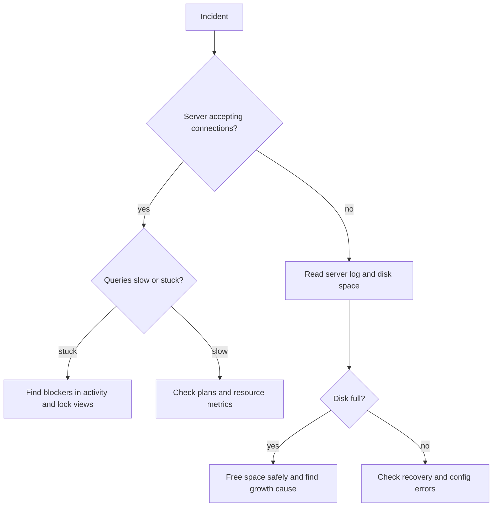

# Failure Modes and Troubleshooting

> Databases fail in recognizable patterns, such as full disks, blocked locks, exhausted connections, runaway log growth, and replication lag, and each pattern has a symptom, a cause, and a diagnostic query.

## Learning objectives

- Recognize the common failure categories and their symptoms.
- Use system views to find blocked sessions, long transactions, and heavy queries.
- Explain how disk-full, log growth, and transaction ID wraparound arise.
- Describe what happens to data in a crash and how to verify recovery.
- Follow a structured incident checklist.

## Prerequisites

- [Architecture](./03-architecture.md)
- [Transactions and Concurrency](./07-transactions-and-concurrency.md)
- [WAL and Recovery](./08-wal-and-crash-recovery.md)
- [Performance and Tuning](./10-performance-and-tuning.md)

## 1. Intuition

When a car dashboard shows a warning light, a mechanic does not guess; they read the diagnostic code, which maps to a known cause. Database failures have codes too: error messages, wait events, and statistics views. A good operator learns the common codes, the usual causes behind them, and the safest first action.

The most important principle: **stop making it worse**. Killing the wrong process, deleting log files to free space, or disabling `fsync` can turn an outage into data loss.

## 2. How it works

A structured approach for any incident:

1. **Stabilize.** Is the database up? Can clients connect? Is the disk full? Check the basics first because many problems are simply resource exhaustion.
2. **Read the logs.** The server log holds the real error text, with timestamps. Find the first error, not the loudest.
3. **Identify the class**: availability (down), performance (slow), correctness (wrong data), or capacity (full).
4. **Query the activity views** to see what sessions are doing right now.
5. **Form a hypothesis** and test it with a read-only check.
6. **Apply the least destructive fix**, such as canceling a single query before terminating a session, and terminating a session before restarting the server.
7. **Verify** with metrics and application behavior.
8. **Write down** the cause and prevention step.

Why prefer cancel over terminate over restart? Each step affects more work. A restart drops every connection, empties the buffer cache, and triggers crash-style recovery if the shutdown was not clean.

## 3. Architecture / data flow



- **Server accepting connections?**: the first split between availability and performance.
- **Read server log and disk space**: the two most common reasons for a down server.
- **Find blockers**: use lock and activity views.
- **Free space safely**: remove unneeded files only after identifying them; never delete live WAL files by hand.

## 4. Internals deep dive

### Failure catalog

| Symptom | Likely cause | Why it happens | Diagnose | Fix |
| --- | --- | --- | --- | --- |
| Queries hang | Lock wait | A transaction holds a row or table lock and has not finished | `pg_stat_activity`, `pg_blocking_pids()` | Finish or terminate the blocker; shorten transactions |
| `too many clients` error | Connection exhaustion | Sessions reached `max_connections` | Count rows in `pg_stat_activity` | Pooler, close leaked connections |
| Deadlock detected error | Cyclic lock waits | Two transactions lock rows in opposite order | Server log shows the processes | Consistent lock ordering, retry |
| Disk full, server stops | Data, temp files, or WAL growth | No space to append the log or extend files | `df`, size of data directory | Free space, then find growth source |
| WAL keeps growing | Stuck replication slot or failing archive | Log is kept until every consumer has read it | `pg_replication_slots`, archive logs | Fix or drop the slot, repair archiving |
| Tables bloat | Vacuum blocked | Old snapshots keep dead rows visible | Oldest transaction age, `pg_stat_user_tables` | End long transactions, tune autovacuum |
| Plan suddenly bad | Stale statistics or data skew | Estimates no longer match data | `EXPLAIN ANALYZE` row mismatch | `ANALYZE`, extended statistics |
| Replica falling behind | Slow replay or network | Standby cannot apply log as fast as it arrives | Replication lag views | Faster standby disk, reduce conflicting queries |
| Server in recovery after crash | Unclean shutdown | Replaying log since last checkpoint | Server log messages about redo | Wait; do not kill the process |
| Corruption errors | Hardware failure, disabled fsync, bugs | Pages differ from what the log says | Checksums, error messages | Restore from backup, replace hardware |
| Refusing writes near wraparound | Transaction ID exhaustion | 32-bit IDs need periodic freezing | Age of oldest transaction ID | Run vacuum to freeze |

### Useful diagnostic queries (PostgreSQL)

Long-running sessions:

```sql
SELECT pid, state, now() - xact_start AS xact_age, left(query, 60) AS query
FROM pg_stat_activity
WHERE xact_start IS NOT NULL
ORDER BY xact_start;
```

Who blocks whom:

```sql
SELECT pid, pg_blocking_pids(pid) AS blocked_by, wait_event_type, left(query, 60) AS query
FROM pg_stat_activity
WHERE cardinality(pg_blocking_pids(pid)) > 0;
```

Cancel and terminate:

```sql
SELECT pg_cancel_backend(12345);     -- cancels the current query
SELECT pg_terminate_backend(12345);  -- closes the whole session
```

Replication slots holding the log:

```sql
SELECT slot_name, active, pg_size_pretty(pg_wal_lsn_diff(pg_current_wal_lsn(), restart_lsn)) AS retained
FROM pg_replication_slots;
```

Dead-row estimate:

```sql
SELECT relname, n_live_tup, n_dead_tup FROM pg_stat_user_tables ORDER BY n_dead_tup DESC LIMIT 5;
```

### Crash behavior

A crash does not normally lose committed data. After restart, the server replays the log from the last checkpoint (see [WAL and Recovery](./08-wal-and-crash-recovery.md)) and opens. Uncommitted transactions disappear. Risk arises when the durability chain is broken: `fsync` off, disks that acknowledge writes they have not made durable, or deleted log files.

### Transaction ID wraparound

PostgreSQL uses 32-bit transaction IDs compared in a circular manner, so about 2 billion IDs are "in the past" and about 2 billion "in the future". If old rows are not frozen by vacuum, they could appear to be in the future and vanish from view. To prevent that, the server warns and, as a last resort, stops accepting new write transactions until vacuum catches up. Prevention is healthy autovacuum and no abandoned long transactions or stale replication slots.

### Backups and recovery

| Method | What it gives | Limit |
| --- | --- | --- |
| Logical dump (`pg_dump`) | Portable SQL or archive of data | Slow for huge databases; restores to dump time only |
| Physical base backup plus archived WAL | Point-in-time recovery to any moment | Needs archive discipline |
| Replica | Fast failover | Replicates mistakes such as `DROP TABLE` too |
| Snapshot of storage | Fast copy | Must be crash-consistent or coordinated |

A backup that has never been restored is only a hope. Practice restores on a schedule.

## 5. Worked example

Reproduce and resolve a blocked query with two PostgreSQL sessions.

Session 1:

```sql
CREATE TABLE jobs(id int PRIMARY KEY, status text);
INSERT INTO jobs VALUES (1, 'new');
BEGIN;
UPDATE jobs SET status = 'running' WHERE id = 1;
-- leave the transaction open
```

Session 2:

```sql
UPDATE jobs SET status = 'done' WHERE id = 1;
-- hangs, waiting
```

Session 3 (diagnosis):

```sql
SELECT pid, pg_blocking_pids(pid) AS blocked_by, state, wait_event_type, left(query, 40) AS query
FROM pg_stat_activity
WHERE cardinality(pg_blocking_pids(pid)) > 0;
```

```text
  pid  | blocked_by | state  | wait_event_type |                  query
-------+------------+--------+-----------------+------------------------------------------
 20311 | {20290}    | active | Lock            | UPDATE jobs SET status = 'done' WHERE id
```

Session 20290 is the blocker: an open transaction that did one update and went idle. Resolution options in order of preference: ask the owner to commit or roll back; if impossible, run `SELECT pg_terminate_backend(20290);`. The blocker's transaction rolls back, and session 2 proceeds. PIDs here are illustrative.

Prevention: keep transactions short, set `idle_in_transaction_session_timeout`, and never leave an interactive session open after `BEGIN`.

## 6. Tradeoffs and limitations

- **Aggressive timeouts** prevent pileups but may kill legitimate long jobs.
- **Keeping WAL for replicas and archives** protects them but risks disk exhaustion if they stall.
- **Automatic failover** reduces downtime but can cause split-brain if poorly configured.
- **Diagnostics views** show current state; for history you need a monitoring system.

## 7. Common misconceptions and pitfalls

- "Deleting old WAL files frees space safely." Doing so by hand can make recovery or replication impossible; fix the cause (slots, archiving) and let the server remove them.
- "Restarting fixes it." It may clear symptoms but destroys the evidence and the cache, and the problem returns.
- "Killing the client kills the query." The server may continue running the query until it notices the disconnect.
- "A replica is a backup." It also copies accidental deletes.
- "Disk usage equals table size." Indexes, temp files, WAL, and bloat all count.

## 8. Recap

- Triage from the basics: up or down, disk space, then logs.
- Use activity and lock views to find blockers; prefer cancel to terminate to restart.
- WAL growth usually means a stuck slot or broken archiving.
- Wraparound and bloat are vacuum problems, often caused by long transactions.
- Test your restores; replicas are not backups.

## 9. Self-check questions

1. Why prefer `pg_cancel_backend` before `pg_terminate_backend`?
2. How can a replication slot fill a disk?
3. Why does the server enter recovery after a crash and what does it do?
4. What does a long idle-in-transaction session break?
5. Why is a replica not a substitute for backups?

## Next

Continue to [Hands-on Labs](./12-hands-on-labs.md).
