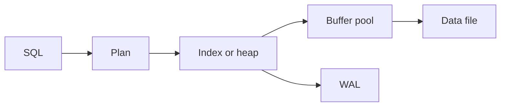

# Database Internals Cheat Sheet

> A one-page reference of key mechanisms, numbers, commands, and diagnostics from this guide.

## Learning objectives

- Recall each layer of the database and its job at a glance.
- Find the right inspection command for pages, plans, locks, and logs.
- Remember key defaults and the settings that matter most.
- Use a quick decision table for common symptoms.

## Prerequisites

- Study the earlier files first; this is a summary, not a tutorial. Start at the [Overview](./01-overview.md) and use the [Glossary](./02-glossary.md) for terms.

## 1. Intuition

A cheat sheet is the laminated card taped beside the cockpit controls: it does not teach flying, but it prevents forgetting the checklist. Use it after learning the mechanisms, when you need the exact command or number quickly.

## 2. How it works

How to use this sheet in practice:

1. Identify the **layer** of your problem (storage, index, query, transaction, log, security).
2. Find that layer's row in the mechanism table.
3. Use the matching command from the command tables to inspect it.
4. Follow the link to the full explanation if the answer is unclear.
5. Always verify defaults for your version with `SHOW setting_name;` because they vary by version.

## 3. Architecture / data flow



Left to right is the request path. Each box has an inspection command in the tables below.

## 4. Internals deep dive

### Mechanism summary

| Layer | Core idea | Key number or rule | Details |
| --- | --- | --- | --- |
| Pages | Fixed-size I/O unit | PostgreSQL 8 KB, InnoDB 16 KB, SQLite 4096 by default | [Storage](./04-storage-engine-and-pages.md) |
| Row address | Page number plus slot | `ctid` in PostgreSQL | [Storage](./04-storage-engine-and-pages.md) |
| B+tree | Wide balanced tree | Search O(log N), 3 to 4 levels for huge tables | [Indexes](./05-indexes-btree-and-lsm.md) |
| LSM | Memtable plus sorted files | Fast writes, compaction cost | [Indexes](./05-indexes-btree-and-lsm.md) |
| Optimizer | Cost-based choice | Relies on statistics | [Query Processing](./06-query-processing-and-optimizer.md) |
| Joins | Nested loop, hash, merge | Hash needs memory | [Query Processing](./06-query-processing-and-optimizer.md) |
| MVCC | Row versions and snapshots | `xmin`, `xmax` | [Transactions](./07-transactions-and-concurrency.md) |
| Isolation | Level sets allowed anomalies | PostgreSQL default read committed | [Transactions](./07-transactions-and-concurrency.md) |
| WAL | Log before data | Flush at commit | [WAL](./08-wal-and-crash-recovery.md) |
| Checkpoint | Bound recovery | PostgreSQL every 5 min by default | [WAL](./08-wal-and-crash-recovery.md) |

### PostgreSQL defaults to remember (verify with SHOW)

| Setting | Default |
| --- | --- |
| `shared_buffers` | 128 MB |
| `work_mem` | 4 MB |
| `maintenance_work_mem` | 64 MB |
| `max_connections` | 100 |
| `random_page_cost` | 4.0 |
| `seq_page_cost` | 1.0 |
| `checkpoint_timeout` | 5 min |
| `max_wal_size` | 1 GB |
| `deadlock_timeout` | 1 s |
| `geqo_threshold` | 12 |
| WAL segment size | 16 MB |
| Default isolation | read committed |

### Inspection commands: PostgreSQL

| Goal | Command |
| --- | --- |
| Show a setting | `SHOW work_mem;` |
| Row physical address | `SELECT ctid, * FROM t;` |
| Row version info | `SELECT xmin, xmax, * FROM t;` |
| Table size | `SELECT pg_size_pretty(pg_relation_size('t'));` |
| Total size with indexes | `SELECT pg_size_pretty(pg_total_relation_size('t'));` |
| Plan only | `EXPLAIN SELECT ...;` |
| Plan with real run | `EXPLAIN (ANALYZE, BUFFERS) SELECT ...;` |
| Refresh statistics | `ANALYZE t;` |
| Clean dead rows | `VACUUM (VERBOSE) t;` |
| Column statistics | `SELECT * FROM pg_stats WHERE tablename = 't';` |
| Active sessions | `SELECT * FROM pg_stat_activity;` |
| Blockers | `SELECT pid, pg_blocking_pids(pid) FROM pg_stat_activity;` |
| Cancel a query | `SELECT pg_cancel_backend(pid);` |
| Terminate a session | `SELECT pg_terminate_backend(pid);` |
| Log position | `SELECT pg_current_wal_lsn();` |
| Force checkpoint | `CHECKPOINT;` |
| Index usage | `SELECT * FROM pg_stat_user_indexes;` |
| Dead rows | `SELECT relname, n_dead_tup FROM pg_stat_user_tables;` |

### Inspection commands: SQLite

| Goal | Command |
| --- | --- |
| Page size and count | `PRAGMA page_size;` and `PRAGMA page_count;` |
| Journal mode | `PRAGMA journal_mode;` |
| Switch to WAL | `PRAGMA journal_mode=WAL;` |
| Checkpoint WAL | `PRAGMA wal_checkpoint(TRUNCATE);` |
| Query plan | `EXPLAIN QUERY PLAN SELECT ...;` |
| List schema | `.schema` |
| Integrity check | `PRAGMA integrity_check;` |
| Timing | `.timer on` |

### Transaction syntax

```sql
BEGIN ISOLATION LEVEL REPEATABLE READ;
SAVEPOINT s1;
ROLLBACK TO s1;
COMMIT;
SELECT * FROM t WHERE id = 1 FOR UPDATE;
```

### Index syntax

```sql
CREATE INDEX idx ON t(a, b);
CREATE UNIQUE INDEX uq ON t(email);
CREATE INDEX idx_active ON t(created_at) WHERE active;
CREATE INDEX idx_lower ON t(lower(email));
```

### Symptom to first action

| Symptom | First action |
| --- | --- |
| Query slow | `EXPLAIN (ANALYZE, BUFFERS)` and compare estimated and actual rows |
| Query stuck | Check blockers with `pg_blocking_pids` |
| Too many clients | Count sessions, add pooler |
| Disk filling | Check WAL, replication slots, temp files |
| Table growing without more data | Check dead rows and long transactions |
| Plan changed suddenly | `ANALYZE`, check data skew |
| Write failing near wraparound | Run vacuum, find old transactions |

### Isolation anomaly table

| Level | Dirty | Non-repeatable | Phantom | Write skew |
| --- | --- | --- | --- | --- |
| Read committed | No | Yes | Yes | Yes |
| Repeatable read (PostgreSQL) | No | No | No | Yes |
| Serializable | No | No | No | No |

### Hardening quick list

- Bind to private interfaces and firewall the port.
- Use `scram-sha-256` or certificates, avoid `trust`.
- Require TLS.
- Separate admin and application roles; grant minimum privileges.
- Use parameterized queries.
- Encrypt and test backups.

## 5. Worked example

Scenario: "Orders page takes 4 seconds."

1. Run `EXPLAIN (ANALYZE, BUFFERS)` on the query.
2. Output shows `Seq Scan on orders ... Rows Removed by Filter: 2,000,000` and `rows=1` estimated versus 40,000 actual.
3. Row estimate is wrong, so run `ANALYZE orders;`.
4. Re-run; plan still scans, so create `CREATE INDEX ON orders(customer_id);`.
5. Re-run; plan now uses the index and finishes in milliseconds.

The cheat sheet path: slow query, then plan, then statistics, then index, then verify.

## 6. Tradeoffs and limitations

- A cheat sheet omits nuance; always read the full file before changing production settings.
- Defaults and views differ between versions and between products (MySQL, Oracle, SQL Server have different names).
- Commands shown are for PostgreSQL and SQLite specifically.

## 7. Common misconceptions and pitfalls

- Copying settings from a blog without understanding the workload.
- Assuming PostgreSQL commands work unchanged in other databases.
- Using `pg_terminate_backend` before trying cancel.
- Forgetting `EXPLAIN ANALYZE` executes the statement.
- Treating defaults as tuned for your hardware; many are conservative.

## 8. Recap

- Pages are the unit of I/O; the buffer pool caches them; the WAL protects them.
- Indexes and statistics drive plan quality.
- MVCC means versions, snapshots, and vacuum.
- Use activity and lock views for incidents.
- Check defaults with `SHOW` on your own version.

## 9. Self-check questions

1. Which command shows both estimated and actual rows?
2. Which default controls per-operation sort memory?
3. Which isolation level still allows write skew in PostgreSQL besides read committed?
4. Which view reveals blockers?
5. Which SQLite pragma reveals the page size?

## Next

Continue to [Exercises and Quiz](./14-exercises-and-quiz.md).
