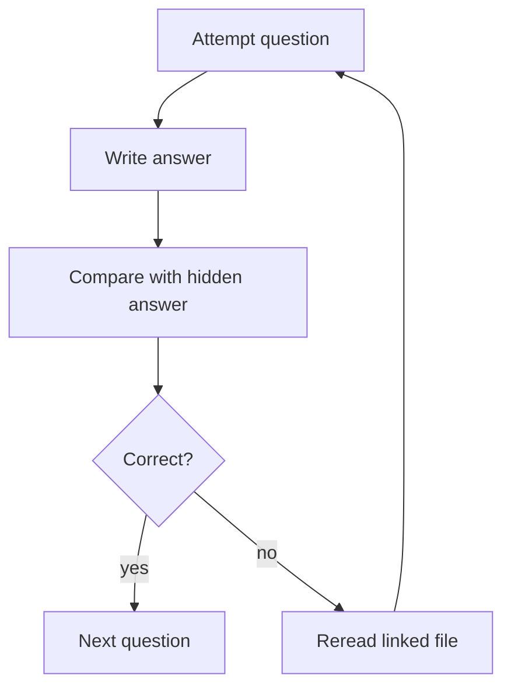

# Exercises and Quiz

> Test your understanding of database internals with short-answer questions, scenario problems, and calculations, each with a hidden answer to check yourself.

## Learning objectives

- Check recall of core mechanisms across all files.
- Apply concepts to realistic scenarios.
- Practice simple calculations such as tree height and log recovery reasoning.
- Identify weak areas to revisit.

## Prerequisites

- All earlier files, especially [Storage](./04-storage-engine-and-pages.md), [Indexes](./05-indexes-btree-and-lsm.md), [Query Processing](./06-query-processing-and-optimizer.md), [Transactions](./07-transactions-and-concurrency.md), and [WAL](./08-wal-and-crash-recovery.md).
- Use the [Glossary](./02-glossary.md) for unfamiliar terms.

## 1. Intuition

Reading feels like understanding, but only retrieval proves it. Trying to answer before peeking forces your brain to rebuild the mechanism, which is why testing yourself works better than rereading. Cover the answer, write your own, then compare.

## 2. How it works

Suggested method:

1. Attempt each question without looking at notes.
2. Write your answer in one to three sentences, explaining the **why**.
3. Open the answer and compare. Mark mismatches.
4. For each miss, reread the linked section.
5. Retry missed questions after a day.

Scoring guide: 80 percent or more correct means you can proceed to a real project; lower means revisit the topic groups where you missed.

## 3. Architecture / data flow

The loop shows the study cycle: attempt, compare, and reread only what you missed.

| Section | Topic | Questions |
| --- | --- | --- |
| A | Storage and pages | 1 to 4 |
| B | Indexes | 5 to 8 |
| C | Query processing | 9 to 12 |
| D | Transactions | 13 to 16 |
| E | WAL and recovery | 17 to 20 |
| F | Operations and security | 21 to 24 |
| G | Scenarios and calculations | 25 to 28 |

## 4. Internals deep dive

### Section A: Storage and pages

**1. Why do databases read and write whole pages rather than single rows?**

Answer

Disk and SSD access cost is dominated by the per-request overhead, and devices transfer in blocks. Reading one page costs almost the same as reading a few bytes, so grouping many rows per page amortizes the cost. It also makes the buffer pool simple, since all cache units are equal.

**2. What does the slot directory in a slotted page provide?**

Answer

An indirection layer. Rows are addressed by page number and slot number. The database can move a row within the page (for compaction) by changing the slot entry, without updating indexes that point to the row.

**3. Why must the log be flushed before a dirty page is written to disk?**

Answer

This is the write-ahead rule. If the page reached disk but its log records did not, a crash would leave changes on disk that recovery cannot explain, redo, or undo. Flushing the log first guarantees every change on disk has a log record.

**4. After an UPDATE in PostgreSQL, where does the old row version go?**

Answer

It stays in the heap page, marked with an `xmax` indicating the updater. It remains until no snapshot can see it, and then vacuum reclaims its space.

### Section B: Indexes

**5. Why does a B+tree stay shallow?**

Answer

Each node is a full page holding hundreds of keys, so fanout is large. Height is log base fanout of N, which is only 3 to 4 levels even for hundreds of millions or billions of keys.

**6. An index exists on `(country, city)`. Which of these can use it efficiently: `WHERE country = 'IN'`, `WHERE city = 'Pune'`, `WHERE country = 'IN' AND city = 'Pune'`?**

Answer

The first and third. The index is sorted by country first, so conditions on the leading column are efficient. A condition on city alone cannot use the ordering because cities are scattered across countries.

**7. What does a page split do, and how does it affect the tree height?**

Answer

When a page is full, a new page is allocated and about half the entries move to it, with a separator key added to the parent. Splits propagate upward; only when the root splits does the tree grow by one level, so all leaves stay at equal depth.

**8. What are tombstones in an LSM tree and why are they needed?**

Answer

Files are immutable, so a delete cannot erase older entries. A tombstone is a marker saying the key is deleted; reads honor it, and compaction eventually removes both the tombstone and the shadowed values.

### Section C: Query processing

**9. Why does the optimizer sometimes ignore an available index?**

Answer

If the query returns a large fraction of the table, random index lookups cost more than one sequential pass; for tiny tables the scan is cheaper still. The optimizer compares estimated costs using statistics.

**10. What is the independence assumption and when does it hurt?**

Answer

The optimizer multiplies selectivities of separate conditions as if columns were unrelated. For correlated columns, such as city and country, this underestimates matching rows, causing poor plan choices. Extended statistics can help.

**11. Compare hash join and nested loop join.**

Answer

A nested loop probes the inner side once per outer row and is excellent when the outer side is small and the inner has an index. A hash join builds a hash table on one input and probes it with the other, which suits large unsorted inputs with equality conditions, but needs memory and may spill to disk.

**12. How do you tell that statistics are stale from an `EXPLAIN ANALYZE` output?**

Answer

The estimated `rows=` differs greatly from the actual `rows=` at one or more plan nodes. Running `ANALYZE` on the table commonly corrects it.

### Section D: Transactions

**13. What do `xmin` and `xmax` mean?**

Answer

`xmin` is the ID of the transaction that created the row version; `xmax` is the ID of the transaction that deleted or replaced it (zero if none). Together with a snapshot they decide visibility.

**14. Why do readers not block writers under MVCC?**

Answer

Writers create new row versions instead of changing existing ones, and readers see the versions consistent with their snapshot. They touch different versions, so no lock conflict arises.

**15. Give an example of write skew and the isolation level that prevents it in PostgreSQL.**

Answer

Two on-call doctors each check that another doctor is still on call, and each removes themselves, leaving none. Each wrote a different row, so snapshot isolation allows it. Serializable isolation detects the dangerous dependency and aborts one transaction.

**16. How does the database detect deadlocks and what happens next?**

Answer

The lock manager looks for a cycle in the wait-for graph, in PostgreSQL after a wait exceeds `deadlock_timeout` (1 second by default). One transaction is chosen as victim and aborted with an error; the application should retry it.

### Section E: WAL and recovery

**17. What exactly must reach disk before a commit is acknowledged?**

Answer

The log records up to and including the commit record. Data pages need not be written.

**18. Explain how replay stays idempotent.**

Answer

Each page stores the LSN of the last change applied. During redo, a record is applied only if its LSN is greater than the page's LSN. Running recovery twice, or after a crash during recovery, therefore yields the same result.

**19. What is the tradeoff of a longer checkpoint interval?**

Answer

Fewer checkpoints mean less write overhead and smoother throughput, but more log to replay after a crash, so recovery takes longer, and more log must be retained.

**20. What is a torn page and how does PostgreSQL protect against it?**

Answer

A page only partly written when a crash occurs, leaving a mix of old and new content. PostgreSQL writes a full page image to the log the first time a page is modified after each checkpoint, so recovery can restore the whole page.

### Section F: Operations and security

**21. Why do parameterized queries prevent SQL injection?**

Answer

The statement structure is parsed separately from the values. A value is treated purely as data and can never alter the parse tree, even if it contains quotes or SQL keywords.

**22. Why should an application not connect as a superuser?**

Answer

A superuser bypasses permission checks and may run powerful server-side operations. Any flaw, such as injection, would then expose everything. A least-privilege role limits the damage.

**23. A disk is filling with WAL files. Name two likely causes.**

Answer

An inactive or lagging replication slot that forces retention, and failing log archiving. Also possible are very high write rates combined with a large `max_wal_size`.

**24. Why does a long-running transaction harm a busy PostgreSQL server?**

Answer

Its old snapshot prevents vacuum from removing dead rows newer than it, causing bloat; it may hold locks that block others; and it delays freezing, contributing to wraparound risk.

### Section G: Scenarios and calculations

**25. A B+tree has fanout 200. Approximately how many levels are needed for 8 million keys?**

Answer

200 squared is 40,000 and 200 cubed is 8,000,000. So 3 levels reach about 8 million entries at the leaf level (counting levels of nodes), meaning a lookup touches about 3 pages, usually fewer from disk because upper levels are cached.

**26. A query returns 40 percent of a table. An index on the filter column exists. What will the planner probably do and why?**

Answer

It will probably choose a sequential scan, since reading 40 percent of the rows by random index lookups costs more than one ordered pass over the table. A bitmap scan might be chosen at lower fractions.

**27. Your system crashes five minutes after the last checkpoint. Roughly what does recovery replay, and does database size matter?**

Answer

It replays the log written since the checkpoint's redo point, about five minutes of changes. Database size is not the main factor; log volume since the checkpoint is.

**28. Two sessions both update rows 1 and 2, in opposite orders, and one fails with "deadlock detected". Give two ways to prevent it.**

Answer

Always lock rows in a consistent order (for example, ascending id), keep transactions short, or lock all needed rows up front with a single ordered `SELECT ... FOR UPDATE`. Also make the application retry on deadlock errors.

## 5. Worked example

Walk through question 26 in full.

1. Table has 1,000,000 rows on 10,000 pages. A filter keeps 40 percent, so 400,000 rows.
2. Index path: find 400,000 entries, then fetch rows from the table in random order, potentially touching most of the 10,000 pages many times (or at least many random reads).
3. Sequential path: read 10,000 pages in order, at the cheaper sequential cost.
4. With `random_page_cost` at 4 times `seq_page_cost`, the index path loses.
5. Answer: sequential scan. The planner is right to ignore the index.

## 6. Tradeoffs and limitations

- Short-answer quizzes test recall, not design skill; the labs build practical skill.
- Answers here follow PostgreSQL behavior; other databases differ in defaults and isolation implementation.
- Numeric examples are simplified.

## 7. Common misconceptions and pitfalls

- Reading the answer before attempting.
- Memorizing numbers without the reason; defaults change by version.
- Confusing PostgreSQL-specific mechanisms (vacuum, TOAST) with universal ones.
- Treating a correct answer as proof of understanding without explaining why.
- Skipping scenario questions, which are closest to real work.

## 8. Recap

- Pages, indexes, plans, transactions, and logs each have a core why you should be able to state.
- Recovery cost depends on log since the last checkpoint.
- The optimizer follows estimated costs, not index existence.
- MVCC trades space and cleanup work for non-blocking reads.
- Retry logic and least privilege are part of correct application design.

## 9. Self-check questions

1. Which three topics did you miss most often?
2. Can you explain the write-ahead rule without notes?
3. Can you draw a B+tree search path from memory?
4. Can you describe a deadlock and its prevention?
5. Can you read an `EXPLAIN ANALYZE` plan and find the estimate error?

## Next

Return to the [Index](./00-index.md) to review the learning path.
