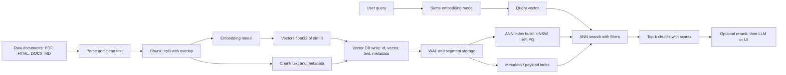

# How Documents Are Stored in Vector Databases

## 1. TL;DR

A vector database doesn't store a document's meaning as text. It splits the document into **chunks**, runs each chunk through an **embedding model** to get a fixed-length array of floats (a **vector**), and stores that vector with an **ID**, the **original text**, and **metadata**. It then builds an **Approximate Nearest Neighbor (ANN) index**, such as HNSW, IVF or PQ, over the vectors. At query time, the question is embedded with the same model, and the database returns the chunks whose vectors are closest to it. Use this when you need search based on meaning ("semantic search"), RAG for LLMs, recommendations or deduplication, where matching keywords isn't enough.

> **Scope assumption:** This covers text documents and the ingestion-to-retrieval pipeline (chunking, embedding, storage layout, indexing, querying). Multimodal embeddings and the internals of training embedding models are only mentioned briefly.

## 2. Background & Motivation

### The problem

Classic databases and search engines match **exact values** or **keywords**:

- SQL: `WHERE title = 'Refund policy'`
- Inverted index (Lucene/Elasticsearch, BM25): finds documents that contain the words `refund` and `policy`.

They fail when the user and the document use **different words for the same idea**:

| User query | Relevant document text | Keyword match? |
|---|---|---|
| "How do I get my money back?" | "Refunds are processed within 5 business days." | ❌ No shared terms |
| "laptop won't turn on" | "Troubleshooting power failures on notebooks" | ❌ Weak |

### What came before

1. **Boolean and keyword search:** exact terms only.
2. **TF-IDF / BM25:** ranks results by term statistics. Still lexical.
3. **Latent Semantic Analysis (LSA):** SVD on term-document matrices. An early form of "semantic" vectors.
4. **Word2Vec / GloVe (2013–2014):** dense vectors for individual words.
5. **Transformer sentence embeddings (Sentence-BERT in 2019, then OpenAI, Cohere, BGE, E5 and others):** dense vectors for whole sentences or passages that capture meaning well.

Once good passage embeddings existed, the bottleneck moved to a systems question: **how do you store millions or billions of high-dimensional vectors and find the nearest ones in milliseconds?** Vector databases (Pinecone, Milvus, Weaviate, Qdrant, Chroma) and vector extensions (pgvector, Elasticsearch/OpenSearch kNN, Redis) were built to answer it.

### Why it matters

- **RAG (Retrieval-Augmented Generation):** LLMs answer questions using your private documents. This is the main driver today.
- **Semantic search, recommendations, anomaly detection, deduplication and image search** all reduce to the same task: finding the nearest vectors.

## 3. Core Concepts

| Term | Meaning |
|---|---|
| **Document** | The original source: a PDF, web page, Markdown file, support ticket, and so on. |
| **Chunk** | A smaller piece of a document, typically 200–1000 tokens. This is the unit that gets embedded and retrieved. |
| **Embedding model** | A neural network that maps text to a fixed-length vector, with similar meanings landing close together. |
| **Embedding / vector** | An array of floats, such as `[0.021, -0.113, ..., 0.087]`, with dimension `d` (for example 384, 768, 1024, 1536 or 3072). |
| **Dimension (d)** | The vector length. It's fixed by the model and must be the same for every vector in a collection. |
| **Similarity metric** | How "closeness" is measured: cosine similarity, dot product or Euclidean (L2) distance. |
| **Metadata / payload** | Structured fields stored next to the vector: `source`, `page`, `author`, `created_at`, `tenant_id`. |
| **Collection / index / namespace** | A logical group of vectors that share a dimension and metric, similar to a table. |
| **ANN index** | A data structure (HNSW, IVF, PQ, DiskANN) that finds *approximately* the nearest vectors without comparing against all of them. |
| **Recall@k** | The fraction of the true top-k nearest neighbors that the ANN search actually returns. |
| **Upsert** | Insert, or update if the ID already exists. |
| **Hybrid search** | Combining vector similarity with keyword (BM25) scores, metadata filters, or both. |

### From first principles

**Step 1: Text can't be compared numerically, but vectors can.**
A computer can't directly tell how close "money back" is to "refund". If every piece of text becomes a point in space, though, "how close" turns into a distance calculation.

**Step 2: The embedding model learns where to put the points.**
During training (often contrastive learning), the model is rewarded for placing related passages close together and unrelated ones far apart. In the resulting space, *direction encodes meaning*.

**Step 3: Documents are too big to fit in one point.**
A 50-page PDF covers many topics. One vector would average them all into a blurry "centroid" that matches nothing well. So we **chunk** the document, giving each topic-sized piece its own vector.

**Step 4: Store the vector with enough context to use it.**
A vector alone is useless to a human. Each stored record therefore looks like this:

```text
Record
├── id:        "handbook.pdf#p12#c3"
├── vector:    float32[768]
├── text:      "Refunds are processed within 5 business days..."
└── metadata:  { source: "handbook.pdf", page: 12, dept: "finance", version: 3 }
```

**Step 5: Brute force doesn't scale, so build an index.**
Comparing a query against 100M vectors of 768 dimensions takes about 77 billion multiply-adds per query. ANN indexes trade a little accuracy for huge speedups.

### Analogy for the hardest idea (embeddings and ANN)

Picture a **giant library where books are shelved by meaning instead of alphabetically**. Cookbooks cluster in one region. Italian cookbooks sit in a sub-region next to wine guides. The embedding model is the **librarian who decides the shelf coordinates** for every page.

The ANN index is the **signposts and hallways**. You don't walk past every shelf. You follow "Food → European → Italian" signs and check only the nearby shelves. Occasionally the perfect book sits one aisle over and you miss it. That's the "approximate" in ANN.

## 4. Theory (Deep Dive)

### 4.1 End-to-end architecture



### 4.2 Ingestion pipeline, step by step

1. **Extract.** Turn PDF, HTML or DOCX into plain text. Keep structure where you can (headings, tables, page numbers).
2. **Clean.** Remove boilerplate such as headers, footers, navigation and duplicate whitespace.
3. **Chunk.** Common strategies:
   - *Fixed-size with overlap*: for example 500 tokens with 50 tokens of overlap, so sentences at the boundaries aren't lost.
   - *Recursive / structure-aware*: split on headings, then paragraphs, then sentences, then characters.
   - *Semantic chunking*: start a new chunk where the embedding similarity between neighboring sentences drops.
4. **Enrich metadata.** Add source, page, section title, timestamps, ACL/tenant and document version.
5. **Embed.** Send chunks through the model in batches. The output is a matrix of shape `(n_chunks, d)`.
6. **Normalize (optional).** L2-normalize the vectors so cosine similarity equals dot product.
7. **Upsert.** Write `(id, vector, text, metadata)` to the database.
8. **Index.** The database adds the vectors to its ANN structure, either incrementally (HNSW) or after training (IVF/PQ).

### 4.3 What happens inside the database on write

Most vector databases (Milvus, Qdrant, Weaviate, LanceDB and others) use a design similar to an LSM tree:

```text
Write request
   │
   ▼
[ Write-Ahead Log ]  ← durability: replayed on crash
   │
   ▼
[ Mutable in-memory segment ]  ← new vectors, often brute-force searchable
   │  (when full / timer)
   ▼
[ Sealed immutable segment on disk ]
   ├── raw vectors (float32 columnar file)
   ├── ANN index (HNSW graph / IVF lists / PQ codes)
   ├── payload / metadata + inverted/btree indexes for filters
   └── deletion bitmap (tombstones)
   │  (background)
   ▼
[ Compaction ]  ← merges segments, purges deleted ids, rebuilds index
```

Key points:

- **Updates are usually delete + insert.** The old vector gets a tombstone, and compaction removes it later.
- **Raw vectors are usually kept** next to compressed codes, so results can be rescored precisely and indexes can be rebuilt.
- With **pgvector**, the vector is just a column type (`vector(768)`) in a Postgres row. Durability comes from Postgres's WAL, and the HNSW or IVFFlat index is a Postgres index.

### 4.4 Similarity metrics

For vectors $a, b \in \mathbb{R}^d$:

**Dot product**

```math
a \cdot b = \sum_{i=1}^{d} a_i b_i
```

**Cosine similarity** (ignores magnitude, compares direction only)

```math
\cos(\theta) = \frac{a \cdot b}{\lVert a \rVert \, \lVert b \rVert}
```

**Euclidean (L2) distance**

```math
\lVert a - b \rVert_2 = \sqrt{\sum_{i=1}^{d} (a_i - b_i)^2}
```

**An important identity:** if $\lVert a \rVert = \lVert b \rVert = 1$, then

```math
\lVert a - b \rVert_2^2 = 2 - 2\,(a \cdot b)
```

So on normalized vectors, cosine similarity, dot product and L2 distance all **give the same ranking**. That's why many pipelines normalize vectors once and then use the cheapest metric, the dot product.

**Rule:** use the metric the embedding model was trained with. Most sentence-embedding models expect cosine.

### 4.5 Storage size math

Raw float32 storage:

```math
\text{bytes} = N \times d \times 4
```

Example: $N = 10^6$ chunks with $d = 768$ comes to $10^6 \times 768 \times 4 \approx 3.07$ GB, *before* index overhead.

| Representation | Bytes per 768-dim vector | 1M vectors |
|---|---|---|
| float32 | 3072 | ~3.07 GB |
| float16 / bfloat16 | 1536 | ~1.54 GB |
| int8 scalar quantization | 768 | ~0.77 GB |
| PQ, m = 96 subvectors with 8 bits each | 96 | ~96 MB |
| Binary quantization (1 bit per dim) | 96 | ~96 MB |

HNSW adds roughly $N \times M \times 2 \times 4$ bytes of graph links at layer 0, where $M$ is the number of neighbors per node. With $M = 16$ that's about 128 bytes per vector.

### 4.6 Index algorithms

#### Flat (brute force)

- Compares the query with every vector. Recall is exactly 100%.
- Time is $O(N \cdot d)$ per query. Fine up to roughly 10⁵ vectors, or when filters cut the candidate set to a small one.

#### IVF (Inverted File Index)

1. **Train:** run k-means on a sample to get `nlist` centroids.
2. **Assign:** each vector goes into the list of its nearest centroid.
3. **Search:** find the `nprobe` centroids closest to the query, then scan only those lists.

- Cost is about $O(\text{nlist} \cdot d + \frac{N \cdot \text{nprobe}}{\text{nlist}} \cdot d)$.
- Raising `nprobe` gives higher recall and slower queries.
- Needs a training step. If the data distribution drifts, the centroids go stale.

#### PQ (Product Quantization): compression

1. Split each $d$-dim vector into $m$ subvectors of $d/m$ dims each.
2. For each subspace, learn 256 centroids with k-means, so each code fits in 1 byte.
3. Store each vector as $m$ bytes, one centroid ID per subspace.
4. At query time, precompute a lookup table of query-to-centroid distances for each subspace. The distance to any vector is then $m$ table lookups summed together (Asymmetric Distance Computation).

PQ is often combined with IVF (IVF-PQ) for billion-scale search.

#### HNSW (Hierarchical Navigable Small World)

This is the most common default index in modern vector databases.

```text
Layer 2:   A ─────────────── F                 (few nodes, long jumps)
           │                 │
Layer 1:   A ──── C ──────── F ──── H          (more nodes)
           │      │          │      │
Layer 0:   A─B─C─D─E─F─G─H─I─J─K─L             (all nodes, short links)
```

- **Insert:** pick a random max layer for the node, with the probability decaying exponentially by layer. Then greedily search down from the top layer and connect to the `M` nearest neighbors on each layer. `ef_construction` controls how widely candidates are explored during the build.
- **Search:** start at the entry point on the top layer and greedily move to whichever neighbor is closer to the query. When you can't improve, drop a layer. On layer 0, keep a candidate list of size `ef_search` and return the top-k.
- **Complexity:** search is roughly $O(\log N)$. Memory is high because it stores the graph plus usually the full vectors in RAM.
- **Knobs:** larger `M` and `ef_construction` give a better graph but a slower build and more memory. Larger `ef_search` gives higher recall but slower queries.

#### DiskANN / Vamana

- A graph index designed to live on SSD, keeping only compressed vectors in RAM. It targets billion-scale data on a single machine.

### 4.7 Query-time flow

1. Embed the query with the **same model** (and the same normalization and prefix conventions; some models expect `"query: "` and `"passage: "` prefixes).
2. Apply **metadata filters**, for example `tenant_id = 42 AND year >= 2023`. There are three approaches:
   - *Pre-filter:* filter first, then search. Accurate, but brute force can be slow if the filtered set is large.
   - *Post-filter:* search the top-k, then filter. Fast, but you may end up with fewer than k results.
   - *Filtered / in-graph search:* the index skips non-matching nodes during traversal. Qdrant, Weaviate and Milvus do this.
3. Run the ANN search and get candidate IDs with scores.
4. Optionally **rescore** candidates with full-precision vectors, if the index used quantized ones.
5. Optionally **rerank** with a cross-encoder. Optionally fuse with BM25 using Reciprocal Rank Fusion (RRF).
6. Return the chunk text and metadata to the application or LLM.

### 4.8 Guarantees and trade-offs

| Dimension | Trade-off |
|---|---|
| Recall vs latency | ANN is approximate. Tuning `ef_search` or `nprobe` moves you along the curve. |
| Memory vs accuracy | Quantization (int8, PQ, binary) shrinks memory but loses precision. Rescoring recovers some of it. |
| Chunk size | Small chunks are precise but lose context. Large chunks keep context but blur meaning and cost more tokens. |
| Freshness vs throughput | Indexing every write immediately is expensive, so batching or segment sealing adds delay before data is fully indexed. |
| Consistency | Many vector databases are eventually consistent for search right after a write. Check the guarantees of yours. |
| Model lock-in | Vectors from different models (or model versions) are **not comparable**. Changing models means re-embedding everything. |

**Invariant:** every vector in one collection must come from the **same model** with the **same dimension** and be compared with the **same metric**.

## 5. Practical Usage

All examples use Python.

### 5.1 Hello world: see a document become a vector

```python
# pip install sentence-transformers numpy
from sentence_transformers import SentenceTransformer
import numpy as np

model = SentenceTransformer("all-MiniLM-L6-v2")  # 384-dim, cosine

docs = [
    "Refunds are processed within 5 business days.",
    "Our office is closed on public holidays.",
]
query = "How do I get my money back?"

doc_vecs = model.encode(docs, normalize_embeddings=True)   # shape (2, 384)
q_vec = model.encode([query], normalize_embeddings=True)[0]

print(doc_vecs.shape)          # (2, 384)
print(doc_vecs[0][:5])         # first 5 floats of the first document's vector

scores = doc_vecs @ q_vec      # dot product == cosine (normalized)
for doc, s in sorted(zip(docs, scores), key=lambda x: -x[1]):
    print(f"{s:.3f}  {doc}")
```

The refund sentence scores highest even though it shares no keywords with the query.

### 5.2 Storing in a vector DB (Chroma, embedded and local)

```python
# pip install chromadb
import chromadb

client = chromadb.Client()  # in-memory; use chromadb.PersistentClient(path="./db") to persist
collection = client.create_collection(
    name="handbook",
    metadata={"hnsw:space": "cosine"},  # similarity metric for the HNSW index
)

collection.add(
    ids=["refund-1", "office-1"],
    documents=[
        "Refunds are processed within 5 business days.",
        "Our office is closed on public holidays.",
    ],
    metadatas=[{"dept": "finance"}, {"dept": "hr"}],
)  # Chroma embeds documents with its default embedding function

results = collection.query(
    query_texts=["How do I get my money back?"],
    n_results=1,
    where={"dept": "finance"},  # metadata filter
)
print(results["documents"], results["distances"])
```

### 5.3 Realistic pipeline: chunk, embed and store in PostgreSQL with pgvector

**Schema:**

```sql
CREATE EXTENSION IF NOT EXISTS vector;

CREATE TABLE doc_chunks (
    id          TEXT PRIMARY KEY,          -- e.g. "<doc_id>#<chunk_no>"
    doc_id      TEXT NOT NULL,
    chunk_no    INT  NOT NULL,
    content     TEXT NOT NULL,
    metadata    JSONB DEFAULT '{}'::jsonb,
    embedding   vector(384) NOT NULL       -- must match model dimension
);

-- ANN index (HNSW, cosine distance)
CREATE INDEX doc_chunks_embedding_hnsw
    ON doc_chunks USING hnsw (embedding vector_cosine_ops)
    WITH (m = 16, ef_construction = 64);

-- Index for metadata filtering
CREATE INDEX doc_chunks_metadata_gin ON doc_chunks USING gin (metadata);
```

**Ingestion code:**

```python
# pip install sentence-transformers "psycopg[binary]" pgvector numpy
import json
import psycopg
from pgvector.psycopg import register_vector
from sentence_transformers import SentenceTransformer

model = SentenceTransformer("all-MiniLM-L6-v2")


def chunk_text(text: str, size: int = 800, overlap: int = 100) -> list[str]:
    """Character-based sliding window. Use token-based in production."""
    if overlap >= size:
        raise ValueError("overlap must be smaller than size")
    chunks, start = [], 0
    while start < len(text):
        end = min(start + size, len(text))
        chunks.append(text[start:end].strip())
        if end == len(text):
            break
        start = end - overlap
    return [c for c in chunks if c]


def ingest(conn, doc_id: str, text: str, metadata: dict) -> None:
    chunks = chunk_text(text)
    vectors = model.encode(chunks, batch_size=64, normalize_embeddings=True)
    with conn.cursor() as cur:
        # Remove stale chunks if the document shrank on re-ingest
        cur.execute("DELETE FROM doc_chunks WHERE doc_id = %s", (doc_id,))
        for i, (chunk, vec) in enumerate(zip(chunks, vectors)):
            cur.execute(
                """
                INSERT INTO doc_chunks (id, doc_id, chunk_no, content, metadata, embedding)
                VALUES (%s, %s, %s, %s, %s, %s)
                """,
                (f"{doc_id}#{i}", doc_id, i, chunk, json.dumps(metadata), vec),
            )
    conn.commit()


def search(conn, query: str, k: int = 5, dept: str | None = None):
    q = model.encode([query], normalize_embeddings=True)[0]
    sql = """
        SELECT id, content, 1 - (embedding <=> %s) AS cosine_sim
        FROM doc_chunks
        {where}
        ORDER BY embedding <=> %s
        LIMIT %s
    """
    params = [q]
    where = ""
    if dept:
        where = "WHERE metadata->>'dept' = %s"
        params.append(dept)
    params += [q, k]
    with conn.cursor() as cur:
        cur.execute("SET hnsw.ef_search = 100")  # recall/latency knob
        cur.execute(sql.format(where=where), params)
        return cur.fetchall()


with psycopg.connect("postgresql://localhost/rag") as conn:
    register_vector(conn)
    ingest(conn, "handbook-v3", open("handbook.txt").read(), {"dept": "finance"})
    for row in search(conn, "How do I get my money back?", dept="finance"):
        print(row)
```

**Explanation of key choices:**

- `<=>` is the pgvector cosine distance operator. `<->` is L2 distance and `<#>` is negative inner product.
- The `id` is **deterministic** (`doc_id#chunk_no`), so re-ingesting is idempotent.
- Deleting old chunks first stops orphan chunks from lingering when a document gets shorter.
- `hnsw.ef_search` trades latency for recall per session or query.

### 5.4 The same idea in other databases (shape of the API)

| DB | Store | Query |
|---|---|---|
| Qdrant | `client.upsert(collection_name, points=[PointStruct(id, vector, payload)])` | `client.query_points(collection_name, query=vec, limit=k, query_filter=...)` |
| Pinecone | `index.upsert(vectors=[{"id", "values", "metadata"}])` | `index.query(vector=vec, top_k=k, filter={...})` |
| FAISS (library, not a DB) | `index.add(np_array)`. You manage IDs and metadata yourself. | `D, I = index.search(q, k)` |

## 6. Common Pitfalls & Best Practices

| Mistake | Why it happens | Fix |
|---|---|---|
| Embedding the whole document as one vector | Seems simpler | Chunk to topic-sized pieces (about 200–1000 tokens) with overlap. |
| Using a different model, or model version, for queries than for documents | Model upgraded, or different services | Store `model_name` and `model_version` in collection metadata. Re-embed everything when switching. |
| Wrong similarity metric | Defaults differ between databases | Use the metric the model was trained for. Normalize the vectors if you use dot product. |
| Dimension mismatch errors | Changed model (384 → 1536) | One collection per model and dimension. Validate at write time. |
| Ignoring model instruction prefixes | Some models (E5, BGE and others) expect `query:` or `passage:` prefixes | Read the model card and apply the prefixes consistently. |
| Text exceeds the model's max tokens | Chunks too big | The model silently truncates them. Chunk by **tokens**, not characters. |
| Not storing the source text or metadata | "The vector is enough" | Store the text, source, page and version so you can cite sources, filter and debug. |
| Duplicate or orphan chunks after re-ingest | Random IDs, no cleanup | Use deterministic IDs and delete by `doc_id` before re-inserting, or use content hashes. |
| Post-filtering returns too few results | Filter applied after top-k | Use filtered ANN or pre-filtering, or raise k. Index the metadata fields. |
| Poor recall at scale, nobody notices | ANN is approximate | Measure recall@k against brute force on a sample. Tune `ef_search`, `nprobe` or `M`. |
| Tables and PDFs get garbled | Naive text extraction | Use layout-aware parsers. Turn tables into Markdown or text rows. |
| Leaking data across tenants | No access-control filter | Add `tenant_id` or ACL metadata and enforce it on every query, or use a namespace per tenant. |
| Expecting exact keyword matches (SKU codes, error IDs) | Embeddings blur rare tokens | Use hybrid search (BM25 + vector) with a reranker. |

## 7. Comparison with Alternatives

| Approach | Best for | Weakness | Choose when |
|---|---|---|---|
| **Dedicated vector DB** (Pinecone, Milvus, Qdrant, Weaviate) | Large scale, filtered ANN, managed scaling | Another system to run, data duplicated | More than 10M vectors, high QPS, advanced filtering or multi-tenancy |
| **Vector extension** (pgvector, OpenSearch/Elasticsearch kNN, Redis) | Keeping vectors next to existing data, using SQL joins and transactions | Less tuned at very large scale | You already run Postgres or Elasticsearch, with moderate scale |
| **ANN library** (FAISS, hnswlib, Annoy, ScaNN) | Maximum speed, research, offline batch work | No persistence, CRUD, metadata or replication out of the box | You build your own serving layer or run batch jobs |
| **Keyword search** (BM25 / inverted index) | Exact terms, IDs, rare words, explainable results | Misses synonyms and paraphrases | Queries are mostly lexical, such as codes or names |
| **Hybrid** (BM25 + vectors + reranker) | Best overall relevance in production RAG | More complexity and latency | Mixed query types, quality-critical search |
| **Long-context LLM, no retrieval** | Small corpora (a few documents) | Cost, latency, "lost in the middle" | The corpus fits comfortably in the context window |
| **Knowledge graph / GraphRAG** | Multi-hop, relationship-heavy questions | Expensive to build | Questions are about entities and their relationships |

## 8. Real-World Applications

- **RAG chatbots over internal docs:** customer-support assistants, HR policy bots and engineering-wiki Q&A. Documents are chunked, embedded and retrieved to ground LLM answers.
- **Semantic and e-commerce search:** "comfortable shoes for standing all day" matches products by description, not just keywords.
- **Recommendations:** items and users get embeddings, and the nearest items become recommendations (Spotify, Pinterest and others publicly describe embedding-based retrieval).
- **Code search:** finding functions by intent across a monorepo.
- **Deduplication and near-duplicate detection:** support tickets, news articles, legal documents.
- **Anomaly and fraud detection:** a transaction embedding far from normal clusters gets flagged.
- **Multimodal search:** image embeddings (for example CLIP) stored alongside text, so a text query can find images.
- **Legal and medical research:** retrieving similar cases or papers by meaning.

## 9. Practice Questions

### 9.1 Conceptual

1. 🟢 **Easy:** Why do we split documents into chunks instead of creating one embedding per document?
2. 🟢 **Easy:** Besides the vector, what else should a stored record contain, and why?
3. 🟡 **Medium:** Explain why cosine similarity, dot product and L2 distance give the same ranking on L2-normalized vectors.
4. 🟡 **Medium:** What does "approximate" mean in ANN search, and how do you measure how approximate it is?
5. 🔴 **Hard:** Explain how Product Quantization compresses a 768-dim float32 vector to 96 bytes, and how distances are computed without decompressing it.

### 9.2 Applied / Scenario-Based

6. 🟡 **Medium:** Your RAG bot answers questions about error code `ERR-4471` poorly, even though a document contains that exact code. What's going on, and how do you fix it?
7. 🟡 **Medium:** Your team upgrades from a 768-dim embedding model to a newer 1024-dim model. What has to happen to the stored data, and how do you migrate without downtime?
8. 🔴 **Hard:** A multi-tenant SaaS app uses `WHERE tenant_id = X` with post-filtering on top-10 ANN results. Small tenants often get 0–2 results. Explain why, and propose fixes.
9. 🟡 **Medium:** Estimate the RAM needed for 50M chunks with a 1024-dim float32 HNSW index (M = 16), and suggest two ways to cut it.

### 9.3 Coding / Hands-On

10. 🟢 **Easy:** Write a function that chunks text by **tokens** (use any tokenizer) with configurable size and overlap, and returns the chunks with their start offsets.
11. 🟡 **Medium:** Using NumPy only, implement brute-force top-k cosine search over a matrix of document vectors, then compute recall@k for a given set of approximate results.
12. 🔴 **Hard:** Make an ingestion pipeline idempotent and incremental: re-running it on a folder of documents should re-embed only changed documents and remove the chunks of deleted ones.

### 9.4 Interview-Style

13. 🟡 **Medium:** "Walk me through what happens, end to end, from uploading a PDF to an LLM answering a question about page 12."
14. 🔴 **Hard:** "Compare HNSW and IVF-PQ. When would you choose each?"
15. 🔴 **Hard:** "Users say the search results 'feel wrong'. How do you debug a vector retrieval system?"

## 10. Answers & Explanations

<details>
<summary>Answer to Q1: Why chunk?</summary>

There are three reasons:

1. **Meaning gets diluted.** An embedding is a single point. A document covering refunds, shipping and privacy produces an averaged vector that sits *between* those topics and matches none of them strongly. Chunks keep each topic sharp.
2. **Model limits.** Embedding models have a maximum input length (often 512 tokens, sometimes 8k). Anything beyond it is truncated, so the content is silently lost.
3. **Retrieval granularity.** In RAG you want to send the LLM the *relevant paragraph*, not a 50-page file. That saves tokens and cost, and reduces distraction.

The trade-off is that chunks which are too small lose context ("it" with no referent). That's why overlap, structure-aware splitting and adding the parent section title to each chunk help.

</details>

<details>
<summary>Answer to Q2: What else to store?</summary>

- **A stable ID** (for example `doc_id#chunk_no`), for upserts, deletes and deduplication.
- **The original chunk text.** The vector can't be turned back into text, and you need the text to show users or feed to the LLM.
- **Metadata:** source URI, page, section, timestamps, version, language, tenant and ACL. This enables filtering ("only 2024 docs", "only tenant 42"), citations, access control and debugging.
- **Embedding model name and version**, at least at the collection level, so you know which vectors are compatible.

Without these, you can find "similar vectors" but can't explain, filter, secure or update them.

</details>

<details>
<summary>Answer to Q3: Why the metrics agree on normalized vectors</summary>

If $\lVert a \rVert = \lVert b \rVert = 1$:

- Cosine is $\frac{a \cdot b}{1 \cdot 1} = a \cdot b$, so cosine and dot product are identical.
- Squared L2 is $\lVert a - b \rVert^2 = \lVert a \rVert^2 + \lVert b \rVert^2 - 2(a \cdot b) = 2 - 2(a \cdot b)$.

Squared L2 is a strictly decreasing function of the dot product, so sorting by smallest L2 gives the same order as sorting by largest dot product. Square root is monotonic, so plain L2 preserves the order too. In practice: normalize once at write time, then use the fastest metric (dot product).

</details>

<details>
<summary>Answer to Q4: What "approximate" means and how to measure it</summary>

Exact k-NN must compare the query with all N vectors, which costs $O(N \cdot d)$. ANN indexes (HNSW, IVF) explore only part of the space, such as some graph neighborhoods or a few clusters. So they *may miss* some true nearest neighbors. In return they're orders of magnitude faster.

Measure it with **recall@k**:

```math
\text{recall@k} = \frac{\lvert \text{ANN top-k} \cap \text{exact top-k} \rvert}{k}
```

Take a sample of real queries, compute the exact top-k by brute force, and compare. Tune `ef_search` (HNSW) or `nprobe` (IVF) until recall meets your target (often 0.95 or higher) at acceptable latency. Keep in mind that recall measures *index* fidelity. End-to-end *relevance* also depends on the embedding model and the chunking.

</details>

<details>
<summary>Answer to Q5: How Product Quantization works</summary>

**Compression:**

1. Split the 768-dim vector into $m = 96$ subvectors of 8 dims each.
2. For each of the 96 subspaces, k-means learns **256 centroids** (a codebook) from training data.
3. Each subvector is replaced by the **ID of its nearest centroid**. 256 options fit in 1 byte.
4. Result: 96 bytes per vector, down from $768 \times 4 = 3072$ bytes. That's **32× smaller**.

**Distance without decompressing (ADC):**

1. When a query arrives, for each subspace $j$, compute the distance from the query's subvector to all 256 centroids. That gives a $96 \times 256$ lookup table.
2. The approximate distance to any stored vector is the sum of its 96 table entries, one per byte code: $\sum_{j} T[j][\text{code}_j]$.
3. That's 96 lookups and additions instead of 768 multiply-adds, and it's cache-friendly.

**Trade-off:** quantization error lowers accuracy. Systems often fetch extra candidates with PQ and then **rescore** them with full-precision vectors.

</details>

<details>
<summary>Answer to Q6: The ERR-4471 problem</summary>

**Why it happens:** dense embeddings capture *meaning* and generalize. Rare, arbitrary tokens like `ERR-4471`, SKUs or UUIDs carry little semantic signal, and tokenizers split them into fragments. The vector for "ERR-4471 fix" ends up close to many generic "error troubleshooting" chunks, and the exact-match chunk can rank low.

**Fixes:**

1. **Hybrid search:** run BM25 or keyword search in parallel and fuse the results (for example with Reciprocal Rank Fusion). BM25 scores rare exact tokens very highly.
2. **Metadata extraction:** pull error codes out at ingest time into a metadata field, then filter or boost on exact matches.
3. **A reranker** (cross-encoder) over the merged candidates. It reads the query and the chunk together, so it can notice exact matches.
4. Check that chunking didn't separate the code from its explanation.

</details>

<details>
<summary>Answer to Q7: Migrating to a new embedding model</summary>

Vectors from different models live in **different, incompatible spaces**. Even at the same dimension, their coordinates mean different things. A 1024-dim model can't even be inserted into a 768-dim index. So **every chunk has to be re-embedded**.

**Zero-downtime migration (blue/green):**

1. Create a new collection (or a new `vector(1024)` column and index) for model v2.
2. Backfill: re-embed all chunks in batches from the stored **source text**. This is why storing the text matters.
3. Dual-write: new or updated documents go to both collections during the backfill.
4. Evaluate: run offline relevance tests (recall and nDCG on a labeled set) and possibly A/B test.
5. Switch the read path to v2 (behind a feature flag or alias), keeping v1 for rollback.
6. Delete v1 once it's stable.

Also make sure the **query** embedding switches at the same moment as the read path.

</details>

<details>
<summary>Answer to Q8: Post-filtering starves small tenants</summary>

**Why:** the ANN search first returns the global top-10 nearest vectors across *all* tenants, and only then drops rows where `tenant_id != X`. If tenant X owns 0.1% of the data, statistically none or almost none of the global top-10 belong to it, even though tenant X has relevant documents.

**Fixes, from simplest up:**

1. **Over-fetch:** ask for top-200, then filter. This helps but is unreliable for very small tenants and costs latency.
2. **Filtered ANN search:** use a database that applies the filter *during* graph or list traversal (Qdrant, Weaviate, Milvus, or pgvector 0.8+ iterative scans). Index `tenant_id` as a payload index.
3. **Pre-filter + brute force for small tenants:** if a tenant has a few thousand vectors, an exact scan over just its rows is fast and gives 100% recall. Many databases switch strategies automatically based on filter selectivity.
4. **Partition by tenant:** use a namespace, collection or partition per tenant (or per large tenant), so each search only covers that tenant's data. This also strengthens isolation.

</details>

<details>
<summary>Answer to Q9: RAM estimate</summary>

- **Raw vectors:** $50 \times 10^6 \times 1024 \times 4 \approx 204.8$ GB.
- **HNSW graph, layer 0:** about $N \times 2M \times 4$ bytes $= 50 \times 10^6 \times 32 \times 4 \approx 6.4$ GB, plus a little for upper layers.
- **Total:** about **210+ GB**, before metadata and the OS.

**Ways to reduce it:**

1. **Quantization:** int8 scalar quantization cuts vectors to about 51 GB. Binary quantization gets to about 6.4 GB. PQ goes lower still. Keep the full-precision vectors on disk for rescoring.
2. **Smaller dimensions:** models trained with Matryoshka Representation Learning can be truncated (for example to 256 dims) with modest quality loss. That's 4× smaller.
3. **Disk-based indexes** (DiskANN, or on-disk HNSW with memory-mapped vectors), keeping only compressed codes in RAM.
4. **Sharding** across nodes, which spreads the memory but doesn't reduce the total.

</details>

<details>
<summary>Answer to Q10: Token-based chunker</summary>

```python
# pip install tiktoken
import tiktoken


def chunk_by_tokens(text: str, size: int = 500, overlap: int = 50,
                    encoding: str = "cl100k_base") -> list[dict]:
    if overlap >= size:
        raise ValueError("overlap must be smaller than size")
    enc = tiktoken.get_encoding(encoding)
    tokens = enc.encode(text)
    step = size - overlap
    chunks = []
    for start in range(0, len(tokens), step):
        window = tokens[start:start + size]
        chunks.append({"start_token": start, "text": enc.decode(window)})
        if start + size >= len(tokens):
            break
    return chunks
```

**Reasoning:**

- Counting tokens (not characters) makes sure chunks never exceed the embedding model's limit. Ideally, use the *embedding model's own tokenizer*.
- `step = size - overlap` makes consecutive windows share `overlap` tokens, so a sentence cut at a boundary still appears whole in one of them.
- Storing `start_token` lets you trace a chunk back to its position in the source for citations.
- In production, prefer splitting on paragraph or sentence boundaries first and using token counts as the limit.

</details>

<details>
<summary>Answer to Q11: Brute-force search and recall@k</summary>

```python
import numpy as np


def normalize(x: np.ndarray) -> np.ndarray:
    norms = np.linalg.norm(x, axis=-1, keepdims=True)
    return x / np.clip(norms, 1e-12, None)


def topk_cosine(doc_vecs: np.ndarray, query: np.ndarray, k: int) -> np.ndarray:
    d = normalize(doc_vecs)
    q = normalize(query)
    scores = d @ q                                # (N,)
    k = min(k, len(scores))
    idx = np.argpartition(-scores, k - 1)[:k]     # O(N) partial selection
    return idx[np.argsort(-scores[idx])]          # sort only the k winners


def recall_at_k(exact_ids, approx_ids) -> float:
    exact, approx = set(exact_ids), set(approx_ids)
    return len(exact & approx) / len(exact) if exact else 1.0


# demo
rng = np.random.default_rng(0)
docs = rng.normal(size=(10_000, 384)).astype(np.float32)
q = rng.normal(size=384).astype(np.float32)
exact = topk_cosine(docs, q, 10)
approx = exact[:8].tolist() + [1, 2]              # pretend ANN missed 2
print(recall_at_k(exact, approx))                 # 0.8 (unless 1 or 2 are in exact)
```

**Reasoning:** `argpartition` finds the top-k in $O(N)$ instead of the $O(N \log N)$ of a full sort. Normalizing makes the dot product equal to cosine. This exact search is the **ground truth** you use to measure any ANN index's recall.

</details>

<details>
<summary>Answer to Q12: Idempotent, incremental ingestion</summary>

**Design:**

1. Keep a **manifest table**: `doc_id -> content_hash, model_version, chunk_count, updated_at`.
2. For each file, compute `sha256(file_bytes)` (or a hash of the normalized text).
3. If the hash and model version are unchanged, **skip** the file.
4. If it changed or is new, chunk and embed it, then in one transaction **delete the chunks** where `doc_id = X` and **insert the new chunks** with deterministic IDs `X#i`. Update the manifest.
5. For any `doc_id` in the manifest that's no longer in the folder, delete its chunks and its manifest row.

```python
import hashlib
from pathlib import Path


def file_hash(p: Path) -> str:
    return hashlib.sha256(p.read_bytes()).hexdigest()


def sync_folder(folder: Path, store, manifest, model_version: str):
    seen = set()
    for path in folder.rglob("*.md"):
        doc_id = str(path.relative_to(folder))
        seen.add(doc_id)
        h = file_hash(path)
        entry = manifest.get(doc_id)
        if entry and entry["hash"] == h and entry["model"] == model_version:
            continue  # unchanged -> skip expensive embedding
        chunks = chunk_by_tokens(path.read_text(encoding="utf-8"))
        vectors = embed([c["text"] for c in chunks])
        with store.transaction():
            store.delete_where(doc_id=doc_id)
            store.insert_many([
                {"id": f"{doc_id}#{i}", "doc_id": doc_id, "text": c["text"],
                 "vector": v, "meta": {"path": doc_id, "hash": h}}
                for i, (c, v) in enumerate(zip(chunks, vectors))
            ])
            manifest.put(doc_id, {"hash": h, "model": model_version})
    for doc_id in set(manifest.keys()) - seen:
        store.delete_where(doc_id=doc_id)
        manifest.delete(doc_id)
```

**Why it works:**

- Content hashing prevents re-embedding unchanged documents, which is the main cost.
- Delete-then-insert by `doc_id` removes orphan chunks when a document shrinks.
- Deterministic IDs and transactions make reruns safe after a crash.
- Including `model_version` in the skip check forces re-embedding when the model changes.

`store`, `manifest`, `embed` and `chunk_by_tokens` are abstractions. Back them with pgvector or Qdrant plus a small SQL table.

</details>

<details>
<summary>Answer to Q13: PDF upload to LLM answer, end to end</summary>

1. **Upload and extract:** a PDF parser extracts text per page and keeps the page numbers (OCR if the PDF is scanned).
2. **Clean and chunk:** remove headers and footers, then split into overlapping, token-bounded chunks. Each chunk records `source=file.pdf, page=12, section=...`.
3. **Embed:** batch the chunks through the embedding model to get vectors of dim `d`, normalized.
4. **Store:** upsert `(id, vector, text, metadata)`. The database writes to the WAL and an in-memory segment, and the vector is inserted into the HNSW graph (or indexed when the segment is sealed).
5. **Query:** the user asks a question. It's embedded with the **same model**, giving a query vector.
6. **Retrieve:** ANN search (plus filters such as tenant or document) returns the top-k chunks. Ideally combine with BM25, then rerank with a cross-encoder.
7. **Augment:** build a prompt containing the system instructions, the retrieved chunks with their citations (`file.pdf p.12`), and the question.
8. **Generate:** the LLM answers, grounded in the retrieved text, and cites page 12.

Good extras to mention: evaluation (retrieval recall, answer faithfulness), access control at retrieval time, and caching.

</details>

<details>
<summary>Answer to Q14: HNSW vs IVF-PQ</summary>

| Aspect | HNSW | IVF-PQ |
|---|---|---|
| Structure | Multi-layer proximity graph | k-means clusters plus compressed codes |
| Recall at low latency | Excellent | Good, depends on `nprobe` and PQ error |
| Memory | High: full vectors plus graph links | Very low: about m bytes per vector |
| Build | Incremental inserts, no training | Needs a training step (k-means, codebooks) |
| Updates and deletes | Inserts are easy, deletes need tombstones or repair | Easy to add to lists, but centroids drift with distribution shift |
| Sweet spot | Up to around 100M vectors in RAM, low-latency online serving | Hundreds of millions to billions, memory or cost constrained, GPU (FAISS) |

**Choose HNSW** when the data fits in memory (possibly with int8 quantization), you need high recall at low latency, and data changes continuously.

**Choose IVF-PQ** when memory dominates cost (at billion scale), you can tolerate some recall loss (recovered by rescoring), and you can retrain periodically.

Also worth mentioning: hybrids such as HNSW with PQ or SQ vectors, and DiskANN for SSD-resident billion-scale indexes.

</details>

<details>
<summary>Answer to Q15: Debugging retrieval that "feels wrong"</summary>

Work through the pipeline in layers, from data to model to index to query.

1. **Build an evaluation set.** Collect 50–200 real queries with known relevant chunks. Measure recall@k and MRR or nDCG. Without this you're only guessing.
2. **Check the data and chunking.** Look at the retrieved chunks. Are they garbled (bad PDF parsing)? Too small and missing context, or too big and blurry? Are tables broken? Are there duplicates?
3. **Check model consistency.** Were the query and documents embedded with the same model and version? Are the right prefixes (`query:` / `passage:`) applied? Are vectors normalized when the metric needs it? Is the metric correct?
4. **Isolate ANN from the model.** Run **brute-force exact search** on the same query.
   - Exact results are good but ANN results are bad: it's an **index** problem. Raise `ef_search` or `nprobe`, rebuild the index, check quantization and rescoring.
   - Exact results are also bad: it's the **embedding or chunking**. Try a better or domain-specific model, hybrid search or a reranker.
5. **Check filters.** Is post-filtering dropping relevant results? Are metadata values wrong (for example version or tenant)?
6. **Check freshness.** Are new documents indexed yet (eventual consistency, an unsealed segment)? Are stale versions still present?
7. **Check the query type.** Exact codes or names need BM25 or hybrid search. Very short or ambiguous queries may need query rewriting.

Change one variable at a time and re-measure against the evaluation set.

</details>

## 11. Summary / Cheat Sheet

- **Pipeline:** parse → clean → **chunk** → **embed** → store `(id, vector, text, metadata)` → **ANN index** → query with the same model → filter → top-k → (rerank) → app or LLM.
- **A vector** is a fixed-length float array (`d` = 384, 768, 1024, 1536...) whose direction encodes meaning.
- **Chunk** to roughly 200–1000 tokens with overlap. Chunk by tokens and respect document structure.
- **Always store** the source text, deterministic IDs, metadata (source, page, version, tenant) and the model name and version.
- **Same model, dimension and metric** for every vector in a collection. Changing models means re-embedding everything.
- **Metrics:** cosine, dot product, L2. On normalized vectors they all give the same ranking.
- **Storage:** $N \times d \times 4$ bytes for float32. 1M × 768 ≈ 3 GB. Quantize (int8, PQ, binary) to shrink it.
- **Indexes:** Flat is exact and slow. **HNSW** is graph-based, fast, high recall and memory-heavy. **IVF** uses clusters and `nprobe`. **PQ** compresses with codebooks. **DiskANN** is SSD-based.
- **Knobs:** HNSW `M`, `ef_construction`, `ef_search`. IVF `nlist`, `nprobe`. Measure **recall@k** against brute force.
- **Internals:** WAL → mutable segment → sealed segments with index → compaction. Updates are delete + insert, with tombstones.
- **Filtering:** prefer filtered ANN or pre-filtering over post-filtering. Index the metadata fields.
- **Production quality:** hybrid search (BM25 + vector) plus a cross-encoder reranker plus an evaluation set.

## 12. Further Reading

**Papers**

- Malkov & Yashunin, *Efficient and robust approximate nearest neighbor search using Hierarchical Navigable Small World graphs* (HNSW): https://arxiv.org/abs/1603.09320
- Jégou, Douze & Schmid, *Product Quantization for Nearest Neighbor Search*, IEEE TPAMI, 2011.
- Johnson, Douze & Jégou, *Billion-scale similarity search with GPUs* (FAISS): https://arxiv.org/abs/1702.08734
- Reimers & Gurevych, *Sentence-BERT: Sentence Embeddings using Siamese BERT-Networks*: https://arxiv.org/abs/1908.10084
- Lewis et al., *Retrieval-Augmented Generation for Knowledge-Intensive NLP Tasks*: https://arxiv.org/abs/2005.11401
- Subramanya et al., *DiskANN: Fast Accurate Billion-point Nearest Neighbor Search on a Single Node*, NeurIPS 2019.
- Kusupati et al., *Matryoshka Representation Learning*, NeurIPS 2022.

**Docs and tools**

- FAISS: https://github.com/facebookresearch/faiss
- pgvector: https://github.com/pgvector/pgvector
- Sentence Transformers: https://www.sbert.net
- Chroma documentation: https://docs.trychroma.com
- Qdrant documentation: https://qdrant.tech/documentation/
- Milvus documentation: https://milvus.io/docs
- MTEB (Massive Text Embedding Benchmark) leaderboard on Hugging Face, for choosing embedding models.

**Related topics that deserve their own notes**

- Embedding models and contrastive learning
- HNSW in depth
- Product Quantization and scalar or binary quantization
- Chunking strategies for RAG
- Hybrid search, BM25 and Reciprocal Rank Fusion
- Rerankers (cross-encoders vs bi-encoders)
- RAG evaluation (recall@k, nDCG, faithfulness)
