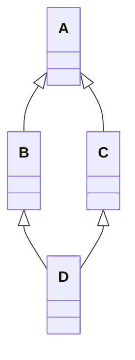

# MRO in Python (Method Resolution Order)

## 1. TL;DR

MRO (Method Resolution Order) is the rule Python uses to decide **which method implementation is called** when you access an attribute or method on an object, especially with **multiple inheritance**. Python computes an ordered list of classes (`__mro__`) using the **C3 linearization** algorithm. You use MRO to design cooperative inheritance with `super()` and to predict/avoid surprising behavior like the “diamond problem”.

## 2. Background & Motivation

### The problem MRO solves

In single inheritance, method lookup is straightforward: check the class, then its parent, then its parent, and so on.

With multiple inheritance, there can be multiple candidate parents:

```text
    A
   / \
  B   C
   \ /
    D
```

If `D` inherits from both `B` and `C`, and both define `foo()`, which one should run when you call `D().foo()`?

Without a consistent rule, multiple inheritance becomes unpredictable and error-prone.

### What came before it

- Older languages used different strategies (left-to-right depth-first, breadth-first, etc.).
- Python 2 used two different systems depending on whether you used “classic” vs “new-style” classes.
- Python 3 uses **new-style classes only** and a single, well-defined algorithm: **C3**.

### Why it matters

- Predictable behavior in complex inheritance hierarchies.
- Enables “mixins” and cooperative multiple inheritance patterns.
- Essential for correct use of `super()` (which follows the MRO, not “the parent”).

## 3. Core Concepts

| Term | Meaning |
|---|---|
| Attribute resolution | Process of finding an attribute/method by searching classes in order. |
| MRO | The exact linear order Python uses to search for attributes/methods. |
| `__mro__` | Tuple of classes defining the method lookup order. |
| `mro()` | Class method that returns the MRO list/tuple (same info as `__mro__`). |
| C3 linearization | Algorithm used to compute MRO that preserves local order and monotonicity. |
| Diamond problem | A class inherits from two classes that both inherit from a common base. |
| Cooperative multiple inheritance | Designing methods to call `super()` so all classes in the MRO participate exactly once. |
| Mixins | Small classes that provide features and are meant to be combined with others via multiple inheritance. |

### From first principles: how lookup works

When you do `obj.method(...)`, Python roughly does:

1. Look in `obj.__class__`.
2. If not found, look in `obj.__class__.__mro__[1]`, then the next, and so on.
3. Stop at `object`.

The key point: **Python does not search “parents” recursively in an ad-hoc way**. It follows a precomputed linear order: the MRO.

### Analogy (hardest idea)

Think of an object method call as following a **playlist** of classes.

- The playlist is the MRO.
- Python plays the first track (class) that contains the requested method.
- `super()` doesn’t mean “my parent”; it means “the next track in the playlist after my class.”

## 4. Theory (Deep Dive)

### 4.1 What `__mro__` contains

For a class `D`, `D.__mro__` is a tuple like:

```python
(D, B, C, A, object)
```

Meaning method lookup checks `D` first, then `B`, then `C`, etc.

### 4.2 C3 linearization: requirements / invariants

Python’s MRO (C3) ensures:

1. **Local precedence order**: the order of base classes in the class definition matters.
   - If `class D(B, C)`, then `B` is searched before `C`.
2. **Monotonicity**: a class’s MRO extends its parents’ MROs without reordering them in a way that would violate their own order.
3. **No duplicates**: each class appears once.

These properties eliminate many of the inconsistencies that appear in simpler “depth-first” rules.

### 4.3 The C3 merge algorithm (step-by-step)

For:

```python
class D(B, C):
    pass
```

C3 defines:

```text
MRO(D) = [D] + merge(MRO(B), MRO(C), [B, C])
```

Where `merge(...)` repeatedly:

1. Looks at the **head** of each list.
2. Picks a head `H` that does **not appear in the tail** of any list.
3. Appends `H` to the result and removes it from all lists.
4. If no valid head exists, the hierarchy is inconsistent → `TypeError`.

This is the reason you sometimes see:

```text
TypeError: Cannot create a consistent method resolution order (MRO)
```

### 4.4 Visualizing MRO computation (Mermaid)



### 4.5 Example: diamond inheritance

```python
class A:
    def who(self):
        return "A"

class B(A):
    def who(self):
        return "B -> " + super().who()

class C(A):
    def who(self):
        return "C -> " + super().who()

class D(B, C):
    pass

print(D.__mro__)
print(D().who())
```

Expected:

- `D.__mro__` is `(D, B, C, A, object)`
- `D().who()` becomes `"B -> C -> A"`

Note that **A is called exactly once**, even though there are two paths to it. That’s the “diamond problem” solved via cooperative `super()` and C3.

### 4.6 Why `super()` works with MRO (and common misconception)

`super()` returns a proxy that delegates lookup to the **next class in the MRO**.

So in `B.who`, `super().who()` does not mean “call A.who()”. It means “call the next class after B in `D.__mro__`”, which is `C`.

That’s why this pattern only works correctly when **every class cooperates** by using `super()` consistently.

### 4.7 Performance characteristics

- Attribute lookup is effectively a linear scan through the MRO until a match is found.
- In typical code, MROs are short (single digits), so performance is excellent.
- Descriptors, `__getattribute__`, and metaclasses can add complexity, but the MRO still defines the class search order.

## 5. Practical Usage

### 5.1 Hello world: inspect MRO

```python
class A: ...
class B(A): ...
class C(A): ...
class D(B, C): ...

print(D.__mro__)
print(D.mro())
```

### 5.2 Cooperative multiple inheritance (realistic pattern)

A common pattern is to have each class accept `**kwargs` and call `super().__init__(**kwargs)`.

```python
class Base:
    def __init__(self, **kwargs):
        super().__init__()


class WithDB(Base):
    def __init__(self, db, **kwargs):
        self.db = db
        super().__init__(**kwargs)


class WithCache(Base):
    def __init__(self, cache, **kwargs):
        self.cache = cache
        super().__init__(**kwargs)


class Service(WithDB, WithCache):
    def __init__(self, db, cache):
        super().__init__(db=db, cache=cache)


s = Service(db="postgres", cache="redis")
print(Service.__mro__)
print(s.db, s.cache)
```

Why this works:

- `Service.__mro__` is `(Service, WithDB, WithCache, Base, object)`
- Each `__init__` consumes its own args and passes the rest along.
- Every initializer runs exactly once.

### 5.3 Non-cooperative example (pitfall)

```python
class B(A):
    def who(self):
        return "B -> " + A.who(self)  # hard-coded parent call
```

This breaks cooperative inheritance:

- `A` might get called twice.
- Classes in between (like `C`) are skipped.

Use `super()` instead.

## 6. Common Pitfalls & Best Practices

| Mistake | Why it happens | Fix |
|---|---|---|
| Thinking `super()` means “call my parent” | In single inheritance, it looks like that | Remember: `super()` follows the MRO; it calls the *next* class. |
| Calling a specific base method directly (`A.method(self)`) | Feels explicit/safe | Use `super()` for cooperative multiple inheritance. Only call a base directly if you intentionally want to bypass the MRO. |
| Not using `**kwargs` in mixin `__init__` | Each class wants its own params | Use `**kwargs` and consume only what you need; pass the rest to `super()`. |
| Getting `TypeError: cannot create a consistent MRO` | Conflicting base class orders | Reorder bases or redesign hierarchy (avoid incompatible multiple inheritance). |
| Mixin defines state but doesn’t initialize it | Mixin author forgot init | Provide an `__init__` that cooperates (`super()`) or document required calls. |
| Overusing inheritance for code reuse | Inheritance seems convenient | Prefer composition; use inheritance mainly for “is-a” or mixin behavior. |

## 7. Comparison with Alternatives

| Approach | When to use | Pros | Cons |
|---|---|---|---|
| Multiple inheritance + MRO | Mixins, cross-cutting behaviors | Powerful composition of behavior | Complexity; needs discipline with `super()` |
| Single inheritance | Most class hierarchies | Simple mental model | Less flexible for combining features |
| Composition (has-a) | Reuse behavior without inheritance | Explicit dependencies, easier testing | More boilerplate wiring |
| Protocols / interfaces (typing) | Structural typing / decoupling | Works without inheritance | Doesn’t provide implementation reuse |

## 8. Real-World Applications

- Django and many frameworks use MRO heavily for class-based views and mixins.
- SQLAlchemy uses cooperative patterns in parts of its declarative model system.
- `unittest.TestCase` and custom test mixins rely on predictable MRO ordering.
- Many Python libraries provide mixins like `LoggingMixin`, `SerializationMixin`, `ValidationMixin` that are intended to be composed.

## 9. Practice Questions

### 9.1 Conceptual (5 questions)

1. 🟢 Easy: What is MRO and why does Python need it?
2. 🟢 Easy: What does `D.__mro__` represent?
3. 🟡 Medium: Why is `super()` described as “the next class in the MRO” rather than “the parent class”?
4. 🟡 Medium: What problem does C3 linearization solve compared to naive depth-first search?
5. 🔴 Hard: Explain what monotonicity means in the context of MRO and why it matters.

### 9.2 Applied / Scenario-Based (4 questions)

6. 🟡 Medium: Given `class D(B, C)`, both `B` and `C` define `foo`, and `D` doesn’t. Which `foo` runs and why?
7. 🟡 Medium: You observe that a base class method runs twice in a diamond hierarchy. What code pattern typically causes this?
8. 🔴 Hard: You get `TypeError: Cannot create a consistent method resolution order`. What does this imply about the inheritance graph, and how do you fix it?
9. 🟡 Medium: In a mixin chain, one class forgets to call `super().__init__()`. What happens and how do you detect it?

### 9.3 Coding / Hands-On (3 tasks)

10. 🟢 Easy: Write a snippet that prints the MRO for a diamond hierarchy and demonstrates which method is called.
11. 🟡 Medium: Create two mixins that both modify a `process()` method using `super()` and show that both apply in the correct order.
12. 🔴 Hard: Design cooperative `__init__` methods across 3 mixins using `**kwargs` and verify each runs once.

### 9.4 Interview-Style (3 questions)

13. 🟡 Medium: “Explain Python’s MRO and how it affects `super()` in multiple inheritance.”
14. 🔴 Hard: “What is C3 linearization? Why does Python use it?”
15. 🔴 Hard: “When is multiple inheritance appropriate in Python, and how do you keep it maintainable?”

## 10. Answers & Explanations

<details>
<summary>Answer to Q1</summary>

MRO is the ordered list of classes Python searches to resolve attributes/methods. Python needs it because multiple inheritance can create ambiguity; MRO gives a deterministic, consistent order.

</details>

<details>
<summary>Answer to Q2</summary>

`D.__mro__` is a tuple like `(D, B, C, A, object)` that defines the exact search path Python uses for method and attribute lookup on instances of `D`.

</details>

<details>
<summary>Answer to Q3</summary>

In multiple inheritance, “the parent” is ambiguous (there are multiple bases). `super()` uses the MRO, so it always means “delegate to the next implementation after this class in the MRO,” ensuring each class in the chain can participate once.

</details>

<details>
<summary>Answer to Q4</summary>

Naive depth-first lookup can revisit shared bases (calling them twice), and can produce orderings that conflict with the order expected by parent classes. C3 produces a linear order that respects local base order and preserves the ordering constraints of all parents (monotonicity).

</details>

<details>
<summary>Answer to Q5</summary>

Monotonicity means that if class `X` precedes `Y` in a parent’s MRO, the child’s MRO cannot reorder them so that `Y` comes before `X`. This matters because otherwise subclasses could break the assumptions of their base classes and make cooperative `super()` chains inconsistent.

</details>

<details>
<summary>Answer to Q6</summary>

`B.foo` runs because Python searches bases in the order they’re listed in the class definition: `D(B, C)` implies `B` comes before `C` in the MRO, so it’s found first.

</details>

<details>
<summary>Answer to Q7</summary>

Direct calls like `A.method(self)` or explicitly calling both parents (`B.method(self)` and `C.method(self)`) bypass the MRO and can cause shared bases to execute multiple times. Cooperative `super()` prevents this.

</details>

<details>
<summary>Answer to Q8</summary>

It implies the inheritance graph has conflicting ordering constraints (for example one branch requires `B` before `C`, while another requires `C` before `B`). Fix by reordering bases consistently, removing the conflicting multiple inheritance relationship, or using composition instead.

</details>

<details>
<summary>Answer to Q9</summary>

If a class doesn’t call `super().__init__()`, the rest of the chain is skipped: later mixins and bases won’t initialize. Detect by adding logging in each `__init__`, writing unit tests that assert state exists, or inspecting that `super()` is used consistently.

</details>

<details>
<summary>Answer to Q10</summary>

Create `A`, `B(A)`, `C(A)`, `D(B, C)`, define a method in each that calls `super()`, print `D.__mro__`, and call the method to see execution order.

</details>

<details>
<summary>Answer to Q11</summary>

Implement `process()` in each mixin as `return "MixinX(" + super().process() + ")"` and provide a base `process()` that returns some core value. The output nesting shows order.

</details>

<details>
<summary>Answer to Q12</summary>

Use `**kwargs` in each `__init__`, consume only your params, and call `super().__init__(**kwargs)`. Then instantiate the final class and assert each mixin’s attributes are set and no initializer runs twice.

</details>

<details>
<summary>Answer to Q13</summary>

MRO is the linear order Python uses for method lookup; `super()` follows that order rather than a specific parent. In multiple inheritance, this enables cooperative method calls so each class contributes exactly once.

</details>

<details>
<summary>Answer to Q14</summary>

C3 linearization is the algorithm that computes the MRO while respecting local base order and ensuring monotonicity. Python uses it to avoid inconsistencies and to make multiple inheritance predictable and safe for `super()` chaining.

</details>

<details>
<summary>Answer to Q15</summary>

Multiple inheritance is appropriate for mixins and orthogonal behaviors (logging, validation, serialization). Keep it maintainable by:

- keeping mixins small and focused,
- using cooperative `super()` everywhere,
- using `**kwargs` in initializers,
- documenting required ordering constraints,
- preferring composition when behavior has complex state or lifecycle.

</details>

## 11. Summary / Cheat Sheet

- MRO defines the **exact** order Python searches classes for a method.
- Use `Class.__mro__` or `Class.mro()` to inspect it.
- Python 3 uses **C3 linearization** for multiple inheritance.
- Base class order in the class definition matters: `class D(B, C)` searches `B` before `C`.
- `super()` means **next in the MRO**, not necessarily the direct parent.
- Cooperative multiple inheritance requires every class to call `super()`.
- If you see “cannot create a consistent MRO”, your base class ordering constraints conflict.

## 12. Further Reading

- Python documentation: “The Python 2.3 Method Resolution Order” (describes C3)
- Python documentation: `super()` built-in
- Raymond Hettinger talks/posts on cooperative multiple inheritance and `super()` (resource name only)
